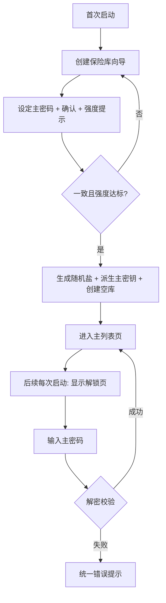
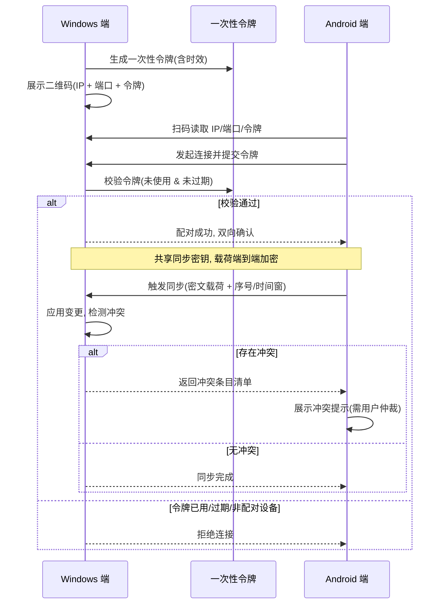

# PasswordMS · 产品需求文档（PRD）

- **项目代号**：PasswordMS
- **文档版本**：v1.0
- **上游依据**：`docs/00-scope.md`（需求冻结书，本 PRD 唯一权威来源）
- **负责人**：许清楚（产品经理）
- **状态**：待评审

---

## 0. 项目信息

| 项 | 内容 |
|----|------|
| Language（文档语言） | 简体中文 |
| Programming Language | 按冻结书 **D1** 冻结：**Tauri 2**（Rust 核心 + Svelte UI，单套代码双端编译）。不使用 Vite + React + MUI 默认栈 |
| Project Name | `passwordms` |
| 交付边界 | **D3** 冻结：本期 = **P0 + P1**（F-01 ~ F-16）；P2 仅登记进 backlog |
| 体积硬约束（一号约束） | Windows 安装包 **≤ 10 MB**；Android APK **≤ 12 MB**。复用系统 WebView2，禁止 Electron / 重型 UI 框架 / 图标字体包 |

**原始需求复述**：做一款体积小巧、本地优先、零知识的密码管理工具，同一套代码同时运行在 Windows 桌面与 Android 手机，通过局域网二维码配对完成设备间加密同步；同时支持加密附件文件与文本型安全笔记（「密钥文档」），并具备 TOTP、Bitwarden 导入、回收站、密码体检能力。

---

## 1. 产品目标与定位

**定位**：一款「不联网、不上云、不信任任何服务器」的个人密码与机密文档保险库，用最朴素的局域网直连把 Windows 与 Android 绑成一对，把安全责任完整地留在用户自己的设备上。

**一句话 slogan**：**你的密码，只住在你自己的设备里。**

**三个正交产品目标**：

| # | 目标 | 可度量标准 |
|---|------|-----------|
| G1 | **安全可信**：零知识、零自研密码学、无任何外传路径 | 双端包体积达标（Win ≤10MB / APK ≤12MB）；无任何出网请求；加密测试向量通过 |
| G2 | **好用顺手**：冷启动到解锁全链路顺滑，关键操作 ≤ 2 次点击 | 冷启动到解锁 ≤ 3s；一键复制 / 一键直达 ≤ 1 次点击；搜索响应 ≤ 200ms（1000 条） |
| G3 | **双端一致且能互通**：同一套代码，Windows 与手机数据可加密同步 | 二维码配对成功率 100%（同局域网内）；同步冲突可感知、可仲裁、可回归 |

---

## 2. 目标用户与核心场景

**目标用户画像**：拥有多台设备（一台 Windows 电脑 + 一台 Android 手机）、在意隐私、不信任云端密码库、希望数据完全自主的个人用户；典型为开发者、运维、自由职业者。

| # | 用户故事 |
|---|---------|
| US-1 | 作为一名**注重隐私的个人用户**，我希望**所有数据只存在本地、任何操作都不联网**，以便**我不必担心厂商拖库或云端泄露**。 |
| US-2 | 作为一名**多设备用户**，我希望**用手机扫一下电脑上的二维码就能完成配对并同步**，以便**我不需要注册账号、也不依赖任何服务器中转**。 |
| US-3 | 作为一名**开发者**，我希望**把 SSH 私钥、许可证、证书等文件加密存进保险库，并集中管理恢复码 / API Key**，以便**机密资料不再散落在磁盘各处**。 |
| US-4 | 作为一名**从 Bitwarden 迁移过来的用户**，我希望**直接导入我的 JSON / CSV 导出文件并在导入前预览字段映射**，以便**迁移不用重新手打几百条密码**。 |
| US-5 | 作为一名**普通用户**，我希望**系统能告出哪些密码太弱、重复使用或久未更换**，以便**我能集中整改，而不是逐个凭感觉猜**。 |

---

## 3. 需求池逐条展开

> 优先级定义：**P0 = Must have（核心最小集）**，**P1 = Should have（本期因 D3 一并交付）**，**P2 = Nice to have（二期 backlog）**。
> 每条验收标准采用 **Given-When-Then** 格式。

### 3.1 P0 · 核心最小集

#### F-01 主密码解锁 / 创建保险库

- **功能描述**：首次启动引导用户创建保险库并设定主密码；此后每次启动凭主密码解锁。
- **交互要点**：首启显示「创建保险库」向导（设定主密码 + 确认主密码 + 主密码强度提示）；非首启显示解锁页，单输入框 + 解锁按钮；解锁期间显示进度反馈；主密码输入框默认掩码、带「按住显示」按钮。
- **边界条件**：主密码最短长度须设定下限（建议 ≥ 8，具体由架构师定）；不允许空密码；确认不一致时不允许提交；解锁失败不得提示「密码错误 vs 数据损坏」的区分信息（见 F-10 与安全需求）。
- **验收标准**
  - Given 用户首次启动且本地无保险库，When 用户两次输入的密码一致且满足最低强度，Then 创建成功并直接进入主列表页。
  - Given 本地已存在保险库，When 用户输入正确主密码，Then 在 ≤3s 内进入主列表页（以 1000 条条目为基准）。
  - Given 本地已存在保险库，When 用户输入错误主密码，Then 显示统一的失败提示，且不泄露失败原因分类。

#### F-02 自动锁定

- **功能描述**：在失焦或空闲超时后自动锁定保险库，锁定时清空界面与内存中的敏感数据。
- **交互要点**：设置页提供 **1 / 5 / 15 分钟** 三档可选；默认档位需明确（建议 5 分钟）；锁定时回到解锁页；应用失焦（切到后台 / 最小化）按配置触发；同步进行中锁定应给出提示，避免中断损坏。
- **边界条件**：锁定后剪贴板内容按 F-06 规则处理；锁定瞬间正在编辑的未保存内容须明确处理策略（建议：提示并丢弃，不做明文落盘）。
- **验收标准**
  - Given 自动锁定设为 1 分钟，When 用户无任何操作持续 1 分钟，Then 应用自动锁定并回到解锁页。
  - Given 应用在解锁状态，When 用户将应用切到后台超过设定时长，Then 应用锁定。
  - Given 应用刚发生锁定，When 用户重新解锁，Then 上次解锁的敏感数据已从内存清除（不残留上一会话明文）。

#### F-03 分组管理

- **功能描述**：对条目分组进行新增、重命名、编辑、删除、排序；分组具备名称、图标、颜色。
- **交互要点**：主列表页左侧分组栏提供「新建分组」入口；分组项右键 / 长按呼出「重命名 / 编辑 / 删除 / 置顶排序」；编辑分组时可选内联 SVG 图标与颜色；拖拽排序（移动端可用上/下移替代）。
- **边界条件**：分组名不允许为空、不允许重复（建议）；删除分组时需二次确认并明确其下条目的去向（建议：一并进回收站或移至「未分组」，策略需在 F-15 中统一）。
- **验收标准**
  - Given 用户在主列表页，When 点击「新建分组」并填写名称、选择图标与颜色，Then 新分组出现在左侧栏且排序生效。
  - Given 存在分组 A，When 用户重命名 A，Then 所有属于 A 的条目在新名称下仍正确归类。
  - Given 分组 A 下存在条目，When 用户删除 A，Then 弹出二次确认，确认后 A 下条目按既定策略处理，且操作可从回收站恢复（若走回收站）。

#### F-04 条目管理

- **功能描述**：条目的增删改查，字段含标题、网址、用户名、密码、备注、自定义键值对（本期 P0 的条目为登录型；`secure_note` / `attachment` 在 P1 引入）。
- **交互要点**：主列表页提供「新建条目」；条目编辑页表单式布局；自定义键值对支持动态增行、隐藏值（用于次要敏感字段）；保存 / 取消；删除走确认。
- **边界条件**：标题不允许为空；网址允许不合法（仅作存储与打开提示，不做强校验）；密码字段支持生成器（联动 F-07）；自定义键值对键名建议唯一。
- **验收标准**
  - Given 用户在条目编辑页，When 填写标题、用户名、密码并保存，Then 条目出现在对应分组列表并可被搜索命中。
  - Given 存在条目 X，When 用户修改其密码并保存，Then 仅 X 被更新，其他条目不受影响（逐条加密语义）。
  - Given 存在条目 X，When 用户删除 X，Then X 进入回收站（F-15），列表中不再显示。

#### F-05 一键直达

- **功能描述**：点击条目的网址直接调用系统默认浏览器打开。
- **交互要点**：条目详情 / 列表的网址字段可点击；点击后调用系统 URL 打开能力；无网址时按钮置灰或隐藏。
- **边界条件**：网址缺少协议头时自动补全 `https://`；非 http/https 协议（如 `file://`、`javascript:`）须拒绝并提示，防钓鱼与本地文件风险。
- **验收标准**
  - Given 条目含合法 http/https 网址，When 用户点击该网址，Then 系统默认浏览器打开对应地址。
  - Given 条目网址为高风险协议（如 `javascript:`），When 用户点击，Then 应用拒绝打开并给出提示。

#### F-06 一键复制

- **功能描述**：分别一键复制用户名 / 密码，剪贴板内容 **30 秒后自动清空**。
- **交互要点**：用户名、密码字段旁各一个复制按钮；复制后给出「已复制，30 秒后自动清除」的轻提示（toast）；清空仅作用于本应用写入的内容。
- **边界条件**：清空前若用户已复制其他内容，不应误删用户新内容（需比对当前剪贴板是否仍为本应用写入的值）；若 30 秒内应用被锁定，也应保证清空逻辑生效。
- **验收标准**
  - Given 用户点击密码复制按钮，When 复制成功，Then 系统剪贴板含该密码且出现 30 秒倒计时提示。
  - Given 密码已复制，When 30 秒计时结束，Then 剪贴板被清空（前提是剪贴板内容未被用户替换）。
  - Given 密码已复制且用户随即复制了别的内容，When 30 秒到达，Then 应用不清空用户新写入的内容。

#### F-07 密码生成器

- **功能描述**：可配置长度、大小写、数字、符号、排除易混字符（如 `0/O`、`1/l/I`）的随机密码生成器。
- **交互要点**：独立生成器页面，也可从条目编辑页的密码字段唤起；实时预览生成结果；一键复制 + 一键「用于此条目」；提供强度指示条。
- **边界条件**：至少需选中一类字符集；长度范围须设上下限（建议 8–64）；生成随机源必须来自 CSPRNG（详见安全需求）。
- **验收标准**
  - Given 用户勾选「大写 + 小写 + 数字」并设长度为 16，When 点击生成，Then 输出长度 16 且仅含所选字符集的密码。
  - Given 用户仅勾选「排除易混字符」，When 生成密码，Then 结果中不含易混字符集中的任何字符。
  - Given 用户一类字符集都未勾选，When 点击生成，Then 应用阻止生成并提示至少选择一类。

#### F-08 搜索与收藏

- **功能描述**：全库模糊搜索；条目可标记收藏并置顶显示。
- **交互要点**：顶部搜索框，输入即时过滤；收藏条目在列表顶部独立分区或带星标；搜索范围覆盖标题、用户名、网址（备注是否纳入需明确）。
- **边界条件**：空关键词显示全部；无匹配时给出空状态；搜索应在解锁状态下进行，不得在锁定态缓存明文索引到磁盘。
- **验收标准**
  - Given 库内存在标题含「github」的条目，When 用户输入「gith」，Then 该条目被模糊命中。
  - Given 用户将条目 A 标为收藏，When 返回列表，Then A 出现在置顶/收藏区且带星标。
  - Given 用户搜索无匹配关键词，When 输入完成，Then 显示空状态提示，不报错。

#### F-09 局域网配对与同步

- **功能描述**：通过二维码配对实现 Windows 与 Android 设备直连；支持手动触发同步并展示同步状态。
- **交互要点**：同步页提供两个角色入口；一方展示二维码，另一方扫码；扫码后带入 IP + 端口 + 一次性令牌完成配对；配对后显示设备列表与「立即同步」按钮；同步过程展示进度与结果；冲突时给出提示（详见第 6 节流程）。**自动同步**为可选增强，须有开关与节流策略。
- **边界条件**：仅同局域网内可配对；令牌一次性且有时效；拒绝未配对设备；同步载荷端到端加密；冲突处理策略需在架构阶段明确（需产品给出上层规则，见待确认问题）。
- **验收标准**
  - Given 两端处于同一局域网，When 手机扫描电脑展示的二维码，Then 配对成功且双端显示对方设备。
  - Given 已完成配对，When 用户点击「立即同步」，Then 同步完成并给出「成功 / 条数变化」反馈。
  - Given 配对令牌已使用或已过期，When 第三方尝试用同一令牌发起连接，Then 连接被拒绝。
  - Given 双端对同一条目做了不同修改，When 触发同步，Then 应用给出冲突提示而非静默覆盖。

#### F-10 加密存储

- **功能描述**：以单文件加密保险库存储全部数据，主密钥派生采用 Argon2id，条目级逐条 AEAD 加密。
- **交互要点**：用户无感（自动落盘）；设置页可展示保险库文件位置与大小；提供「立即保存 / 已保存」状态指示。
- **边界条件**：主密码不落盘；修改单条不重写全库；错误信息统一化（不区分密码错与数据损坏）；无任何明文临时文件。
- **验收标准**
  - Given 用户新增 / 修改条目，When 保存完成，Then 落盘文件中该条目为密文，且不含明文密码。
  - Given 库内 1000 条，When 用户仅修改 1 条，Then 只需重写该条而不是整库。
  - Given 保险库文件被外部破坏，When 用户尝试解锁，Then 显示与「密码错误」无差别的统一错误提示。

### 3.2 P1 · 本期一并交付

#### F-11 TOTP 内置验证器

- **功能描述**：支持扫码 / 手动录入 TOTP 密钥，在条目详情页展示动态验证码与剩余倒计时。
- **交互要点**：条目类型为 `login` 时可添加 TOTP；录入支持摄像头扫码或手动粘贴密钥（Base32）；详情页展示 6 位验证码 + 环形/条状倒计时；支持一键复制当前验证码。
- **边界条件**：时间同步依赖设备本地时间，偏差过大时应提示；密钥需加密存储；不支持 HOTP 等非时间型（明确排除）。
- **验收标准**
  - Given 用户手动录入合法 Base32 密钥，When 进入条目详情，Then 每秒刷新显示 6 位验证码与倒计时。
  - Given TOTP 密钥已录入，When 设备时间产生较大偏差，Then 应用给出时间校准提示。
  - Given 用户点击验证码复制，When 复制成功，Then 剪贴板按 F-06 规则在 30 秒后清空。

#### F-12 密钥文档 · 加密附件

- **功能描述**：上传任意文件（SSH 私钥、许可证、证书等），以密文 blob 存入保险库，并可导出。
- **交互要点**：附件作为一类条目（`attachment`）出现在列表；编辑页支持选择文件、显示原始文件名 / MIME / 大小；详情页提供「导出 / 另存为」；提供删除（进回收站）。
- **边界条件**：须展示并限制单文件与库总量上限（建议由架构师定，需产品给出提示语）；导出时须提示将产生明文文件；不做文件类型白名单强制（用户可能存任意机密文件），但应提示。
- **验收标准**
  - Given 用户选择本地文件 `id_rsa`，When 保存，Then 保险库中出现该附件条目，且落盘为密文。
  - Given 附件条目存在，When 用户点击导出，Then 在用户指定位置生成与原始内容一致的文件，并给出明文风险提示。
  - Given 附件条目存在，When 用户删除该条目，Then 其进入回收站且密文数据按 F-15 策略保留/清理。

#### F-13 密钥文档 · 安全笔记

- **功能描述**：纯文本型加密条目，用于恢复码、API Key、长文本备注等。
- **交互要点**：条目类型为 `secure_note`，编辑页为纯文本域；支持等宽字体以便查看密钥；支持折叠 / 展开敏感内容；可标收藏、可归类到分组。
- **边界条件**：正文长度需设上限（建议由架构师定）；不做富文本 / Markdown 渲染（避免体积与 XSS 面），纯文本展示。
- **验收标准**
  - Given 用户新建安全笔记并粘贴一段恢复码，When 保存，Then 条目以密文落盘且再次打开内容一致。
  - Given 安全笔记含长文本，When 在列表中展示，Then 以截断摘要显示，不暴露全文。

#### F-14 Bitwarden 导入

- **功能描述**：支持导入 Bitwarden 导出的 JSON 与 CSV，含字段映射预览。
- **交互要点**：导入页选择文件 → 解析 → 展示将导入的条目数、分组数、跳过数 → 用户确认后导入；导入前提供映射预览表格（见第 7 节）。
- **边界条件**：仅处理 `folders`、`type=1 (login)`、`type=2 (secure note)` 及自定义字段 `fields`；`type=3 (card)`、`type=4 (identity)` 等不支持类型跳过并计数提示；文件格式错误 / 加密导出文件须明确报错（Bitwarden 加密 JSON 不支持，需用户先导出为未加密 JSON / CSV）。
- **验收标准**
  - Given 用户选择合法 Bitwarden JSON，When 解析完成，Then 显示可导入条目数、分组数与跳过数预览。
  - Given JSON 中含 type=3 的项目，When 导入完成，Then 这些项目被跳过并在结果中提示跳过数量。
  - Given 用户确认导入，When 导入完成，Then 分组与 login / secure_note 条目正确落入库中且字段映射正确。

#### F-15 回收站

- **功能描述**：删除的条目进入回收站，**保留 30 天**，支持还原与彻底删除。
- **交互要点**：回收站作为独立视图；列表显示条目、原分组、删除时间；提供「还原」「彻底删除」「清空回收站」；显示剩余保留天数。
- **边界条件**：超过 30 天自动清理（建议在启动 / 解锁时触发）；「清空回收站」需二次确认且不可恢复；回收站数据是否加密保留须遵循 F-10。
- **验收标准**
  - Given 用户删除条目 A，When 打开回收站，Then A 出现在列表中并显示删除时间与剩余天数。
  - Given 回收站中存在 A，When 用户点击还原，Then A 回到原分组且从回收站移除。
  - Given 某条目删除已超 30 天，When 用户下次启动应用，Then 该条目被自动清理且用户收到提示。

#### F-16 密码健康体检

- **功能描述**：统计弱口令、重复使用、超期未改，并给出整改建议。
- **交互要点**：体检页展示总分 / 各维度统计卡片；点击维度可跳转至对应条目列表；给出可执行整改建议；仅对 `login` 类型参与评分。
- **边界条件**：过期阈值需可配置（建议默认 180 天，具体由架构师/产品确认）；弱口令判定规则须明确（建议：长度 < 8 或仅含单一字符类型）；重复使用指同一密码被 ≥2 条登录条目使用；全部计算在本地完成，不外传。
- **验收标准**
  - Given 库内存在 2 条使用相同密码的登录条目，When 打开体检页，Then「重复使用」维度命中并显示这 2 条。
  - Given 某条目密码长度不足且字符类型单一，When 打开体检页，Then「弱口令」维度命中该条目。
  - Given 设过期阈值为 180 天且某条目超期未改，When 打开体检页，Then「超期未改」维度命中该条目并给出建议。

---

## 4. 数据模型草案

> 以下为**逻辑模型草案**，字段命名为建议值，最终物理实现（序列化格式、加密边界）由架构师高见远确定。`🔒` 标记的字段属于**必须加密**的敏感字段。

### 4.1 `Vault`（保险库元信息）

| 字段 | 类型 | 必填 | 约束 / 说明 |
|------|------|------|------------|
| `vault_id` | string(uuid) | 是 | 保险库唯一标识 |
| `version` | int | 是 | 保险库格式版本，用于升级迁移 |
| `kdf_algorithm` | string | 是 | 如 `argon2id`（具体由架构师定） |
| `kdf_salt` | bytes | 是 | 🔒 每库唯一随机盐，来自 CSPRNG |
| `kdf_params` | json | 是 | 迭代/内存/并行度等参数，随库存储以便演进 |
| `encryption_scheme` | string | 是 | 逐条 AEAD 算法标识 |
| `item_count` | int | 是 | 条目计数（含回收站则另注） |
| `folder_count` | int | 是 | 分组计数 |
| `created_at` | timestamp | 是 | 创建时间 |
| `updated_at` | timestamp | 是 | 最近保存时间 |
| `auto_lock_minutes` | int | 是 | 1 / 5 / 15，默认 5 |
| `settings_json` | json | 否 | 生成器默认参数、体检阈值等偏好 |

### 4.2 `Folder`（分组）

| 字段 | 类型 | 必填 | 约束 / 说明 |
|------|------|------|------------|
| `folder_id` | string(uuid) | 是 | 主键 |
| `name` | string | 是 | 非空；建议库内唯一 |
| `icon` | string | 否 | 内联 SVG 标识（不使用图标字体包） |
| `color` | string | 否 | 十六进制色值 |
| `sort_order` | int | 是 | 排序序位，升序 |
| `created_at` | timestamp | 是 | 创建时间 |

### 4.3 `Item`（条目基类）

| 字段 | 类型 | 必填 | 约束 / 说明 |
|------|------|------|------------|
| `item_id` | string(uuid) | 是 | 主键 |
| `type` | enum | 是 | `login` / `secure_note` / `attachment` |
| `title` | string | 是 | 🔒 非空 |
| `folder_id` | string(uuid) | 否 | 所属分组；空 = 未分组 |
| `favorite` | bool | 是 | 是否收藏，默认 false |
| `created_at` | timestamp | 是 | 创建时间 |
| `updated_at` | timestamp | 是 | 最近修改时间（用于冲突比对） |
| `revision` | int | 是 | 版本号，用于同步冲突检测（建议） |

#### 4.3.1 子类型 `login`（登录型）

| 字段 | 类型 | 必填 | 约束 / 说明 |
|------|------|------|------------|
| `url` | string | 否 | 🔒 网址；缺失时 F-05 按钮置灰 |
| `username` | string | 否 | 🔒 用户名 |
| `password` | string | 否 | 🔒 密码明文（存储时加密） |
| `notes` | string | 否 | 🔒 备注 |
| `totp_secret` | string | 否 | 🔒 Base32 TOTP 密钥（F-11） |
| `custom_fields` | array | 否 | 🔒 自定义键值对，元素 `{key, value, hidden}` |

#### 4.3.2 子类型 `secure_note`（安全笔记）

| 字段 | 类型 | 必填 | 约束 / 说明 |
|------|------|------|------------|
| `body` | string | 是 | 🔒 长文本正文，纯文本，无富文本渲染 |

#### 4.3.3 子类型 `attachment`（加密附件）

| 字段 | 类型 | 必填 | 约束 / 说明 |
|------|------|------|------------|
| `original_filename` | string | 是 | 🔒 原始文件名（如 `id_rsa`） |
| `mime_type` | string | 是 | 🔒 MIME 类型 |
| `size_bytes` | int | 是 | 原始文件大小 |
| `blob_ref` | string | 是 | 密文 blob 引用（指向库内密文块） |
| `blob_size_bytes` | int | 是 | 密文占用大小（用于容量统计） |

### 4.4 `Trash`（回收站）

| 字段 | 类型 | 必填 | 约束 / 说明 |
|------|------|------|------------|
| `trash_id` | string(uuid) | 是 | 主键 |
| `item_snapshot` | object | 是 | 🔒 被删条目的完整快照（加密存储） |
| `original_folder_id` | string(uuid) | 否 | 还原时回到的原分组 |
| `deleted_at` | timestamp | 是 | 删除时间 |
| `expire_at` | timestamp | 是 | 删除时间 + 30 天，到期自动清理 |

---

## 5. UI 页面清单与布局说明（文字化）

> 总体布局原则：**双栏（桌面）/ 单栏 + 抽屉（手机）自适应**；配色与组件保持极简，**不引入任何重型 UI 组件库**，图标使用内联 SVG；交互控件优先原生能力以控制体积。

| # | 页面 | 布局与功能说明 |
|---|------|---------------|
| P-01 | **锁屏 / 解锁页** | 居中卡片式：应用标识 + 主密码输入框（掩码 + 按住显示）+ 解锁按钮 + 统一错误提示区。首启时此页切换为「创建保险库」向导（密码 + 确认 + 强度提示）。 |
| P-02 | **主列表页** | 桌面三区：左侧**分组栏**（全部 / 收藏 / 各分组 / 回收站 / 体检入口，含新建分组）；中间**条目列表**（搜索框 + 条目卡片：标题 / 用户名 / 收藏星标）；右侧**详情面板**（选中条目的字段与操作按钮）。手机端：列表为主视图，分组以抽屉/底部导航呈现，详情为独立页。 |
| P-03 | **条目编辑页** | 表单式：类型选择（新建时）、标题、分组选择、动态字段区（随类型切换：login 显示网址/用户名/密码/备注/TOTP/自定义键值对；secure_note 显示正文域；attachment 显示文件选择与元信息）、底部「保存 / 取消」。密码字段旁含「生成」「复制」「显示」。 |
| P-04 | **密码生成器** | 模态或独立页：长度滑块 + 字符集开关（大写/小写/数字/符号/排除易混）+ 结果预览 + 强度条 + 「复制」「用于此条目」。 |
| P-05 | **密钥文档查看页 · 文本笔记** | 等宽字体正文区 + 折叠/展开敏感内容控件 + 「复制到剪贴板」+ 「编辑」+ 「删除」。 |
| P-06 | **密钥文档查看页 · 附件** | 文件元信息卡（原始文件名 / MIME / 大小）+「导出 / 另存为」（导出前弹出明文风险提示）+「删除」。 |
| P-07 | **导入页** | 顶部说明（支持 Bitwarden JSON / CSV）→ 文件选择 → 解析结果概览（可导入条目数 / 分组数 / 跳过数）→ 字段映射预览表 → 「确认导入」按钮 → 结果反馈。 |
| P-08 | **同步配对页** | 双角色切换：**展示二维码**（含设备信息 + 一次性令牌，附倒计时/刷新按钮）与**扫码**（调用摄像头）；配对成功后显示已配对设备列表、配对时间、解除配对入口。 |
| P-09 | **同步页 / 同步状态** | 显示「上次同步时间」「待同步变更数」「立即同步」按钮、同步进度条与结果提示；自动同步开关（可选增强）。冲突时弹出冲突提示面板（参见第 6 节）。 |
| P-10 | **设置页** | 分区块：安全（自动锁定档位、剪贴板清空时长说明、改主密码）、数据（保险库位置与大小、导入、导出、备份）、同步（已配对设备、自动同步开关）、体检阈值、关于（版本、开源许可）。 |
| P-11 | **密码体检页** | 顶部总览评分卡 + 三个维度卡（弱口令 / 重复使用 / 超期未改）+ 整改建议列表；点击维度跳转过滤后的条目列表。 |
| P-12 | **回收站** | 列表：条目摘要 / 原分组 / 删除时间 / 剩余保留天数 + 每项「还原」「彻底删除」+ 顶部「清空回收站」（二次确认）。 |

---

## 6. 关键交互流程

### 6.1 首启创建保险库 → 解锁

### 6.2 解锁 → 一键复制 → 剪贴板 30 秒清空

1. 用户解锁保险库，进入主列表页。
2. 打开条目详情，点击密码字段的「复制」按钮。
3. 应用将密码写入系统剪贴板，弹出「已复制，30 秒后自动清除」提示。
4. 应用启动 30 秒倒计时。
5. 倒计时结束前，若剪贴板内容仍为本次写入的值 → 清空剪贴板；若已被用户替换 → 不动用户新内容。
6. 若期间应用被锁定，清空逻辑仍按上述规则执行。

### 6.3 生成已配对设备二维码 → 手机扫码配对 → 同步 → 冲突提示

**冲突提示高层规则（产品侧，待架构确认细节）**：同一条目双端均被修改时，**不做静默覆盖**；向用户呈现「保留本机 / 采用远端 / 两者都留」的显式选择，并展示各自修改时间。具体合并算法与协议由架构师定。

---

## 7. Bitwarden 导入字段映射表

### 7.1 Bitwarden JSON 顶层结构

| Bitwarden 顶层 | 说明 | PasswordMS 处理 |
|---------------|------|----------------|
| `folders` | 分组数组 | 映射为 `Folder`（`name` → `name`） |
| `items` | 条目数组，每项含 `type` | 按 `type` 分派，见下 |
| `type=1` | Login | 映射为 `login` 条目 |
| `type=2` | Secure note | 映射为 `secure_note` 条目 |
| `type=3` | Card | **不支持**，跳过并计数 |
| `type=4` | Identity | **不支持**，跳过并计数 |
| `fields` | 自定义字段数组（位于 `item.fields`） | 映射为 `custom_fields` |

> **CSV 导出**同理：以列为准，`type` 列判定 1/2，其余列按同名映射；`folder` 列映射分组。**不支持类型（card / identity）跳过并计数提示。**

### 7.2 字段映射（逐项）

| Bitwarden 字段 | 所属 | PasswordMS 字段 | 说明 |
|---------------|------|----------------|------|
| `folders[].id` | folder | （内部映射表） | 生成新旧 ID 对应关系 |
| `folders[].name` | folder | `Folder.name` | 分组名 |
| `items[].id` | item | （内部映射表） | 生成新旧 ID 对应关系 |
| `items[].type` | item | `Item.type` | 1→`login`；2→`secure_note`；其余跳过 |
| `items[].name` | item | `Item.title` | 标题 |
| `items[].folderId` | item | `Item.folder_id` | 通过映射表转新分组 ID |
| `items[].favorite` | item | `Item.favorite` | 收藏标记 |
| `items[].notes` | item | `login.notes` / `secure_note.body` | login 进 `notes`，secure note 进 `body` |
| `items[].login.username` | login | `login.username` | 用户名 |
| `items[].login.password` | login | `login.password` | 密码 |
| `items[].login.uris[].uri` | login | `login.url` | 取第一条 URI（多 URI 策略见待确认问题） |
| `items[].login.totp` | login | `login.totp_secret` | TOTP 密钥（F-11） |
| `items[].fields[].name` | item | `custom_fields[].key` | 自定义字段键 |
| `items[].fields[].value` | item | `custom_fields[].value` | 自定义字段值 |
| `items[].fields[].type` | item | `custom_fields[].hidden` | type=1(隐藏)→`hidden=true`，0→`false` |
| `items[].secureNote.type` | secure_note | — | 仅一种类型，忽略（固定纯文本） |
| `items[].card.*` | card | — | **不支持**，跳过 |
| `items[].identity.*` | identity | — | **不支持**，跳过 |

### 7.3 不支持类型处理策略

1. 解析阶段统计 `type=3 / type=4` 及其他未知类型的数量。
2. 导入预览页**显式提示**「将跳过 N 条不支持类型（如银行卡 / 身份信息）」。
3. 导入完成后结果反馈中再次确认跳过数量。
4. **不阻塞**整体导入，不因个别不支持项而失败。
5. 遇到 Bitwarden **加密导出文件**（含 `encrypted` 字段）时，明确报错并引导用户改为导出未加密 JSON / CSV。

---

## 8. 待确认问题

| # | 问题 | 建议默认值（供决策） | 影响范围 |
|---|------|-------------------|---------|
| Q1 | 主密码最低强度要求（最短长度 / 是否强制复杂度） | ≥ 8 位，不强制混合，但给出强度提示 | F-01 |
| Q2 | 分组下条目单一归属还是多条挂载？导入时多 URI（多网址）如何取舍？ | 每条目单分组；导入取第一条 URI | F-03 / F-14 |
| Q3 | 同步冲突的上层合并策略（保留本机 / 采用远端 / 两者都留 是否足够） | 三选一显式仲裁，不静默覆盖 | F-09 |
| Q4 | 附件单文件与整库容量上限？超出时的提示策略 | 待架构师给出建议值与提示语 | F-12 |
| Q5 | 密码体检的「超期未改」阈值与「弱口令」判定规则是否可配置 | 超期默认 180 天；弱口令 = 长度<8 或单一字符类型 | F-16 |

---

> **附注**：本 PRD 严格遵循冻结书四项决策（D1 Tauri 2 / D2 二维码配对直连 / D3 P0+P1 / D4 附件与笔记都要），未做任何架构级选型；加密算法与参数、同步协议报文、文件结构、模块划分均由架构师在 `docs/02-arch.md` 中确定。
