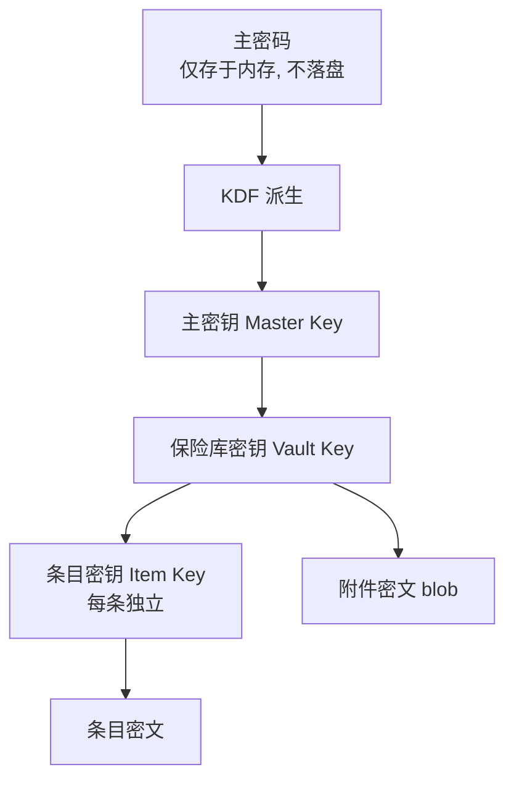

# PasswordMS · 安全需求说明

- **项目代号**：PasswordMS
- **文档版本**：v1.0
- **上游依据**：`docs/00-scope.md`（需求冻结书 · §5 安全底线）、`docs/01-prd.md`
- **负责人**：许清楚（产品经理）
- **状态**：待评审
- **说明**：本文**只规定安全要求（What）**，不指定具体库选型与算法参数（How）。库选型、参数取值、协议报文格式由架构师在 `docs/02-arch.md` 中确定。

---

## 1. 威胁模型

**安全假设**：本工具为**本地优先、零知识**的个人保险库，**不存在任何服务器/云端**。攻击者视角下的主要攻击面如下：

| # | 威胁 | 场景描述 | 后果 | 对应防护 |
|---|------|---------|------|---------|
| T1 | **本地磁盘被翻拷** | 攻击者取得设备或备份文件，直接拷走保险库文件 | 全部凭据泄露 | §2 加密要求、§3 痕迹要求 |
| T2 | **局域网嗅探** | 同网段攻击者抓包同步流量 | 凭据泄露 | §4 同步安全要求（端到端加密） |
| T3 | **手机丢失 / 被解锁** | 设备落入他人手，或锁屏被绕过 | 库内数据被读 | §2、§3（自动锁定、统一报错） |
| T4 | **剪贴板残留** | 复制的密码长期驻留剪贴板，被其他应用/输入法读取 | 凭据泄露 | §3 剪贴板清空 |
| T5 | **内存转储** | 攻击者 dump 进程内存或利用崩溃转储 | 明文密钥/密码泄露 | §3 锁定清空敏感内存 |
| T6 | **恶意同步请求** | 未配对设备或重放流量尝试接入 / 篡改 | 数据污染、伪造同步 | §4 同步安全要求 |
| T7 | **侧信道信息泄露** | 通过错误提示倒推「密码错 vs 数据损坏」 | 辅助爆破、探测 | §3 统一化报错 |

**明确不在威胁模型内**（见冻结书 §4 ❌）：浏览器扩展攻击面、云端拖库、团队越权、Web 端 XSS —— 因这些能力**本就不做**。

---

## 2. 加密要求

### 2.1 密钥层级（不可跳级、不可扁平化）

| 层级 | 要求 |
|------|------|
| **主密码** | 仅存在于内存，**不以任何形式持久化**（不写盘、不写日志、不写崩溃转储） |
| **KDF** | 由主密码 + 每库唯一随机盐派生主密钥；**必须选用抗 GPU/ASIC 暴力破解的内存硬 KDF**（算法与参数由架构师定并留档） |
| **主密钥 → 保险库密钥** | 主密钥不直接加密数据，须经中间层包裹保险库密钥，便于主密码变更时仅重包裹而不重写全部密文 |
| **保险库密钥 → 条目密钥** | **逐条独立密钥**，由保险库密钥包裹；实现「改一条不重写全库」 |
| **随机数** | 一律来自 **CSPRNG**，禁止使用可预测/弱随机源 |

### 2.2 加密算法与模式要求

| 项 | 要求 |
|----|------|
| 算法 | **只用经过审计的成熟密码学库**，**零自研**；算法与参数写入文档留档（冻结书 §5.1） |
| 模式 | **逐条 AEAD**（认证加密），同时提供机密性与完整性；拒绝无认证的纯流/块加密模式 |
| Nonce | **每条密文独立随机 nonce**，**严禁 nonce 复用**；nonce 与密文一并存储，不保密 |
| 关联数据 | 建议将条目标识等元数据作为 AEAD 关联数据（AAD），防止密文被移植/替换 |
| 盐 | 每库唯一；主密钥派生与任何密钥派生均须带独立盐 |
| 完整性 | 解密失败必须被检测并触发统一报错（见 §3.4） |

### 2.3 存储加密边界

| 数据 | 加密要求 |
|------|---------|
| 条目敏感字段（`title` / `url` / `username` / `password` / `notes` / `totp_secret` / `custom_fields` / `body` / 附件元信息） | **必须加密** |
| 附件内容（blob） | **必须加密**，独立密文块 |
| 回收站条目快照 | **必须加密** |
| 分组名称、图标、颜色 | 应加密（避免元数据泄露条目主题） |
| 保险库非敏感元信息（版本、计数、KDF 参数、盐） | 可明文，但不得包含任何凭据 |

---

## 3. 会话与痕迹要求

### 3.1 自动锁定

| 要求 | 说明 |
|------|------|
| 可配档位 | **1 / 5 / 15 分钟**三档；默认 5 分钟 |
| 触发条件 | 空闲超时 **或** 应用失焦（切后台 / 最小化）按配置触发 |
| 锁定动作 | 回到解锁页；**立即清空内存中的敏感数据**（明文密钥、解密后的字段、搜索索引明文） |
| 编辑态保护 | 锁定与未保存编辑冲突时，明确策略：**丢弃并提示，绝不将明文落盘或写临时文件** |

### 3.2 锁定即清空敏感内存

- 锁定时须主动清零 / 释放承载主密钥、保险库密钥、条目明文、TOTP 密钥的内存。
- 不得依赖「作用域结束即回收」这种不可靠假设；对敏感缓冲区应采用显式擦除手段。
- 崩溃转储、日志、临时文件中**不得**出现上述敏感数据。

### 3.3 剪贴板

| 要求 | 说明 |
|------|------|
| 自动清空 | 复制凭据后 **30 秒**自动清空剪贴板 |
| 只清自有内容 | 清空前须比对剪贴板当前值是否仍为本应用写入的内容；若用户已替换，**不得清除用户新内容** |
| 锁定兼容 | 若倒计时期间应用被锁定，清空逻辑仍须生效 |
| 提示 | 复制后须给出「密码已复制，30 秒后自动清除」的明确提示 |

### 3.4 日志与报错

| 要求 | 说明 |
|------|------|
| 日志零凭据 | 日志、遥测（本应用无遥测）、错误上报中**不得记录任何凭据、明文、密钥、口令、TOTP 密钥** |
| 统一化报错 | **解密/解锁失败**一律返回**统一错误信息**，**不得区分**「主密码错误」与「数据损坏 / 保险库被篡改」，避免侧信道（冻结书 §5.6） |
| 无遥测 | 无登录设备指纹、无使用统计外传（冻结书 §4 ❌） |

---

## 4. 同步安全要求

**总原则（零知识同步）**：局域网同步**只传密文载荷**，对端**永不接触明文**（冻结书 §5.2）。

| # | 要求 | 说明 |
|---|------|------|
| S1 | **一次性配对令牌** | 由监听端（Windows）生成，**一次性使用**，且**具备时效**；过期即失效，须可刷新 |
| S2 | **令牌校验** | 扫码方提交令牌，监听端校验「未使用 & 未过期 & 匹配」；任一不满足即拒绝 |
| S3 | **载荷端到端加密** | 同步载荷须端到端加密；传输通道即便被嗅探也只见密文 |
| S4 | **防重放** | 报文须携带**单调序号**或**时间窗**，拒绝重复 / 过期载荷；接收端须维护已处理序列状态 |
| S5 | **配对后双向确认** | 配对成功须双端双向确认并各自持久化配对关系与共享同步密钥 |
| S6 | **拒绝未配对设备** | 未完成配对流程的设备发起的任何同步请求**一律拒绝**，不得降级为明文或弱校验 |
| S7 | **主动告知** | 配对成功 / 解除配对 / 同步接入等敏感事件须在 UI 侧给出明确状态提示 |
| S8 | **可解除配对** | 提供解除配对入口；解除后须**废弃共享密钥**，旧设备被拒绝 |

---

## 5. 敏感操作清单与防护要求

| # | 敏感操作 | 风险 | 防护要求 |
|---|---------|------|---------|
| O-01 | **复制密码** | 剪贴板残留（T4） | 复制后 **30 秒自动清空**；清空前比对是否用户已替换；给出倒计时提示 |
| O-02 | **显示密码** | 肩窥 / 截屏 | 默认**掩码显示**；需**主动按住/点击**才临时明文；可配置显示时长；松开即恢复掩码；显示期间不做任何持久化 |
| O-03 | **导出保险库** | 生成明文文件（T1） | **二次确认** + **明确明文风险提示** + 要求输入主密码验证身份；导出动作记入审计计数（不含凭据） |
| O-04 | **导出附件** | 生成明文文件（T1） | **二次确认** + **明确将产生明文文件的风险提示**；导出后不自动打开文件 |
| O-05 | **删除分组 / 条目** | 误删、不可逆 | **二次确认**；默认走**回收站**（F-15，保留 30 天）而非直接物理删除 |
| O-06 | **清空回收站** | 不可恢复 | **强二次确认**（明确「不可恢复」文案）；清空后数据不可访问 |
| O-07 | **解除配对** | 遗留共享密钥 | **二次确认**；解除后**废弃共享同步密钥**；旧设备被拒绝接入 |
| O-08 | **修改主密码** | 密钥重包裹 | 须先验证当前主密码；变更后**仅重包裹保险库密钥**，不重写全部密文；失败不得破坏原库 |
| O-09 | **导入 Bitwarden** | 引入外部明文 | 导入文件仅在本机解析；解析后**不保留中间明文文件**；不支持加密导出文件，明确报错 |
| O-10 | **创建 / 解锁保险库** | 弱口令、爆破 | 强度提示；解锁失败**统一报错**；失败无法区分原因 |

**通用防护基线**：所有涉及「不可逆 / 明文外泄 / 密钥变更」的操作，一律**二次确认**；所有涉及敏感明文的展示，一律**默认掩码 + 主动揭示**；所有涉及外发文件的操作，一律**明文风险提示**。

---

## 6. 安全验收要点（供 QA 对照）

| # | 验收点 | 判定 |
|---|--------|------|
| A-01 | 保险库文件中不含任何明文凭据 | 十六进制/字符串扫描无命中 |
| A-02 | 仅修改 1 条时，全库密文未被整体重写 | 文件变更量 ≈ 单条 |
| A-03 | 复制后 30 秒剪贴板被清空；用户替换则不清 | 手动验证 |
| A-04 | 锁定后内存中无残留会话明文 | 内存检查 / 复查上一会话数据不可见 |
| A-05 | 解锁失败提示不区分「密码错 / 数据损坏」 | 文案一致 |
| A-06 | 过期 / 已用配对令牌无法再次配对 | 重放被拒 |
| A-07 | 未配对设备同步请求被拒 | 连接被拒 |
| A-08 | 重放同一同步载荷被拒 | 序号 / 时间窗校验生效 |
| A-09 | 日志文件中无任何凭据 | 关键字扫描无命中 |
| A-10 | 导出 / 清空 / 解除配对均有二次确认 | 交互验证 |
