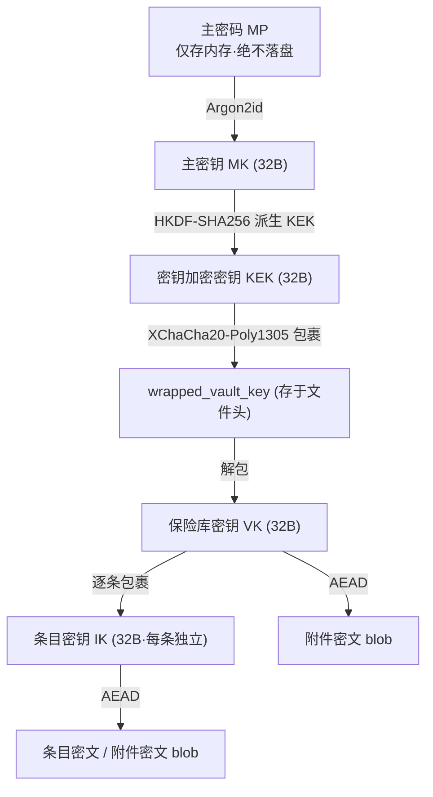
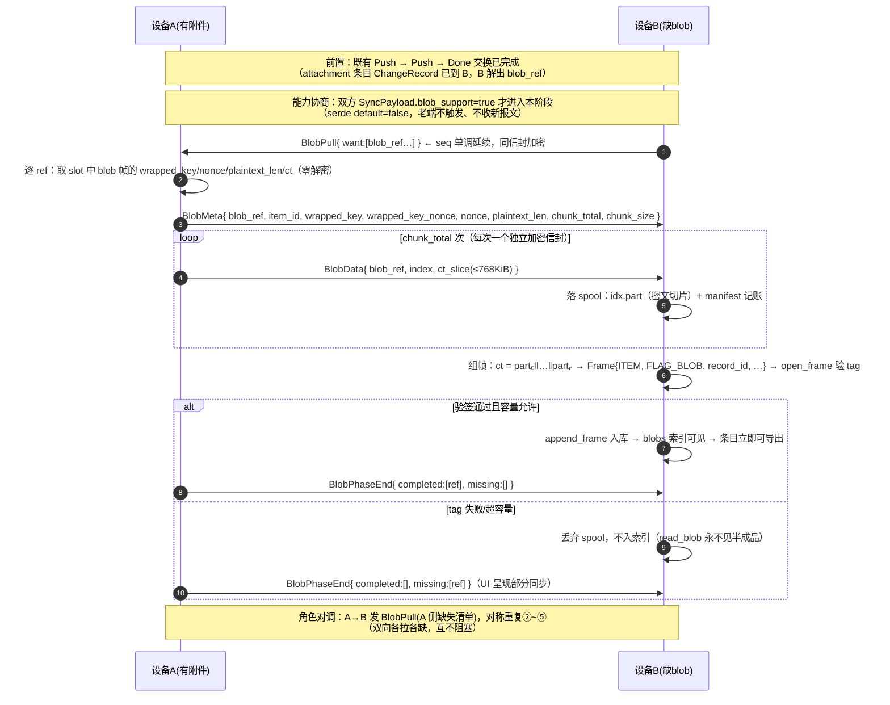
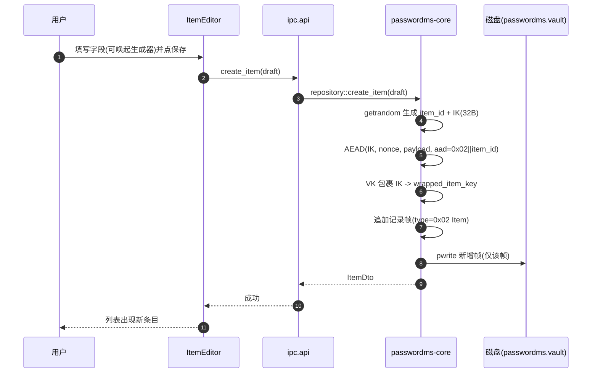
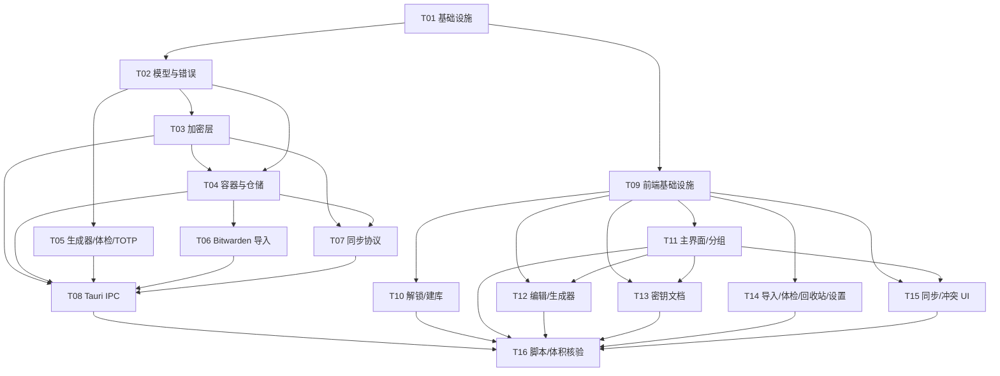

# PasswordMS · 系统架构设计与任务分解

- **项目代号**：PasswordMS
- **文档版本**：v1.0
- **上游依据**：`docs/00-scope.md`（需求冻结书）、`docs/01-prd.md`（PRD）、`docs/01-security-req.md`（安全需求）
- **负责人**：高见远（架构师）
- **状态**：待评审
- **修订记录**：§2.6 帧表曾长期滞后于实现（D-1 的 `wrapped_key` 未回写文档），2026-10-22 已与 `frame.rs` 对齐；各节修订以正文内的 `D-nn` 标注为准。
- **设计基线**：四项冻结决策（D1 Tauri 2 / D2 二维码配对直连 / D3 P0+P1 / D4 附件+笔记都要）**只细化、不推翻**

> **裁定说明**：PRD §8 五项待确认问题（Q1~Q5）已由主理人代为裁定，本文按裁定结论设计，并在对应章节标注 **【已裁定】**。

---

## 目录

- [1. 实现方案与框架选型](#1-实现方案与框架选型)
- [2. 加密方案](#2-加密方案)
- [3. 局域网同步协议](#3-局域网同步协议)（含 §3.12 附件 blob 同步·缺陷 D-53 增量设计）
- [4. 文件列表及相对路径](#4-文件列表及相对路径)
- [5. 数据结构与接口](#5-数据结构与接口)
- [6. 程序调用流程](#6-程序调用流程)
- [7. 任务列表](#7-任务列表)
- [8. 依赖包列表](#8-依赖包列表)
- [9. 共享知识](#9-共享知识)
- [10. 待明确事项](#10-待明确事项)
- [附录 A：安全验收点（A-01~A-10）对照表](#附录-a安全验收点对照表)

---

## 1. 实现方案与框架选型

### 1.1 核心技术难点

| # | 难点 | 本质 | 应对策略 |
|---|------|------|---------|
| N1 | **一体双端** | Windows 与 Android 共用一套逻辑与 UI | Rust workspace：`passwordms-core`（纯逻辑，零 Tauri 依赖）+ Tauri 外壳；前端 Svelte 单套代码，平台差异用 `platform()` 运行时判定 |
| N2 | **体积硬约束** | Win ≤ 10 MB / APK ≤ 12 MB | 复用系统 WebView（不打包内核）；Rust 依赖白名单；拒绝重型 UI 库 / 图标字体 / TLS 栈 / 数据库引擎 |
| N3 | **零自研密码学** | 算法与参数可审计、可留档 | 全量使用 RustCrypto 成熟 crate（argon2 / chacha20poly1305 / hkdf / sha2 / hmac / x25519-dalek） |
| N4 | **逐条加密 + 少重写** | 改一条不重写全库 | 记录帧化容器（见 §2.6）：每条独立 nonce/IPK；未变记录复用密文，仅重写变更帧 |
| N5 | **零知识局域网同步** | 嗅探/重放/中间人/未配对接入防护 | 应用层 E2E（XChaCha20-Poly1305）+ X25519 密钥协商 + 指纹与密钥确认 + 序号/时间窗防重放 |
| N6 | **冲突可见可仲裁** | 不得静默覆盖 | 条目级 LWW 探测「双改」，命中即入「冲突箱」，UI 三选一 |

### 1.2 选型结论（含版本）

| 层 | 选型 | 版本 | 理由 |
|----|------|------|------|
| 桌面/移动外壳 | **Tauri** | **2.x**（基线 `2.1`） | 冻结 D1；复用系统 WebView2（Win）/ Android System WebView，天然满足体积约束；官方支持 Android 目标 |
| 前端框架 | **Svelte** | **5.x**（`^5.0`，启用 runes） | 编译期产出、无运行时框架开销，产物体积远小于 React/Vue；响应式 store 契合本地状态管理 |
| 构建工具 | **Vite** | **6.x** | Svelte 官方配套；ES 构建产物小、可 tree-shake |
| 语言（前端） | **TypeScript** | **5.x** | 与 Rust DTO 对齐，编译期校验 IPC 契约 |
| 语言（后端） | **Rust** | **edition 2021** | 内存安全 + 单文件静态链接 + 跨端复用；`edition 2021` 稳定且无额外成本 |
| 异步运行时 | **tokio**（经 `tauri::async_runtime`） | 随 Tauri | 复用 Tauri 内置运行时，不额外引入 async-std/smol |
| 同步传输 | **原生 TCP + 自研长度前缀帧** | `std`/`tokio` | LAN 直连 + 应用层 E2E，**无需 TLS/HTTP 栈**（省 1~2 MB，也未必要） |

> **不使用清单（会导致体积超标）**：Electron（禁用）；Ant Design / MUI / Element 等重型 UI 库（禁用）；图标字体包 Font Awesome/Material Icons（改用内联 SVG）；`image` / `opencv`（改为无图像编解码依赖，QR 生成用 `qrcode` 纯矢量、QR 识别放前端）；`rustls`/`native-tls`/`tokio-tungstenite`（LAN 直连不需要 TLS）；`sqlx`/`rusqlite`/`diesel`（改用自研记录帧容器，零数据库引擎）；`chrono`/`time`（时间戳直接用 `SystemTime` 转 `i64` UTC 毫秒）。

### 1.3 体积核算表

> **⚠️ 本节全部数字均为设计期「预估/估算」，不是实测值。**
> 表中 ✅ 仅表示"估算值落在红线内"，**不等于体积红线已通过**。真实体积须由 `scripts/build.*` 产出安装包后，用 `scripts/check-size.*` 实测（该门禁已修为"产物缺失即失败"）。
> **截至 2026-10-13：体积红线 `未验证`** —— Tauri 打包在本机尚未跑通（见 `docs/03b-verification.md` §7、`docs/04-qa.md`）。

#### Windows 安装包（NSIS/MSI，目标 ≤ 10 MB）

| 构成项 | 预估体积 | 说明 |
|--------|---------|------|
| Tauri 运行时（`tauri`+`tao`+`wry`） | 2.4 – 3.2 MB | 静态链接进 exe |
| WebView2 引导/加载器 | 0 – 1.5 MB | 采用 **evergreen 系统运行时**（Win10/11 预装）可趋近 0；兜底 bootstrapper ≈1.5 MB |
| Rust 核心 + 加密依赖（静态） | 0.9 – 1.4 MB | argon2/chacha20poly1305/hkdf/sha2/hmac/x25519-dalek/uuid/base64/qrcode |
| 前端产物（gzip 后内嵌） | 0.15 – 0.3 MB | Svelte 编译产物 + jsQR |
| 图标/资源 | < 0.1 MB | 内联 SVG，ICO/PNG 各一张 |
| **合计** | **≈ 3.5 – 5.2 MB** | **预估 ≤ 10 MB（估算，未实测）** |

#### Android APK（目标 ≤ 12 MB）

| 构成项 | 预估体积 | 说明 |
|--------|---------|------|
| Rust `.so`（arm64-v8a，strip 后） | 2.8 – 4.0 MB | 仅 arm64 + armeabi-v7a 双 ABI，按需裁剪 |
| AndroidX / Tauri Android glue | 2.0 – 3.0 MB | WebView 容器、Activity、权限 glue |
| 前端产物（assets 内嵌） | 0.2 – 0.4 MB | 同上 |
| 资源/图标/清单 | 0.4 – 0.8 MB | 多密度图标 + manifest |
| **合计** | **≈ 5.4 – 8.2 MB** | **预估 ≤ 12 MB（估算，未实测）** |

> **结论（估算口径）**：按设计期估算，选型组合在两端均有 ≥ 45% 体积余量。**该结论未经实测**，须以 `scripts/check-size.*` 对真实产物的核验结果为准。**唯一风险点是 WebView2 兜底引导器**——交付时默认依赖系统 evergreen 运行时，估算安装包 < 6 MB。

### 1.4 双端代码组织策略

```
PasswordMS/                       # Cargo workspace 根
├── Cargo.toml                    # [workspace] members = ["crates/passwordms-core", "src-tauri"]
├── package.json                  # 前端（Svelte/Vite）—— 两端共用同一份
├── vite.config.ts
├── index.html
├── src/                          # 前端源码（两端共用，平台差异运行时判定）
├── crates/
│   └── passwordms-core/          # ★ 纯 Rust 逻辑核心：加密/容器/同步/导入/体检/TOTP
│                                 #   零 Tauri 依赖，可单测、可被任意外壳复用
└── src-tauri/                    # Tauri 外壳（桌面 + Android 共用）
    ├── src/                      # Rust 命令层：把 core 暴露为 #[tauri::command]
    ├── tauri.conf.json           # 含 bundle 目标（nsis/msi + android）
    └── gen/android/              # Tauri 生成的 Android 工程（apk/aab）
```

**Rust 核心复用**：`passwordms-core` 是纯库 crate，不依赖 `tauri`；桌面端与 Android 端由**同一个 `src-tauri`** 编译（Tauri 2 支持同一工程 `tauri android build` / `tauri build`）。所有业务逻辑下沉到 core，`src-tauri` 只做「参数解包 → 调 core → 错误映射」的薄命令层。

**前端复用**：`src/` 单套代码；布局差异通过 CSS 断点 + `platform()`（`@tauri-apps/api/os` 或 Tauri 2 `platform()`）运行时判定（桌面三栏 / 手机单栏+抽屉）；平台专属能力（如 Android 相机扫码）通过能力探测降级（无摄像头 → 手动录入）。

---

## 2. 加密方案

> 全程落实安全需求 §2 与冻结书 §5；对应验收点 **A-01 / A-02 / A-04 / A-05**。

### 2.1 密钥层级（不可跳级）



| 层级 | 作用 | 存储形式 |
|------|------|---------|
| **MP 主密码** | 唯一用户输入 | **仅内存**；不写盘、不写日志、不写崩溃转储 |
| **MK 主密钥** | KDF 输出，输入到 HKDF | **仅内存**；解锁后立刻经 HKDF 派生 KEK，MK 不再留存 |
| **KEK 密钥加密密钥** | 专门用于包裹/解包 VK，便于改主密码时只重包裹 | **仅内存**；`Zeroizing<[u8;32]>` |
| **VK 保险库密钥** | 包裹全部 IK，是数据加密的根 | 以 `wrapped_vault_key`（KEK 加密）形式**存于文件头明文区** |
| **IK 条目密钥** | 每条目独立，包裹在该条目记录内 | 以 `wrapped_item_key`（VK 加密）随条目记录存储 |

**改主密码（O-08）**：仅用新 KEK 重新包裹**同一个 VK**，不重写任何条目密文。

### 2.2 KDF 算法与具体参数

| 项 | 取值 | 说明 |
|----|------|------|
| 算法 | **Argon2id**（v1.3，`argon2` crate） | 内存硬，抗 GPU/ASIC |
| 内存开销 `m` | **64 MiB**（65536 KiB） | 权衡手机端可接受性 |
| 迭代次数 `t` | **3** | 单次派生约 3 趟内存填充 |
| 并行度 `p` | **1** | 低端机稳定、跨端可复现（参数随库存储） |
| 盐长度 | **16 字节**（每库唯一，CSPRNG） | 独立于任何其它派生盐 |
| 输出长度 | **32 字节**（→ MK） | 直接作为 HKDF 输入 |
| 参数存储 | 写入 `header_json.kdf` | 便于未来演进；解锁**按文件内参数**执行 |

**低端 Android 预估**：以 4×Cortex-A53 @1.4 GHz 为参照，Argon2id(64 MiB, t=3, p=1) 单次 ≈ **0.8 – 1.6 s**，满足「解锁 ≤ 3 s」（G2）且显著抬高离线爆破成本。**iOS/中端机** ≈ 0.4 – 0.7 s。

**HKDF 派生标签（`info` 常量）**：

| 派生 | info 字符串 | 输出 |
|------|------------|------|
| KEK | `"passwordms/v1/kek"` | 32B，包裹 VK |
| 密码校验键 | `"passwordms/v1/verify"` | 32B，见 §2.5 |

### 2.3 对称加密

| 项 | 取值 |
|----|------|
| 算法 | **XChaCha20-Poly1305**（AEAD，`chacha20poly1305` crate） |
| 密钥长度 | **256 bit（32 字节）** |
| Nonce | **24 字节（192 bit）随机**，每次加密由 CSPRNG 生成，与密文同存、不保密；192-bit 随机空间使 nonce 复用概率可忽略 |
| Tag | Poly1305，**16 字节**，附于密文尾 |
| AAD | 绑定记录身份，防密文移植/替换。**条目/记录 AAD = `record_type(1B) ‖ record_id(16B)`**；根层 VK 包裹 AAD = 常量 `"passwordms/v1/vault-key"`；同步会话内层 AAD = `session_id ‖ seq(8B) ‖ ts(8B)` |
| 完整性 | 解密失败（tag 校验失败）一律映射为统一错误（§2.5） |

**包裹 VK/IK 的实现**：复用同一 AEAD（XChaCha20-Poly1305）做密钥包裹（key wrap）：`wrapped = AEAD(key=KEK/VK, nonce=rand24, pt=rawkey32, aad=...)`。

### 2.4 随机数来源

- **统一使用 `getrandom` crate**（`getrandom = "0.2"`），底层为 OS CSPRNG：Windows `BCryptGenRandom`、Android `getrandom(2)` 系统调用。**禁止**在密码学用途使用任何用户态可预测 PRNG。
- 覆盖范围：KDF 盐、VK/IK、AEAD nonce、配对令牌、X25519 临时私钥、会话 ID、`sync_state` 随机盐。

### 2.5 密钥验证方式（不泄露信息）

- 解锁 = **用 KEK 解包 `wrapped_vault_key`**。AEAD tag 校验通过 ⇒ 主密码正确且数据完整；失败 ⇒ 抛**统一错误 `ERR_UNLOCK_FAILED`**。
- **不区分**「主密码错误」与「数据损坏/被篡改」，文案与错误码完全一致（落实 A-05、冻结书 §5.6）。
- 另存 `verify_mac = HMAC-SHA256(derive(verify_key), "passwordms/v1/verify")` 用于**快速负向判定**：MAC 不匹配直接判失败。为避免侧信道，`verify_mac` 校验与 VK 解包**均返回同一错误码**；实现上用 `subtle::ConstantTimeEq` 做常量时间比较。
- 主密钥/密码在验证后立即 `zeroize`，不留存。

### 2.6 保险库文件格式（单文件容器）

**文件名**：`passwordms.vault`（逻辑单文件；扩展名自定义）。

#### 顶层二进制布局

| 偏移 | 长度 | 字段 | 类型/说明 |
|------|------|------|----------|
| `0x00` | 8 | `magic` | ASCII 固定 `"PMSVAULT"` |
| `0x08` | 2 | `format_version` | `u16` 小端，当前 = **1** |
| `0x0A` | 2 | `header_len` | `u16` 小端，**头部区容量**（= `header_json` 尾部空格补齐后的字节数，**不是** JSON 实长） |
| `0x0C` | 4 | `reserved` | 全 0（对齐/扩展） |
| `0x10` | `header_len` | `header_json` | UTF-8 JSON + 尾部空格填充，**明文元数据**（不含任何凭据） |
| `0x10+header_len` | 变长 | `record_area` | 记录帧序列（每条独立 AEAD 密文） |

- **头部区容量语义**：头部区**固定容量、尾部空格填充**（A-02 要求计数更新可原位移位写入），`header_len` 记的是容量，`Container::open` 直接把读到的值当 `header_capacity`。新建 = `HEADER_RESERVED_BYTES`(**8192**)；写不下时整文件重写并**翻倍**（8192 → 16384 → 32768 → 65535）。
- **容量硬上限 65535（D-78）**：`header_len` 是 u16，翻倍必须夹在 `MAX_HEADER_BYTES`(= `u16::MAX`) 内；夹不住**返回 `ERR_VAULT_CAPACITY_EXCEEDED` 且磁盘一字不动**，绝不用夹住后的容量继续写。历史实现此处无夹取：`65536 as u16 == 0` → `header_len` 写成 0 → `open` 判 `zero header` → **库永久打不开**；且进程内 `header_capacity` 仍是正确的 65536，故**本次运行毫无异常，重启/重新解锁才暴露**。实测主人库头部 JSON 实长 808 B / 容量 8192，到达危险窗口需连踩四次区间（JSON 8193..16384 → 16385..32768 → 32769..65536），一次性跳跃会被 `serialize_header_padded` 的 `?` 挡在 Err（安全），故概率极低、后果不可回退。

#### `header_json`（明文，禁止含凭据）

| 字段 | 类型 | 说明 |
|------|------|------|
| `vault_id` | string(uuid) | 库唯一标识 |
| `format_version` | int | 冗余校验，=1 |
| `kdf` | object | `{algorithm:"argon2id", memory_kib, iterations, parallelism, salt_len}` |
| `kdf_salt` | string(base64) | 16B 盐 |
| `wrapped_vault_key` | object | `{nonce(base64 24B), ct(base64 48B=32+16)}` |
| `verify_mac` | string(base64) | 32B HMAC，含 `hmac_salt` |
| `encryption_scheme` | string | `"xchacha20poly1305"` |
| `item_count` / `folder_count` | int | 计数（不含回收站） |
| `created_at` / `updated_at` | int | UTC 毫秒 |
| `auto_lock_minutes` | int | 1/5/15，默认 5 |

#### 记录帧 `record`（`record_area` 内逐帧）

| 偏移 | 长度 | 字段 | 说明 |
|------|------|------|------|
| `0` | 1 | `record_type` | `0x01` Folder / `0x02` Item / `0x03` Trash / `0x04` Conflict / `0x05` Settings / `0x06` Device / `0x07` SyncState |
| `1` | 1 | `flags` | bit0 = tombstone（墓碑，已删除占位）／ bit1 = blob（附件密文帧） |
| `2` | 2 | `reserved` | 全 0 |
| `4` | 16 | `record_id` | UUID 原始 16 字节（条目/分组 ID） |
| `20` | 24 | `wrapped_key.nonce` | 该条目 IK 的包裹 nonce |
| `44` | 48 | `wrapped_key.ct` | 32B IK + 16B tag |
| `92` | 4 | `payload_len` | `u32` 小端 = `24 + ct_len`（**含** `[100..124)` 那段 nonce） |
| `96` | 4 | `plaintext_len` | `u32` 小端（容量统计用，不含 tag） |
| `100` | 24 | `nonce` | XChaCha20-Poly1305 nonce |
| `124` | `ct_len` | `ct` | 密文 + 16B tag，`ct_len = plaintext_len + 16` |

- **固定帧头 `FRAME_HEADER_LEN` = 124 B**。
- **单帧总长 = `124 + ct_len` = `100 + payload_len`**。`payload_len` 已含 24 字节 nonce（nonce 在帧头 `[100..124)`，不在 `ct` 里），所以**不能**用 `124 + payload_len` 算帧长——那会把 nonce 算两次。
- **表已与实现对齐（关闭 D-1）**：原表的帧头只有 52 B、未含 `wrapped_key`，与「IK 由 VK 包裹、随条目记录存储」（§2.1／§3.6）自相矛盾。实现从一开始就把 `wrapped_key`（nonce 24B + ct 48B）纳入帧头，并在 `frame.rs` 顶部标注「与架构文档的偏差（D-1）」；自本版起本节即为真值，偏差关闭。
- **AAD** = `record_type(1B) ‖ record_id(16B)`。
- **更新语义（满足 A-02）**：修改单条 → 仅重写该帧；若新密文长度不变则**原地 pwrite**，否则将旧帧置墓碑（`flags.bit0=1`）并在尾部追加新帧。**未变记录帧的 nonce 与密文完全复用，字节级零差异**，故「改 1 条 → 文件字节变更量 ≈ 单条」。提供「压缩保险库」维护操作清理墓碑与空洞。
- **记录内容**：条目/分组/回收站/冲突记录的**明文头**仅含 `record_id`（在帧头里）与极少量元信息；**全部敏感字段（标题、网址、用户名、密码、备注、TOTP、自定义字段、正文、附件元信息、分组名/图标/颜色、回收站快照）均在 `ct` 内**。
- **附件 blob**：作为 `0x02 Item`（`attachment` 型）的密文负载之一，或独立大 blob 帧（`plaintext_len` 达 20 MB 级），由条目记录通过 `record_id` 引用。

### 2.7 敏感内存处理（Rust zeroize）

| 载体 | 类型 | 处理 |
|------|------|------|
| MP / MK / KEK / VK / IK / TOTP 密钥 | `zeroize::Zeroizing<[u8;32]>` 或 `#[derive(Zeroize, ZeroizeOnDrop)]` 结构 | 离开作用域或显式 `.zeroize()` 时**覆写为 0** |
| 解密后的明文字段（密码、正文） | `Zeroizing<String>` / `SecretString` | 界面回传后 Rust 侧立即清零；前端 DTO 短生命周期 |
| 会话容器 | `Session` 持有上述全部，`Drop` 时级联清零 | 锁定时 `*state = Session::Locked`，触发 Drop |
| 剪贴板 | 由 `tauri-plugin-clipboard-manager` 写；Rust 侧不常驻 | 前端 30s 清空（§9） |

- **锁定清理（A-04）**：`lock` 命令将 `AppState.session` 替换为 `Locked`，旧 `Session` 立即 Drop → 全部 `Zeroizing` 缓冲区清零；同时清空前端 store 中的明文，丢弃未保存编辑（提示）。
- **禁止**：依赖「作用域结束即回收」；崩溃转储/日志/临时文件不得出现敏感数据（A-09）。

---

## 3. 局域网同步协议

> 落实安全需求 §4（S1~S8）与验收点 **A-06 / A-07 / A-08**；对应冻结决策 D2。

### 3.1 角色与总览

- **Host（监听端）**：生成一次性令牌 + 展示二维码，绑定 `0.0.0.0:<port>` 监听。
- **Joiner（扫码端）**：扫描二维码获得 `IP+端口+令牌+指纹`，主动发起 TCP 连接。
- 两端角色**可互换**（Windows 或手机都能当 Host）。

### 3.2 配对流程时序（含密钥协商与确认）

```mermaid
sequenceDiagram
  autonumber
  participant H as Host(监听端)
  participant J as Joiner(扫码端)
  H->>H: 生成会话: 临时X25519密钥对 + 一次性令牌 + session_salt
  H->>H: 绑定端口并展示二维码(IP/端口/令牌/指纹/exp)
  J->>J: 扫码解析 QRPayload
  J->>J: 校验 exp 未过期, 生成临时X25519密钥对
  J->>H: HELLO{token, joiner_id, joiner_pub, v}
  H->>H: 校验令牌: 未使用 & 未过期 & 匹配
  alt 校验通过
    H-->>J: ACCEPT{host_id, host_pub, session_id, session_salt, v}
    Note over H,J: 双方 shared = X25519(priv_eph, peer_pub)<br/>prk = HKDF-Extract(salt, shared)<br/>sync_key/confirm_key = HKDF-Expand(...)
    H->>H: mac_h = HMAC(confirm_key, "server"||transcript)
    J->>J: mac_j = HMAC(confirm_key, "client"||transcript)
    J->>H: CONFIRM{mac_j}
    H->>J: CONFIRM{mac_h}
    H->>H: 校验 mac_j -> 一致则配对成立
    J->>J: 校验 mac_h -> 一致则配对成立
    Note over H,J: 双向持久化 设备ID+指纹+sync_key(session确认); 标记令牌已用
  else 令牌已用/过期/不匹配
    H-->>J: REJECT{code: ERR_PAIR_TOKEN_*}
  end
```

### 3.3 二维码内容结构（字段级）

**字符串形式**：`PMS1:` + `base64url(UTF-8(JSON))`（前缀便于版本识别）。

| 字段 | 类型 | 必填 | 说明 |
|------|------|------|------|
| `v` | int | 是 | 协议版本，=1 |
| `ip` | string | 是 | Host 局域网 IPv4 点分十进制 |
| `port` | int | 是 | Host 监听端口（49152–65535 内随机空闲端口） |
| `token` | string(base64url) | 是 | **一次性配对令牌**，32B CSPRNG |
| `host_id` | string(uuid) | 是 | Host 设备稳定 ID |
| `host_name` | string | 是 | 展示用设备名（可含设备型号，不含隐私） |
| `fp` | string(hex) | 是 | Host 静态身份公钥指纹 = `sha256(pubkey)` 前 8 字节 hex，共 16 字符 |
| `exp` | int | 是 | 令牌过期时间 UTC 毫秒（默认 **签发 + 120 s**） |

**令牌有效期**：默认 **120 秒**；UI 提供倒计时与「刷新」（旧令牌立即作废）。**一次性**：Host 校验成功后立即 `used=true`；重复提交同一令牌 → `ERR_PAIR_TOKEN_USED`。

**指纹来源**：Host 首次运行生成**长期身份密钥对**（X25519，存于应用数据目录），其 `fp` 随二维码下发，Joiner 可（可选）向用户展示并与 Host 界面比对。

### 3.4 密钥协商与确认

- **ECDH**：双方各自生成**临时 X25519** 密钥对；`shared = X25519(my_priv_eph, peer_pub_eph)`。
- **派生**：`prk = HKDF-Extract(salt=session_salt, ikm=shared)`；
  - `sync_key = HKDF-Expand(prk, "passwordms/sync/v1/key", 32)`
  - `confirm_key = HKDF-Expand(prk, "passwordms/sync/v1/confirm", 32)`
- **密钥确认（防 MITM）**：`transcript = sha256(HELLO ‖ ACCEPT)`；双方交换 `HMAC(confirm_key, role ‖ transcript)` 并常量时间比对，任一方失败即中止并报 `ERR_FINGERPRINT_MISMATCH`。
- **共享密钥持久化**：`sync_key` 以「由 VK 包裹」的形式存入本库 `paired_devices`，用于后续会话（见 §3.5 会话引导）。

### 3.5 会话引导（已配对设备的后续同步）

已配对设备再次同步时，重放完整 ECDH 握手成本高；采用**基于共享密钥的一次性挑战**：

1. 双方各自生成一次性 `nonce_a`（Joiner）/`nonce_b`（Host）随握手交换；
2. 会话密钥 `sk = HKDF(sync_key, salt=nonce_a‖nonce_b, info="passwordms/sync/v1/session")`；
3. 双方用 `sk` 完成密钥确认（同上）；未配对设备因无 `sync_key` 无法推导 `sk` → **拒绝（A-07）**。
4. 每次同步 `session_id` 随机、`sk` 唯一，构成会话隔离。

**v1.2.4 增量（对端地址自愈 + 被动同步通知，缺陷见 §3.15）**

5. `ResyncHello` 增加 `#[serde(default)] sync_port: u16`：发起方通告**自己的**持久重同步监听端口。
   老客户端不发该字段 → 反序列化为 `0` → 响应方**保留**其原有 `peer_port`（不得被 0 清空）。
6. 响应方在**校验通过且同步成功之后**用「accept 出的真实来源 IP + `hello.sync_port`」刷新配对记录
   （`Repository::update_paired_addr`，只改 `peer_ip`/`peer_port`，不动 `sync_key_wrapped` 等）。
   失败/被拒的连接不得写入地址（防投毒）。
7. 被动同步（对端发起）成功后，壳层 `spawn_resync_worker` 向前端 emit `sync://applied`
   （载荷只有计数 `applied`/`blobs`/`conflicts`），前端据此 reload——否则本机 UI 会停留在同步前的快照。
8. **v1.2.10（D-74）**：上述自愈**只在连接成功后**才生效，换网络时是死锁。故发起侧在静态地址
   连接失败后增加一次**按需局域网发现**兜底，见 §3.17。

### 3.6 同步报文格式（字段级 schema）

传输：TCP + 长度前缀帧（`u32` 小端长度 + 帧体）。握手阶段帧体为**明文 JSON**；数据阶段帧体为**加密信封**。

#### 信封 `SyncEnvelope`（明文外壳 + 密文内层）

| 字段 | 类型 | 说明 |
|------|------|------|
| `session_id` | string(base64url 16B) | 会话 ID，每会话随机 |
| `seq` | int(u64) | **单调递增序号**，双向各自独立计数，从 1 起 |
| `ts` | int(i64) | 发送时刻 UTC 毫秒 |
| `nonce` | string(base64 24B) | AEAD nonce |
| `ct` | string(base64) | `AEAD(sk, nonce, SyncPayload, aad=session_id‖seq‖ts)` |

#### 内层 `SyncPayload`（被加密）

| 字段 | 类型 | 说明 |
|------|------|------|
| `kind` | enum | `push` / `pull` / `ack` / `conflict_notice` / `done` |
| `device_id` | string(uuid) | 发送方设备 ID |
| `cursor` | int(u64) | 变更游标（对端已确认的 `seq` 水位），`pull` 用 |
| `changes` | array | `push` 时的变更集，元素为 `ChangeRecord` |
| `conflicts` | array | `conflict_notice` 时的冲突清单（仅 ID + 时间，不含明文） |

#### `ChangeRecord`（变更集元素）

| 字段 | 类型 | 说明 |
|------|------|------|
| `record_type` | int | 0x01 Folder / 0x02 Item / 0x03 Trash / 0x04 Conflict |
| `record_id` | string(uuid) | 记录 ID |
| `rev` | int(u64) | 条目/记录修订号，本地每次编辑 +1 |
| `updated_at` | int(i64) | UTC 毫秒 |
| `modified_by` | string(uuid) | 最后修改设备 ID |
| `deleted` | bool | 墓碑标记 |
| `wrapped_key` | string(base64) | 由 **VK** 包裹的 IK（对端可用同一 VK 解包，故要求双端 VK 一致） |
| `ciphertext` | string(base64) | `AEAD(IK, nonce, payload, aad=record_type‖record_id)`，**端到端密文**，Host 无法解密对端明文 |

> **零知识保证**：`ciphertext` 由 IK 加密，IK 由 VK 包裹。双端 VK 相同（配对时由 Host 的 VK 通过 `sk` 加密下发 `VK` 给 Joiner，实现「同一保险库密钥」），故任一端都可解密，而链路嗅探者只有密文。**VK 下发**：配对成功后 Host 发送 `sync_key` 加密的 `VK`（`AEAD(sk, VK)`）给 Joiner，Joiner 用自己的 KEK 重新包裹存入自库。

> **#531 增量字段过线说明**：`Item.pinned/pin_order/use_count/last_used_at` 与 `Folder.pinned/pin_order` 全部 `#[serde(default)]` 内嵌于记录明文 payload，随密文原样过线——**协议零改动、报文零新增**；旧客户端 serde 忽略未知字段可读（语义不识别，双端同发惯例不变）。`use_count`/钉住变更推 `rev` 走**正常 LWW**（计频节流 60s 已把流量限制在每条目每分钟 ≤1 次；`record_item_usage`/`move_item_to_folder` 不动 `updated_at`，避免元数据变更污染用户可见的「最近更新」）。`FORMAT_VERSION` 不动。实测回归见 `tests/ordering_usage.rs`（8 例：排序四段/节流/钉住递增/重排校验/归组/旧库兼容/分组聚合/收藏不置顶）。

### 3.7 防重放（S4 / A-08）

| 机制 | 设计 |
|------|------|
| **单调序号** | 每一方向维护 `seq`，从 1 递增；接收端维护 `last_recv_seq`，**拒绝任何 `seq ≤ last_recv_seq`** 的报文 |
| **时间窗** | `ts` 必须落在 `[now-120s, now+120s]`；越界拒绝 |
| **会话绑定** | AAD 含 `session_id‖seq‖ts`，跨会话重放必然 tag 失败 |
| **一次性令牌** | 配对令牌用后即焚（`used=true`），重放旧令牌 → `ERR_PAIR_TOKEN_USED`（A-06） |
| **会话 ID** | 每会话随机，旧会话信封在新会话下无法通过 AEAD |
| **错误码** | 命中任一 → `ERR_REPLAY_DETECTED`，断开连接、记录**不含凭据**的审计计数 |

### 3.8 防中间人（S3 / 密钥确认）

- Apple/Google 通用做法：**ECDH + 指纹 + 密钥确认三件套**。
- `fp`（Host 身份指纹）随二维码下发，Joiner 可选展示给用户比对（防二维码被偷拍替换）。
- `HMAC(confirm_key, transcript)` 双向确认，阻断任何未持有 `shared` 的中间人。
- 二维码**不含密钥材料**，仅含路由信息与一次性令牌。

### 3.9 冲突检测与「冲突箱」

**裁定 Q3【已裁定】**：**不静默覆盖**；自动同步按条目级 LWW 推进，但**双方自上次同步后都改过同一条目**时，保留冲突副本进「冲突箱」，UI 三选一。

**基准（base）追踪**：`sync_state` 为每个已配对设备记录每条记录的 `last_synced_rev` 与 `last_synced_hash`。

| 情形 | 判定 | 处理 |
|------|------|------|
| 仅本端改 | `local.rev > base.rev` 且 `remote.rev == base.rev` | 推送本地版本 |
| 仅远端改 | 对侧反之 | 应用远端版本，更新 base |
| 双端都改且内容相同 | `local.hash == remote.hash` | 视为无冲突，更新 base |
| **双端都改且内容不同** | 两者 `rev > base.rev` 且 `hash` 不同 | **产生冲突**：本地版本保留为正式条目，远端版本快照存入 `ConflictEntry`，条目置 `has_conflict=true`，UI 三选一 |

**三选一语义**：

| 选项 | 动作 |
|------|------|
| 保留本机 | 丢弃远端快照，`has_conflict=false` |
| 采用远端 | 用远端快照替换本机条目，`rev = max(rev)+1` |
| 两者都留 | 本机保留；远端快照生成**新条目**（标题追加「(冲突副本)」，新 `item_id`） |

**`ConflictEntry`** 见 §5.1。

### 3.10 触发与重试

| 触发方式 | 说明 | 默认 |
|---------|------|------|
| **手动** | 「立即同步」按钮 | 始终可用 |
| **启动时** | 解锁后自动尝试一次 | 可开关，默认**关** |
| **定时/变更** | 数据变更后 debounce 3 s 触发；节流 ≥ 60 s | 可开关，默认**关** |

**失败重试**：指数退避 `1s → 2s → 4s`，最多 **3 次**，含 ±20% 抖动；仅针对「网络超时/连接拒绝」；协议类错误（令牌/重放/指纹）**不重试**，直接提示。

### 3.11 异常路径与返回码

| 场景 | 触发条件 | 返回码 |
|------|---------|--------|
| 未配对设备接入 | 无有效 `sync_key` 或握手确认失败 | `ERR_NOT_PAIRED`（A-07） |
| 令牌已过期 | `now > exp` | `ERR_PAIR_TOKEN_EXPIRED` |
| 令牌已使用 | `used == true` | `ERR_PAIR_TOKEN_USED`（A-06） |
| 令牌不匹配 | 提交值与签发值不等 | `ERR_PAIR_TOKEN_INVALID` |
| 指纹/密钥确认失败 | `HMAC` 比对失败 | `ERR_FINGERPRINT_MISMATCH` |
| 重放 | `seq ≤ last` 或 `ts` 越窗 | `ERR_REPLAY_DETECTED`（A-08） |
| 会话被中断 | 锁定/网络断开 | `ERR_SYNC_ABORTED` |

### 3.12 附件 blob 同步（增量设计 · 缺陷 D-53）

> **缺陷**：同步只搬运条目/分组，附件的密文 blob 帧不随行——对端有附件条目元数据却无内容，导出报「条目不存在」。本节在 §3.6/§3.9 之上做**纯增量**设计：不改 `SYNC_MAX_FRAME_BYTES`（U4 推论，冻结）、不引入明文过网、不改动既有 `Push → Push → Done` 交换循环的语义。

#### 3.12.1 代码现状裁定依据（工程师必读）

| 事实 | 出处 | 设计影响 |
|------|------|---------|
| `ChangeRecord` 无 `flags` 字段，wire 无法区分 blob 帧与条目帧 | `sync/protocol.rs` | 分片报文**不复用** `ChangeRecord`，另立 `BlobMessage` |
| blob 帧以 `record_type=ITEM + FLAG_BLOB` 存储，`record_id == blob_ref == item_id`；AAD = `record_type ‖ record_id` | `store/repository.rs` `write_record`/`import_attachment` | 分片传输可直接切片 blob 帧**密文**，对端按原字节还原整帧 |
| blob 帧头无 rev/updated_at（rev 属于 item 明文层）；`update_item` 不重写 blob 帧 → **blob 内容写后不可变** | `store/repository.rs` | blob 不参与 LWW，规则退化为「按 `blob_ref` 幂等补齐」 |
| 传输单帧上限 `SYNC_MAX_FRAME_BYTES = 1MB + 64KB`；1MB 明文经 AEAD(+16B)+Base64(×4/3) 膨胀 ≈ 1.37MB **必超限** | `constants.rs` / `sync/transport.rs` | 线上分片明文预算必须 < 1MB，见 §3.12.2 |
| 三条同步路径（配对 `server.rs`/`client.rs`、重同步 `resync.rs`）共用 `export_changes` + `merge::apply_changes` | 复核确认 | blob 阶段做成**公共模块**供三处复用，一处实现三处生效 |
| `export_changes` 只导出 live 记录且 `deleted` 恒为 `false`（墓碑不在 `live` 表） | `store/repository.rs` | **发现独立缺陷**：删除（条目与 blob 皆然）当前根本不会过线传播，见 §3.12.7 |

#### 3.12.2 分片传输协议（裁定：方案 B 改良——独立 blob 阶段 + 密文切片）

**结论**：采用 **B（条目交换完成后按需拉取的独立阶段）**，但分片**不是**「每块一条 `ChangeRecord`」，而是对 blob 帧密文的**透明切片**（新报文 `BlobMessage::Data`）。

**为什么不选 A（每块一条 ChangeRecord）**：
1. `ChangeRecord` 的契约是「一条密文对应一个完整 AEAD 帧」——密文切片不是合法 AEAD 输出，塞进去要为每片伪造 `plaintext_len` 语义，破坏 §3.6 的字段不变式；
2. 每片独立 IK 意味着 20MB 附件产生 20 组 `wrapped_key`，且对端收齐后仍须「解密→重组→重新 AEAD 封装」成单个本地 blob 帧（本地存储是单帧，U4），Android 端多付一轮 20MB 级 CPU+内存；
3. 三条同步路径的交换循环都要改造成多信封推送，动面大。

**B+切片的收益**：
- 发送端**零解密**：切片直接取自内存 `slots` 中 blob 帧的 `ct`（`Frame.ct` 常驻），不触碰明文；
- 接收端重组密文后**一次 `open_frame`**——AEAD tag 免费充当「组帧完整性+真实性」校验，无需额外哈希；
- 本地 blob 帧字节与对端**完全一致**（可原样 `append_frame`），对 A-02 式去重与压缩友好；
- 每信封仅 ~835KB 密文，Android 内存受控。

**分片尺寸推导（红线：`SYNC_MAX_FRAME_BYTES` 不放宽）**：

```
SYNC_BLOB_CHUNK_BYTES := 768 KiB = 786,432 B   （新增常量，线上分片尺寸）
Base64(786,432)            = 1,048,576 B（恰为 1 MiB，×4/3 精确整除）
信封 JSON 开销（会话ID/seq/ts/nonce/字段名）≈ 600 B
合计 ≈ 1,049,200 B < SYNC_MAX_FRAME_BYTES = 1,114,112 B ✓（余量 ≈ 64KB）
```

> 注意：`ATTACHMENT_CHUNK_BYTES = 1MB`（U4）是**本地**分片常量，继续用于本地；线上分片用 `SYNC_BLOB_CHUNK_BYTES`，二者**分离命名、分离取值**，互不牵动。

#### 3.12.3 协议时序（push 侧分片 → 传输 → 对端组帧 → apply → 条目可用）



**方向与编排**：`Done` 之后，先 A 拉 B 缺的，再 B 拉 A 缺的（串行，避免半双工交织）；两条路径共用 `sync/blob_transfer.rs` 的 `pull_missing()` / `serve_pull()`。

#### 3.12.4 新增 / 变更的数据结构

**`sync/protocol.rs`**：

```rust
// SyncPayload 增量（serde default → 老端反序列化兼容）
#[serde(default)] pub blob_support: bool,

// 新报文族（与 HandshakeMessage 平行的明文外壳 + 信封加密，serde tag="t"）
pub enum BlobMessage {
    Pull  { want: Vec<String> },                       // 拉取方 → 对端：缺失清单
    Meta  { blob_ref: String, item_id: String,         // 帧元信息（一次）
            #[serde(with = "b64")] wrapped_key: Vec<u8>,
            #[serde(with = "b64")] wrapped_key_nonce: Vec<u8>,
            #[serde(with = "b64")] nonce: Vec<u8>,
            plaintext_len: u32, chunk_total: u32, chunk_size: u32 },
    Data  { blob_ref: String, index: u32,              // 一片一信封
            #[serde(with = "b64")] ct_slice: Vec<u8> },
    End   { completed: Vec<String>, missing: Vec<String> },  // 阶段收尾
}
```

**`constants.rs`**：`SYNC_BLOB_CHUNK_BYTES: usize = 768 * 1024`（推导见 §3.12.2）。

**`store/repository.rs` 新增原语**（只加不改既有签名）：

| 方法 | 职责 |
|------|------|
| `has_blob(blob_ref) -> bool` | `blobs` 表查询（补齐判定的依据） |
| `attachment_blob_refs() -> Vec<String>` | 收集**全部可能恢复该 blob 的引用**：活跃条目 ∪ 回收站快照 ∪ 冲突快照（两侧），见 §3.14.4 与 D-79 修订注记 |
| `blob_frame(blob_ref) -> Option<&Frame>` | 暴露完整 blob 帧（含 `wrapped_key`/`nonce`/`plaintext_len`/`ct`），供发送端零解密切片 |
| `write_blob_frame(frame: Frame) -> BlobWriteOutcome` | 接收端入库：帧已存在且字节一致 → `Skipped`；存在但不同 → 保留本地 `KeptLocal`；不存在 → `Appended`（blob 帧内容写后不可变，不做 LWW 覆盖） |
| `remove_item_direct`（变更） | 删除 attachment 条目时**连带 `tombstone_blob`**（先查 kind 再墓碑） |

**新模块 `sync/blob_transfer.rs`**：`pull_missing()` / `serve_pull()` / `BlobPhaseReport{ completed, missing }`；内含 spool 管理（§3.12.6）。

**`SyncResultDto` / `ResyncOutcome`（IPC）**：`#[serde(default)] blobs: usize`（本阶段实际入库 blob 数，UI 呈现）。

#### 3.12.5 blob 的 rev/updated_at 语义与收敛（裁定）

- blob 帧头**无** rev/updated_at（帧布局 §2.6 既有事实），rev 语义属于 item 明文层 → **blob 不参与 LWW**；
- 当前实现中 blob 内容**写后不可变**（`update_item` 仅重写 item 帧；无替换 blob 的 API）→ 规则收敛为幂等补齐：
  - 本地缺 `blob_ref` → 拉取；本地已有且字节一致 → 跳过（不重传不重写）；
  - 本地已有但字节不同 → **保留本地**、计入 `missing` 上报（异常路径，记审计日志，不得覆盖本地）；
- **次序无关收敛**：
  - 先 item 后 blob → item 在列表可见，导出/查看返回 `ERR_BLOB_MISSING`，UI 显示「附件内容待同步」；blob 补齐后立即可用；
  - 先 blob 后 item → blob 静默入库（无 item 引用，无 UI 入口，无泄露面）；item 到达后零成本可用。

#### 3.12.6 不完整 blob 的中间态与断点续传（裁定）

- **spool 目录**：`<保险库文件路径>.blobspool/<blob_ref>/`，内含 `idx.part`（**密文切片**）+ `manifest.json`（`{blob_ref, chunk_total, chunk_size, received:[…]}`）。**A-01 安全**：spool 只存密文，泄漏不产生明文暴露面；
- **`read_blob` 永不见半成品**：`blobs` 索引仅在「组帧 → `open_frame` tag 验证通过 → `append_frame` 入库」成功后写入；spool 与正式索引物理隔离；
- **断连重试续传**：manifest 持久化已收分片，重同步时该 `blob_ref` 仍在缺失清单 → 已收分片跳过（按 `idx` 与 `part` 文件长度双重校验），只补差额；
- **孤儿清理**：锁定时 / 下次同步开始时，清理「无对应 attachment 条目」的 spool 目录（条目中途被删的场景）；
- **上限校验前置**：接收端在 `Meta` 阶段做 `MAX_VAULT_BYTES` 容量预检，超限直接拒绝（回 `missing`），不落半个分片；
- **内存峰值备案（D-56 轮补注）**：finalize 的「拼接 → `open_frame` 验 tag」在内存中持有完整密文一次（≤ 20MB + 16B tag）；MVP 可接受，如需优化可改为流式拼接 + 分块校验（不改协议）。

#### 3.12.7 删除传播（裁定 + 独立缺陷上报）

- **merge 侧连带规则（本次就位）**：`apply_changes` 的 ITEM `deleted=true` 分支，若被删条目为 attachment → 连带 `tombstone_blob`（与 `delete_item(permanent=true)` 本地语义对齐）；本地**软删（进回收站）不清 blob**（还原需要），仅远端删除与 purge 清；
- **🔴 独立缺陷（建议另立 D-5x，不并入 D-53）**：`export_changes` 只遍历 `live` 表且 `deleted` 恒为 `false` → **墓碑记录从不导出，当前任何删除（条目/blob/分组）都不会传播到对端**。blob 删除传播的触发前提缺失。本设计已把 merge 侧连带逻辑与 blob 幂等规则就位，待墓碑导出补齐后自动生效；D-53 验收范围限定为「blob 可用性同步」。

#### 3.12.8 安全复核（A-01 / A-06 / A-07 / A-08 / A-09）

| 项 | 复核结论 |
|----|---------|
| 明文过网 | **无**。线上载荷 = 会话密钥 AEAD 信封内的 blob 帧**密文切片**（双重加密：会话层 + blob IK 层），发送端全程不解密 |
| 同步层是否需解密 blob | **不需要**。对端持 VK（U1/U2 裁定共享）即可解开 `wrapped_key` 入库；唯一解密发生在接收端 finalize 的一次 `open_frame`（兼作组帧校验） |
| 防重放 | **不受影响**。blob 阶段全部信封走同一 `ReplayGuard`，`seq` 从 `Done` 之后单调延续，AAD 仍绑 `session_id‖seq‖ts`（A-06/A-08） |
| 未配对/越权 | 阶段仅在既有握手+密钥确认成功后进入，无新增认证面（A-07） |
| 日志/落盘 | spool 仅密文；日志不记 `blob_ref` 以外任何内容，不记凭据（A-09） |

#### 3.12.9 新增错误码

| code | 含义 | 触发 |
|------|------|------|
| `ERR_BLOB_MISSING` | 附件条目存在但本地无密文 blob | 导出/查看附件时 blob 未同步 |
| `ERR_BLOB_INCOMPLETE` | 组帧失败（分片缺失/错序/tag 不符） | finalize 校验失败（内部，转 `missing` 上报） |
| `ERR_BLOB_CAPACITY` | 接收端容量预检超限 | `Meta` 阶段 `MAX_VAULT_BYTES` 预检 |

#### 3.12.10 兼容性（裁定）

MVP 两端同时发版；协议层以 `SyncPayload.blob_support`（`serde(default)=false`）做**能力协商**：老端不带该字段 → 新端**不发起** blob 阶段，行为与现状逐位一致（老端永远不会收到无法解析的新报文）；两端同版则全功能。混跑期间 D-53 缺陷在老端依旧存在——可接受，文档留痕。

> **🔴 修订注记（D-60 附件依附父条目）**：本节「blob 帧的 `record_id == blob_ref == item_id`」假设**自 D-60 起作废**——blob 帧 `record_id` 改为附件自身的 `attachment_id`（UUID，≠ 父 item_id），附件元数据内嵌于父条目（§3.14）。`blob_transfer.rs` 按 `blob_ref 16B` 传输与 spool 按 `blob_ref` 隔离的机制**不变**；变化仅在 blob 清单来源（`attachment_blob_refs` 遍历父条目 `attachments` 数组，**含回收站快照**）与孤儿清理判定（可达性 GC，§3.14.4）。`blob_support` 协商机制不变。

### 3.13 删除传播（增量设计 · 缺陷 D-56）

> **缺陷**：`export_changes` 只遍历 `live` 表且 `deleted` 恒为 `false`，墓碑帧从不导出 → 任何删除（条目/分组/blob）不过线（§3.12.7 已上报）。本节补齐「墓碑导出 + 远端删除语义」，**零帧格式变更、零 wire 结构变更**，与 §3.12 blob 阶段正交。

#### 3.13.1 裁定一：墓碑枚举——解密原 payload 取 rev，零格式变更

**事实**（复核确认）：帧头无 rev/updated_at；`tombstone()` 仅 `flags |= FLAG_TOMBSTONE` 原地 pwrite，**payload（删除前的原记录密文）未被重写**。

**裁定**：**不改 `tombstone()`、不改帧格式**。导出时遍历 `slots` 中满足「`is_tombstone && !is_blob && record_type ∈ {ITEM, FOLDER}`」的帧，用本端 VK 经既有 `open_frame` 解密原 payload → 反序列化 `Item`/`Folder` → 取 `rev`/`updated_at` → 构造 `ChangeRecord{ deleted: true, rev, updated_at, wrapped_key/nonce/ciphertext 原样 }`。

- **老库兼容**：旧墓碑帧 payload 同样未重写，天然可提取；解密失败（损坏）→ **跳过该墓碑并计数，不致命**（统一错误语义，A-05）；
- `deleted_at` 不入 wire：merge 的墓碑分支只消费 `rev`（base 推进），不参与 LWW 比较；回收站展示的删除时间由对端**本端**生成（软删时刻）；
- blob 墓碑**不独立导出**：item 墓碑已完整表达删除意图（对端软删保留 blob，见裁定二），blob 帧墓碑仅本地语义。

#### 3.13.2 裁定二：远端删除 = 软删（进回收站），修正 §3.12.7 连带规则

**结论**：远端 item 墓碑到达时，对端**走软删**（新 `Repository::trash_item_direct`，等价 `move_item_to_trash`：新 `trash_id` 由对端本地生成、`deleted_at` = 对端当前时间），**不是** `remove_item_direct` 永久删。

- **理由**：(a) 安全需求 O-05 要求删除默认走回收站而非物理删除——对端用户同样享有误删保护；(b) 两端语义对称，A 端软删 ⟺ B 端软删；(c) 若永久删，单端误删/缺陷即瞬时摧毁对端数据且不可恢复；
- **🔴 修正 D-53 §3.12.7**：远端删除改软删后，`remove_item_direct` 的「连带 `tombstone_blob`」**不再由 merge 触发**——软删后 blob 必须保留（回收站还原需要）；blob 墓碑仅随**本端** purge（`purge_item`/`empty_trash`/30 天到期）发生。`remove_item_direct` 降级为内部保留方法（merge 不再调用）。

**merge `deleted` 分支新逻辑（幂等 + 收敛）**：

```text
base = state.base.get(id)
若 base.rev >= change.rev  → report.skipped += 1; continue     // 幂等判重：墓碑不重放（收敛）
match repo.get_item_opt(id):
  Some(local) if local.rev > change.rev:                        // 删除-修改拉锯：本端更新
      remote_snapshot = repo.decrypt_change(change)?           // 墓碑 ct = 死亡前快照（零 wire 变更！）
      add_conflict(ConflictEntry{ local, remote_snapshot })    // 入冲突箱，UI 三选一（Q3）
  Some(_)  => repo.trash_item_direct(&local)?                   // 软删：tombstone ITEM + 写本端 trash
  None     => {}                                                // 本端从未见过，仅推进 base
state.base.insert(id, { rev: change.rev, hash: [0u8;32] })      // 无论何分支，base 推进到墓碑 rev
```

- **删除-复活拉锯收敛确认**：A 删（rev=R）、B 未同步前改（rev=R+1）→ B 收墓碑 rev=R，`local.rev(R+1) > R` → **冲突箱而非复活/静默删**；仲裁「保留本机」→ B 条目存活、后续 item 变更正常过线 → A 端复活（A 本地无条目 + 非删除变更 → 正常 put）✓；仲裁「采用远端」→ B 软删 + base 推进，A 端 trash 快照本地私有保留 ✓。两向皆收敛，无拉锯震荡；
- **FOLDER 墓碑 = 仅删分组壳，无级联**：A 端 `delete_folder(ToTrash)` 的条目级联**已经**通过逐条 item 墓碑过线（`delete_folder` 内部对每条 `move_item_to_trash`）；`ToUngrouped` 的条目转未分组也已通过 item 更新（`folder_id=None, rev+1`）过线。对端只需应用分组墓碑 + 各 item 变更，**不得**再自行级联（会与对端用户意图冲突）。对端条目 `folder_id` 悬空的瞬态（同步中断）由前端兜底「分组不存在 → 渲染为未分组」。

#### 3.13.3 裁定三：墓碑保留与收敛

| 项 | 裁定 |
|----|------|
| 墓碑帧物理累积 | **MVP 可接受，本轮不物理清除**（留 TODO：compaction 时剔除「全部已配对设备 base.rev 均已推进至该墓碑 rev」的帧） |
| 体积量化 | 条目/分组墓碑 ≈ 124B 帧头 + 300–600B 密文/条；按 1000 次删除估算 ≤ **0.75 MB**（< 200MB 上限的 0.4%）。**blob 墓碑是唯一大头**：`tombstone_blob` 原地标记，≤20MB 密文仍占文件——`file_size()` 容量预检已计入（现状即含），不产生超卖；blob 墓碑回收依赖未来 compaction（TODO） |
| 免重发 | `export_changes` 增加 **peer base 过滤**：base 已推进（`base.rev >= 墓碑 rev`）的墓碑**不导出** → 连续两次同步第二次墓碑零重发、对端零重复应用（带宽 + 幂等双收益） |

#### 3.13.4 裁定四：trash 记录本身不过线（确认建议）

**确认**：`RECORD_TYPE_TRASH` 的 live 记录与墓碑**均不导出**。理由：回收站是本地私有视图（30 天本地保留），`trash_id` 由各端独立生成，同步会造成 ID 漂移与重复记录；对端删除感知完全由 item 墓碑承载。顺带修正既有浪费：`export_changes` 现遍历整个 `live` 表，TRASH/CONFLICT/DEVICE/SYNC_STATE 的 live 记录也会被发出去在对端 `skipped`——本次**白名单化**：live 仅导出 ITEM/FOLDER，墓碑仅导出 ITEM/FOLDER，其余一律不发。

#### 3.13.5 裁定五：与 blob 阶段的交互（确认）

- 远端 item 墓碑 → 对端**软删**（blob 保留）→ 条目进对端回收站，`attachment_blob_refs()`（基于活跃条目）不再含该 `blob_ref` → §3.12.6 的孤儿清理**只清 spool 目录，不清正式 blob 索引**（现状设计即如此，确认无需改）→ 回收站内附件可正常还原导出；
- 对端 30 天到期 `purge_expired_trash` / 手动彻底删 → 本端 `tombstone_blob` → blob 不可读、密文留待 compaction（TODO）；对端 purge 事件**不需要**额外过线报文（各端回收站生命周期自治，最终一致）；
- `blob_transfer.rs` 拉取判定基于活跃条目 → 已删条目的 blob 既不会被拉取也不会被误清 ✓。

#### 3.13.6 函数签名变更（前后端契约不变，仅 Rust 内部）

| 签名 | 变更 |
|------|------|
| `Repository::export_changes(&self, peer_base: &DeviceSyncState) -> Vec<ChangeRecord>` | **签名变更**：增加 peer base 参数做免重发过滤；内部并入墓碑枚举与类型白名单。4 个调用点（`server.rs:349`、`client.rs:114`、`resync.rs:197/383`）各传在手 `state` |
| `Repository::tombstone_changes(&self, peer_base) -> CoreResult<Vec<ChangeRecord>>`（**新**） | 遍历墓碑帧 → 解密取 rev → `ChangeRecord{deleted:true}`；解密失败跳过计数 |
| `Repository::trash_item_direct(&mut self, item: &Item) -> CoreResult<()>`（**新**） | merge 专用软删：写本端 trash（新 trash_id、deleted_at=now）+ tombstone ITEM（**不**清 blob） |
| `merge::apply_changes` ITEM/FOLDER deleted 分支 | 重写为 §3.13.2 逻辑（幂等判重 / 冲突箱 / 软删 / base 推进） |
| `Repository::remove_item_direct` | 降级为内部保留（merge 不再调用）；文档标注 |

**时序要点**（并入既有 `Push → Push → Done` + blob 阶段，无新阶段）：Push 载荷的 `changes` 由「live ITEM/FOLDER + 墓碑 ITEM/FOLDER（peer 过滤后）」构成 → 对端 merge 按上文分支应用 → 墓碑在两端 base 推进后自然停发。wire 结构、传输上限、加密层**零变更**。

#### 3.13.7 兼容性

老端（D-56 前）收到新端墓碑 ChangeRecord：merge 既有 deleted 分支会执行 `remove_item_direct`（永久删）+ base 推进——**行为正确但语义偏狠**（对端无回收站痕迹），且老端不导出墓碑故删除单向。MVP 两端同版发版（与 D-53 同一约束），混跑期间可接受，文档留痕。

#### 3.13.8 实现补注（D-56 落地时的两处细化与一处补充，用例实证必要）

1. **幂等判重 / 导出过滤按 base.hash 细化**：base 与墓碑同 rev 但 `hash != [0;32]` 表示本端持有**同 rev 活跃条目**，该墓碑是**首次到达**，不得判重跳过——常规流「同步 rev1 → 删 rev1」中 `base.rev == 墓碑 rev` 恒成立，伪码字面的 `>=` 会使删除永远不过线。修正为：`base.rev > rev`，或 `base.rev == rev && base.hash == [0;32]`（墓碑标记）才判重；导出侧 peer 过滤同理。
2. **发送侧墓碑基准推进（`merge::note_sent_tombstones`）**：协议无「已应用」回执，接收侧 base 无法回传；各发送点在**发送成功后**把已导出墓碑记入本端对该对端的 base（`hash=[0;32]`），下一轮导出过滤即零重发（§3.13.3 的落点）。失败路径不落盘（`save_sync_state` 仅在整轮成功后执行），中断自动重发，宁多勿丢。
3. **复活抑制**：merge 的 live 分支在本端无活跃条目但持有 `rev >= 变更 rev` 的墓碑时跳过该 live 变更——否则「采用远端」删除仲裁后的收敛会被对端陈旧 live 变更回滚（拉锯震荡）。

> **🔴 修订注记（D-60 附件依附父条目）**：本节的「条目删除连带 blob」规则按 §3.14.4 改写为**可达性 GC**——父条目墓碑（附件元数据随父帧密文一同死亡）到达对端走软删、blob 保留（回收站还原需要），blob 墓碑仅在**孤儿回收**时发生（扫描全部活跃条目 + 回收站快照的 `attachments[].attachment_id`，不在引用集合中的 blob 帧才 `tombstone_blob`）。原「`remove_item_direct` 连带 `tombstone_blob`」1:1 规则作废（KeepBoth 仲裁下两条目可共享同一 blob_ref，1:1 会误杀）。merge 的墓碑判重/冲突箱/复活抑制逻辑**不变**（全部作用于父条目层，附件无独立 rev）。

> **架构复核追认（高见远，2026-10-18）**：上三点全部追认——1 是对 §3.13.2 伪码 `>=` 缺陷的正确修正（主干路径阻断级，反例独立复推成立）；2 是 §3.13.3 欠定处的必要补全；3 是收敛正确性必需。**残余风险备案**：若本端完整走完一轮（send 成功→base 推进→落盘）而接收端在读取 push 帧之后、apply 落盘之前崩溃，该墓碑两端均不再重发，收敛为「对端存活、本端已删」的静默分歧（数据无损、不复发不震荡，窗口毫秒~秒级）——MVP 接受为已知残余风险。远期修正方向（P2 backlog）：(a) Lamport/HLC 时钟统一删除-vs-live 新旧比较（推荐，零 wire 变更）；(b) Done 载荷 base 回执反熵。到达序不对称（墓碑先到→冲突箱；live 先到→静默复活）同属此本质冲突，一并入 P2。

#### 3.13.9 实现补注（D-57 · 重同步连接超时与网络文案归一化）

1. **连接统一短超时**：`SYNC_CONNECT_TIMEOUT_SECS = 4` 为配对与重同步共用常量；`transport::connect`（无超时版）已删除，全部连接走 `connect_with_timeout`。
2. **connect 阶段文案统一**：`stage == "connect"` 的 Io 失败无论 kind 一律报 `err.network_unreachable`（「无法连接到对端设备：请确认两台设备在同一 Wi‑Fi 同一网段…」）——连接失败对用户只有一种可行动含义。**v1.2.4 起该文案方向中性**（原文写死「无法连接到电脑…手机与电脑」，电脑端触发时方向反了）。配对路径 client.rs 的 connect 失败**不带** connect 阶段标注，仍按 kind 归一化结果报 `network_refused`（「对方可能已离开配对页」），两场景可行动含义区分保留（QA 实证）。
3. **跨平台 kind 形态根因（D-44 遗留缺陷修正）**：`format!("io:{}", err.kind())` 的 Debug 输出在 Windows 实测为小写带空格（`io:connection refused`/`io:timed out`，QA harness 本机实证），D-44 的 PascalCase 字面映射表（`io:ConnectionRefused`）**整体落空坠入 `err.io`**——用户网络错误全部显示「文件读写出错」。修复：message_key 对 kind 归一化（去 `io:` 前缀 → 小写 → 仅留字母数字）后匹配，双形态通吃；`operation would block` 等未映射 kind 仍走 `err.io` 兜底（WouldBlock 在 D-46 轮询中是正常控制流不上屏，无回归）。

### 3.14 附件产品语义修正（增量设计 · D-60：附件依附父条目）

> **需求**（主人 #530 走查裁定）：附件不是第三种条目类型，而是**登录/安全笔记条目的附属内容**——详情页内添加/查看/导出/删除，文件随父条目走（父删除 → 附件级联；同步随父条目变更传播）。不再有独立 attachment 条目与列表页「添加附件」按钮（D-59 入口回退）。

#### 3.14.1 数据模型裁定：案 a —— 父条目内嵌 `attachments` 数组

**两案权衡**：

| 维度 | 案 a：条目内嵌数组 | 案 b：独立记录 + `parent_item_id` 外键 |
|------|------------------|--------------------------------------|
| 实体/白名单 | 零新增（复用 ITEM 帧与全部既有链路） | 新 record_type(0x08)：export 白名单、墓碑导出、peer 过滤、merge 分支、冲突箱拼装全链路加类 |
| 同步帧 | 元数据随父 `ChangeRecord` 加密帧走，自动获得 E2E/rev/快照 | 父子两帧独立同步，冲突检测粒度碎，仲裁需拼装 |
| 删除语义 | 父 tombstone → 附件级联天然成立 | 级联需外键扫描 + 子墓碑传播 |
| 冲突箱 | Item 快照完整含附件 | 快照须拼父子两帧 |
| blob 引用 | 需孤儿 GC 替代 1:1 引用（见 §3.14.4） | 天然 1:1 |
| IPC/UI | 父条目详情一跳可达 | 双实体查询拼装 |

**裁定：案 a**。决定性理由：同步链路（白名单/墓碑/判重/冲突箱）**零新增类型**，删除级联天然成立；代价（孤儿 GC）与回收站生命周期天然对齐（§3.14.4）。附件数上限（常量 `MAX_ATTACHMENTS_PER_ITEM = 16`，禁硬编码）下单条目元数据最坏 ≈ 16 × ~200B ≈ 3.2KB，相对 1MB 传输帧上限无压力。

**结构定义（serde，wire snake_case；`#[serde(default)]` 向后兼容）**：

```rust
pub struct AttachmentMeta {
    pub attachment_id: String,      // UUID；同时是 blob 帧 record_id（16B）
    pub filename: String,           // 原始文件名（wipe_plaintext 覆盖）
    pub mime_type: String,
    pub size_bytes: u64,
    pub blob_size_bytes: u64,       // 密文占用（容量统计）
}
pub struct Item {
    // … 既有字段不变 …
    #[serde(default)]
    pub attachments: Vec<AttachmentMeta>,
}
```

- **`ItemKind::Attachment` 变体废弃**（保留反序列化仅供迁移读取，§3.14.3）；
- **`attachment_id == blob 帧 record_id`**：旧模型「`blob_ref == item_id`」的强耦合解耦——同一 blob 帧可被多条目引用（KeepBoth 仲裁场景），附件删除**不**立即 tombstone blob，交孤儿 GC；
- `wipe_plaintext`：`filename` 纳入擦除（与原 `AttachmentData.original_filename` 同级私密）；
- 搜索（`item_matches`）与健康检查**不含**附件文件名（最小改动：不扩大搜索面，文件名随父条目密文天然受 A-01 保护）。

#### 3.14.2 同步协议影响：元数据随父帧走，blob 阶段机制不变

| 项 | 影响与裁定 |
|----|-----------|
| 元数据传输 | `attachments` 在父条目明文 payload 内 → 随父 `ChangeRecord` 加密过线：**自动获得**端到端加密（A-01）、rev 版本化、LWW、冲突快照、D-56 判重/墓碑——**wire 结构零变更** |
| blob 拉取清单 | 对端 merge 应用父条目后，`attachment_blob_refs()` 收集**全部活跃条目 + 回收站快照 + 冲突快照（两侧）**的 `attachments[].attachment_id`（D-79）；缺失者即拉取清单（父帧数组即清单，无需新报文） |
| blob 阶段机制 | `BlobPull/Meta/Data/End`、`SYNC_BLOB_CHUNK_BYTES`、spool 按 `attachment_id`（原 blob_ref）目录隔离、manifest 续传、`blob_support` 协商——**全部不变**；仅 spool 键由「父 item_id」变为「attachment_id」（多附件互不干扰） |
| D-56 级联 | 父墓碑到达 → 对端软删父（trash 快照含附件元数据）→ blob 保留；对端 purge 父 → 孤儿 GC tombstone blob。**无新增墓碑类型**，判重/复活抑制/冲突箱逻辑全部保持在父条目层 |
| 冲突仲裁 | 「两者都留」：新条目复制 `attachments` 元数据、`attachment_id` 原样 → 两父条目**共享**同一 blob 帧（内容写后不可变，双份导出均正确）；删除其一不清 blob（GC 兜底） |
| 老端兼容 | 父帧多出 `attachments` 字段：老端 serde 忽略未知字段可读，但**语义不识别**（老端把附件当独立条目）；本项目双端同发惯例不变——**混跑不支持附件新语义**，`blob_support` 协商照旧，文档留痕 |

#### 3.14.3 迁移：启动时一次性自动迁移（独立附件条目 → SecureNote 挂附件）

**裁定：自动迁移（migrate on unlock）**，废弃重导不采纳。依据：blob 帧可零重写复用（迁移仅改父帧元数据，blob 帧原样保留）；迁移逻辑幂等可测；「主人库只有走查样例」不构成废弃重导的充分理由——自动迁移对任意老库都正确。

规则（解锁重建索引后、对 `kind == Attachment` 的存量条目一次性执行）：

1. 生成新条目 `kind = SecureNote{ title: 原附件 title, body: "" }`——**选 SecureNote 而非 Login**：假 Login（无密码）会污染 F-16 体检「弱口令」统计，笔记无此副作用；
2. `attachments = [AttachmentMeta{ attachment_id: 原条目 item_id（= 原 blob_ref → **blob 帧零重写**）, filename: 原 original_filename, … }]`；
3. 新条目 `rev = 原 rev + 1`、`folder_id/favorite/created_at` 继承 → 正常随同步传播；
4. 旧 ITEM 帧置墓碑（D-56 墓碑链路自动传播删除）；
5. `persist_header` + 计数修正；迁移在 `wipe_plaintext` 之前、幂等（无 `kind == Attachment` 即空转）。

#### 3.14.4 blob 生命周期：孤儿可达性 GC

取代 D-53/D-56 的 1:1「条目删 → blob 墓碑」规则：

- **引用集合 = 活跃条目 ∪ 回收站快照 ∪ 冲突快照（local_snapshot + remote_snapshot 两侧）**：
  - 活跃条目 `attachments[].attachment_id`；
  - 回收站快照的 `attachments[].attachment_id`（还原必须可用）；
  - **冲突快照的 `local_snapshot` 与 `remote_snapshot` 各自的 `attachments[].attachment_id`**
    ——**仅限尚未仲裁（`resolved == false`）的冲突**（D-79 引入，D-80 收窄，见下方两条修订注记）；
- **GC 触发时机**：`purge_item` / `empty_trash` / `purge_expired_trash` / 解锁时（幂等扫描）；不在引用集合中的 blob 帧 → `tombstone_blob`；
- **正确定性**：删除单个附件（父条目仍存活）→ 该 blob 立即脱离引用集合 → 下一次 GC 时 tombstone（密文滞留待未来 compaction，§3.13.3 量化结论不变）；KeepBoth 共享引用 → 双方任一存在即保活 ✓；
- 容量预检（`MAX_VAULT_BYTES`）语义不变（`file_size()` 已含全部滞留密文）。

> **🔴 修订注记（D-79 冲突快照必须计入引用集合，v1.2.9）**：
> 上述引用集合**从 D-60 落地起就漏了 `conflicts`** —— `ConflictEntry` 持有 `local_snapshot: Item` 与
> `remote_snapshot: Item`，两者都带 `attachments`，但 `attachment_blob_refs()` 只遍历 `items` 与 `trash`。
> **一个函数四张嘴，四处一起错**：`gc_orphan_blobs()`（tombstone 掉）、`plan_compaction()`（D-76 压缩重写时丢弃，
> 最彻底——帧从文件里消失）、`cleanup_orphan_spools()`（spool 被删）、`send_blob` 的 `want` 清单（对端缺该 blob 时不去拉）。
> **触发路径**：同一 item 双端并发修改，一版删了附件 A、另一版仍含 A → 冲突快照引用 A、活条目不再引用 A
> → 用户**尚未仲裁**时跑 GC/压缩 → 选「采用含 A 的那版」⇒ `BlobMissing`，附件永久丢失。
> **修法**：`attachment_blob_refs()` 追加 `self.conflicts` 遍历，两个快照都收；**`resolved` 这一版不过滤、一律计入**
> （代价不对称：多保活只浪费空间，少保活是永久丢数据）。
> **不变量**：引用集合必须覆盖**所有可能恢复该 blob 的快照来源**；新增任何「暂存一份 `Item` 等用户决定」的结构，
> 必须同步加进这里。
> 守门测试：`tests/compaction.rs` 的 `compact_keeps_blob_referenced_by_conflict_snapshot` /
> `gc_orphan_blobs_keeps_blob_referenced_by_conflict_snapshot` / **`compact_drops_blob_referenced_by_nobody`（防过修）**。

> **🟢 二次修订（D-80 收窄：已仲裁冲突停止保活，v1.2.11）**：
> D-79 的「一律计入」是**保守兜底**——当时没核清「已仲裁快照是否还会被读」。核实后结论是**不会**，于是收窄：
> `attachment_blob_refs()` 遇 `resolved == true` 直接 `continue`，两端快照的引用不再计入。
>
> **三条依据（已核实，不是「看起来没人读」的推测）**：
> 1. **读不到**：`list_conflicts()` 过滤 `!resolved` ⇒ 已仲裁冲突前端不可见，不存在读取 / 回滚 / 再仲裁路径；
> 2. **不需要**：`resolve_conflict()` 的写入顺序是「先写活条目/副本（`KeepBoth` 新建 `item_id` 副本；
>    `TakeRemote` 且 `remote_deleted` 时 `trash_item_direct` 软删），**最后**才写 `resolved = true`」。
>    所以磁盘上 `resolved=true` 成立的那一刻，被继承的附件引用已落在活条目或回收站快照里，
>    而这两处本来就由本函数保活；逐级 `?` 上抛保证「写 conflict 失败 ⇒ `resolved` 仍为 false ⇒ 保活照旧」；
> 3. **留着有害**：已仲裁快照是**永久 dead weight**（每冲突最多 2×16 个引用、单 blob 20MB），
>    与 D-76「用户删掉的东西真的没了」直接冲突。
>
> **`KeepLocal` / `KeepBoth` 的分野正是「停的是 dead weight、不是活引用」的证明**：
> 前者用户明确丢弃远端快照 ⇒ 其引用应回收；后者把远端快照变成**新 `item_id` 的副本条目**、引用被继承 ⇒ 必须保活。
>
> **副作用（预期，非 bug）**：仲裁后 `reclaimable_bytes` 会**增大**——原来被已仲裁快照钉住的 blob 转入可回收。
> 设置页「保险库文件」卡片里变大的是**「可回收」**这一行；**「已删附件占」不受影响**（那是墓碑帧字节），
> 故 D-80 **不需要任何前端改动**（文案语义核对见 `06-ui-design.md` §6.11）。
>
> **新增守门测试**（`tests/compaction.rs`，3 例）：
> `gc_orphan_blobs_reclaims_blob_of_resolved_conflict`（GC 出口）/ `compact_reclaims_blob_of_resolved_conflict`（压缩出口）
> / **`resolve_conflict_keep_both_keeps_inherited_blob_alive`（防过修：`KeepBoth` 继承的 blob 必须仍活着且可读）**。
> 变异验证：把 `if entry.resolved { continue; }` 删掉 → 前两例红、第三例**仍绿**（证明停的是 dead weight）。
>
> **仍未释放**：已仲裁的 **conflict 记录本身**（约 1.2KB × N）仍在库里，与 backlog「已仲裁冲突永不删除」同一件事，本轮不做。

#### 3.14.5 IPC 契约变更（前后端）

| 命令 | 变更 |
|------|------|
| `add_attachment`（替代 `import_attachment`） | `{item_id, source_path, title?}` → 返回**父条目** `ItemDto`（`rev+1`）；校验：父存在且非 attachment 遗留、附件数 ≤ 16（`ERR_ATTACHMENT_LIMIT`，新增错误码）、单文件 ≤ 20MB、库容量 ≤ 200MB |
| `remove_attachment`（新） | `{item_id, attachment_id}` → 父 `ItemDto`（`rev+1`）；blob 交 GC |
| `export_attachment` | `{item_id, attachment_id, dest_path}`（原按条目定位改按附件定位） |
| `ItemDto` | 增加 `attachments: AttachmentMetaDto[]` |

`attachment-import.ts` 守卫逻辑**原样复用**：依赖注入签名仅 `importAttachment` → `addAttachment(item_id, …)` 一处替换，取消/成功/失败/守卫四分支契约不变。

#### 3.14.6 UI 改动清单

| 改动 | 说明 |
|------|------|
| ItemList：**回退 D-59 第三按钮** | 「添加附件」列表入口移除（`attachment-import.ts` 逻辑保留供详情页复用） |
| ItemDetail：新增附件区 | 登录/笔记条目通用：区头「添加附件」+ 行列表（文件名 / 大小 / MIME + 导出 + 删除）；空态隐藏 |
| AttachmentView → **AttachmentRow** | 由整页详情组件改造为附件行组件（导出前保留明文风险二次确认 + `ERR_BLOB_MISSING` 待同步态） |
| ItemEditor | 不含附件编辑（附件只在详情页操作，避免编辑-删除竞态） |
| Trash | 父条目行显示附件数徽标；还原/彻底删除均整父操作 |
| i18n | `item.new_attachment` 撤销；新增 `attachments.add/export/remove/empty/limit` 等键（中英双份） |

`docs/06-ui-design.md` 增加一行「待实现」注记（D-60 附件区布局）。

#### 3.14.7 任务分解（T-D60-xx）

| 编号 | 任务 | 涉及文件 | 前置 | 验收要点 |
|------|------|---------|------|---------|
| T-D60-01 | core 数据模型 + 迁移 + GC | `model/item.rs`（AttachmentMeta/attachments/wipe）、`store/repository.rs`（add/remove_attachment、export_attachment 重定位、孤儿 GC、migrate_legacy_attachments）、`constants.rs`（MAX_ATTACHMENTS_PER_ITEM=16）、`error.rs`（ERR_ATTACHMENT_LIMIT） | — | serde 往返含 attachments（default 兼容旧帧）；迁移后 blob 帧字节不变且导出一致；GC 不误杀 trash 快照引用与 KeepBoth 共享引用；附件数上限拒绝 |
| T-D60-02 | core 同步 + 删除适配 | `repository.rs`（attachment_blob_refs 扩展含 trash 快照）、`sync/blob_transfer.rs`（spool 键确认）、`sync/merge.rs`（复核父层逻辑不变） | T-D60-01 | blob 拉取清单来自父数组；父软删 blob 保留；KeepBoth 共享 blob 同步后双端可导出；多附件（≥3）逐个续传 |
| T-D60-03 | 前端 UI | `ItemList.svelte`（回退第三按钮）、`ItemDetail.svelte`（附件区）、`AttachmentView→AttachmentRow`、`attachment-import.ts`（注入改造+测试适配）、i18n 双份、`docs/06-ui-design.md` 注记 | T-D60-01 | 列表无独立附件入口；详情页增/导出/删全链路；守卫四分支测试照过；明文风险二次确认保留 |
| T-D60-04 | 回归测试 | `tests/sync_blob.rs`（9 例改：blob_ref≠item_id、多附件）、`tests/sync_deletion.rs`（8 例改：父删级联 GC）、`sync_conflict`（快照含附件）、`ipc-contract.test.ts`（锚点更新）、新增 attachment-in-item 用例 | T-D60-02, T-D60-03 | 全部旧用例修订后通过 + 新增：添加附件→父 rev+1→同步→对端详情可见→导出字节一致→删附件→GC；迁移用例（老库 attachment 条目→SecureNote 挂附件） |
| T-D60-05 | 文档收尾 | `docs/03-impl.md`（实现注记） | T-D60-04 | 与 §3.14 一致；标注混跑限制 |

#### 3.14.8 风险与边界

- **元数据膨胀**：附件数上限 16（常量），最坏 ~3.2KB/父帧，远低于 1MB 传输上限；文件名长度校验 ≤ 255B（导入时拒绝超长，`ERR_VALIDATION`）；
- **多附件顺序与续传**：blob 阶段逐 `attachment_id` 串行传输，spool 按其目录隔离，manifest 续传机制复用，互不干扰；
- **KeepBoth 共享 blob**：元数据复制、blob 共享，GC 引用集合保证不误删（T-D60-01/T-D60-04 显式用例）；
- **回收站**：整父呈现（附件数徽标），不提供单附件粒度还原——附件操作只在活跃父条目上；
- **迁移触发时机**：解锁后同步前执行，避免迁移产物与远端旧语义帧竞态；两端各自幂等迁移，收敛一致。

#### 3.14.9 v1.2.5 增量（D-66：Android `content://` 附件 + 已配对设备可辨识）

> 真机反馈两条：① Android 上**永远加不进附件**；② 两台手机在设备列表里都叫 `Android-3dd4390a`，无法分辨。前者是根因级缺陷，后者是可用性缺陷。

**A. Android 文件选择返回 `content://`，不能当路径读（缺陷根因）**

- **根因**：`@tauri-apps/plugin-dialog` 的 Android 实现在 `open()` 里返回的是 ContentProvider URI 字符串（`tauri-plugin-dialog` 的 `DialogPlugin.kt`：`uris.add(uri?.toString())`），而 §3.14.5 的 `add_attachment` 把它当文件系统路径直接交给 `Repository::add_attachment(&item_id, Path::new(&source_path), &title)`；core 第一步 `std::fs::metadata(source_path)?` 对 `content://…` 必然失败 → `CoreError::Io` → `ERR_IO` → 前端 toast「文件读写出错。」。
- **修法（分层，IPC 形状零变更）**：

| 层 | 变更 |
|----|------|
| `passwordms-core` | 新增 `attachment_name::filename_from_source(&str) -> String`：`content://` → 取最后一个 `/` 后的段 → 百分号解码（手写 `%XX`，不新增依赖）→ 再取 `/` 后段 → 剥 provider 前缀（`document/`、`primary:`、`raw:`、`home:`）；其它按路径取最后一段；空结果兜底 `attachment`。provider 不给真名时**原样保留**（如 `image:1000000123`），不伪造扩展名。 |
| `passwordms-core` | `Repository` 抽出私有 `insert_attachment(item_id, filename, data: &[u8])` 承载**全部**校验与落库逻辑；公开入口两个：`add_attachment(item_id, source_path, title)`（保留 `metadata` 预检避免超大文件进内存）与新增 `add_attachment_bytes(item_id, filename, data)`。校验**顺序与错误码逐条不变**（legacy → `AttachmentLimit` → `AttachmentTooLarge` → `VaultCapacityExceeded` → `filename_too_long`），大小判定由 `meta.len()` 改为 `data.len()`。 |
| `src-tauri` | `add_attachment` 新增注入参数 `app: tauri::AppHandle`；`#[cfg(target_os = "android")]` 且 `source_path.starts_with("content://")` 时，用 `tauri_plugin_fs::{FilePath, FsExt, OpenOptions}` 打开该 URI（插件 Android 侧走 `getFileDescriptor` 解析 content URI）读字节 → `add_attachment_bytes`；其余情况（桌面全部路径、Android 普通路径）原样走 `add_attachment`。Rust 侧直接调插件 API 不经 IPC 权限，**capabilities 无需改动**；`tauri::Url` 即 `url::Url` 的再导出，`Cargo.toml` 无新增依赖。 |

- **错误映射**：fs 插件 `open` / `read_to_end` 失败 → `std::io::Error` → `CoreError::Io` → 仍是 `ERR_IO`，**不新增错误码**。虚拟文件（云盘类 provider 不返回 fd）同样落 `ERR_IO`，用户可换用「下载到本地再添加」。
- **兼容性**：桌面行为零变化；Android 普通路径（极少数第三方选择器）仍走原路径分支；`tests/attachment_sync.rs` 三例语义不变。

**B. 已配对设备默认名加平台前缀 + 支持重命名**

- **默认名**：`resync::device_display_name` 由固定 `PasswordMS-<8 位短 ID>` 改为 `<平台>-<8 位短 ID>`（`Android-3dd4390a`、`Windows-a1b2c3d4`），平台由 `cfg!(target_os = …)` 判定（`Android` / `iOS` / `Windows` / `macOS` / 其它 `Linux`）。纯函数、无隐私字段；wire 校验（`server_id` / 指纹 / MAC）**一律不动**——展示名只作为 `client_name` / 配对通告名传输。外壳侧 `host_display_name` 改为委托同一函数，保证「配对时通告的名字」与「重同步 HELLO 里的 `client_name`」同源。
- **手动改名**：core 新增 `Repository::rename_paired_device(device_id, name) -> CoreResult<PairedDevice>`：trim 后空 → `Validation("device_name_empty")`；trim 后 > 64 **字节** → `Validation("device_name_too_long")`；设备不存在 → `NotPaired`；**只改 `device_name`**（`peer_ip` / `peer_port` / `sync_key_wrapped` / `fingerprint` / `paired_at` / `last_sync_at` 一字不动）；trim 后与现值相同不重写记录（与 `update_paired_addr` 的「值未变化不重写」一致）。
- **IPC 契约**：新增命令 `rename_paired_device { device_id, name } → void`（`DeviceDto` 结构不变，前端自行显示 `paired_at`）。

#### 3.14.10 v1.2.5 修订（D-69：配对核对改「会话码」口径，修正 D-68）

> 出包前的门禁抓到的**真红**（不是环境问题）：`bytes_entry_keeps_validation_order_of_path_entry`
> 失败 → 顺藤查出 `repository.rs` 里残留着 QA 变异实验的注入代码（文件名校验被提到大小校验之前，
> 与同函数文档承诺相反）。回滚后转绿。**同一轮还查出 D-68 首版实现是负收益**，一并修正。

**A. 残留变异实验代码（真红根因）**

- 现象：`insert_attachment` 里有一句 `// [QA125 变异实验 e] …` 的注入块，把 ⑥ 文件名校验搬到 ④ 大小校验之前。
- 为何是 defect 而不是测试错：同函数的 doc 明确承诺「④ 大小 → ⑤ 容量 → ⑥ 文件名」，测试守的正是文档；
  **代码与文档不一致时，按 §0 约定以文档为准 → 回滚代码**。回滚后 6/6 绿。
- 纪律：变异实验的注入块**必须带可检索标记**（本轮靠 `grep 变异实验|QA125|MUTATION` 唯一命中定位），
  且**回滚后才能提交**；`docs/03-impl.md` §13.5 已把「落盘前对抗实验」写成流程，需补「回滚自检」一步。

**B. D-68 → D-69：会话码必须是**同一次握手**绑定的量**

| 项 | 首版（D-68，错误） | 修正（D-69） |
|----|----|----|
| 电脑屏显示 | `identity.fingerprint()`＝`sha256(长期身份公钥)` | `SyncServer::session_code()`＝`sha256(host_eph 公钥)` |
| 手机屏显示 | `fingerprint_of(&Accept.host_pub)`＝`sha256(临时公钥)` | 同一把 `host_eph` 的公钥 → **同一个值** |
| 结果 | 两把不同密钥 → **必然不等**，每台设备都被报成中间人 | 构造上必然相等；中继式中间人两侧公钥不同 → 两码不等，**能抓出** |
| 临时密钥生成点 | `handle_stream` 每条连接新生成 | `SyncServer::start()` 一次生成（否则电脑屏在手机连上前无值可显示） |
| 命名 | 两处都叫 `fingerprint` | 拆成 `session_code`（每次变）与 `device_fingerprint`（稳定），DTO 字段同步改名 |

- **为什么不在 `Accept` 里带长期身份公钥**：那是 wire 变更 + 双方必须同时升级（老板已裁定本轮不做协议变更）。
  会话码方案不动 wire，且安全性上真正成立——它绑的是 ECDH 实际使用的公钥。
- **电脑端不再写对端指纹**：`HostSyncResult.fingerprint` 由 `fingerprint_of(&joiner_pub)`（临时公钥）改为**空串**。
  HELLO 只带 Joiner 的临时公钥，拿它算「设备指纹」就是 D-67 同类错误的重演。
  要恢复「电脑端也能看到手机长期指纹」需扩展 HELLO 携带 `joiner_identity_pub`（加法式、向后兼容）→ **backlog D-70**。
- **手机端设备指纹改真**：`JoinerSession.device_fingerprint` 改取**二维码 `QRPayload.fp`**（长期身份指纹，
  与电脑「本机身份」同源），不再取临时公钥指纹；写进 `PairedDevice.fingerprint` 后跨重配对稳定。
- **测试**：`crates/passwordms-core/tests/pairing_session_code.rs` 三例（替换原 `pairing_fingerprint_consistency.rs`）——
  ① 两屏同值且为 16 位小写 hex；② 会话码跨配对必变、设备指纹跨配对不变、两者不相等；③ 电脑端对端指纹留空。

#### 3.14.11 v1.2.6 增量（D-71 / D-72：Android `content://` 写盘 + 「取消不是错误」口径 + 导入模板）

> 客户真机反馈（2026-10-21）：「手机端想把附件下载保存时，提示：文件读写错误。」
> 「在设置有个导入功能，对导入内容的格式有什么要求？是否需要给用户一个模板？」
> 拍板：**导出＋导入一起修**；**加说明＋可下载 CSV 模板**，不做通用列映射向导。

**A. D-71：`content://` 是 ContentProvider URI，不是内核路径**

Android 的保存对话框（`ACTION_CREATE_DOCUMENT`）回传的是 `content://com.android.providers.…`，
内核里不存在对应路径 → `std::fs::write` 必返 `EINVAL` → `ERR_IO` →「文件读写出错。」。
**这不是权限问题，也不是分隔符问题**——SAF URI 根本不该被交给文件系统 API。

- **收敛点**：`src-tauri/src/content_uri.rs`（`read_to_bytes` / `write_bytes`），经
  `tauri-plugin-fs` 的 Android 实现 `resolve_content_uri` → `run_mobile_plugin("getFileDescriptor")`
  → `FsPlugin.kt::openAssetFileDescriptor(uri, mode)` 拿到 provider fd。
- **写模式 = `"wt"`**：`OpenOptions` read=false + write=true + **truncate=true** → `android_mode()` 映射 `"wt"`。
  必须 truncate，因为 `ACTION_CREATE_DOCUMENT` **已经建好**目标文件，新内容比旧的短时会留尾部残字节；
  不用 `"rwt"`（多要一个读权限，部分 provider 直接拒）；不设 `create`（文件由系统创建）。
- **读有上限**：最多读 `MAX_ATTACHMENT_BYTES` + 1 字节，超限即 `AttachmentTooLarge`——
  SAF 允许选中几百 MB 视频，先整份读进内存再让 core 拒掉是 OOM 级尖峰。
- **两个函数不加 `cfg` 门控**：桌面侧 `Fs::open` / `FilePath` / `OpenOptions` 与 Android 同名同签名，
  不门控才能在桌面目标下被 `cargo check` / clippy 覆盖（**没编过等于没写过**）；
  只有调用点的 `content://` 分支在 `cfg(target_os = "android")` 内。
- **capabilities 零改动**：Rust 侧直调插件 API，不经 IPC 权限层，`default.json` 不动。
- **打包侧证据**（插件源码）：`DialogPlugin.kt:199-235` 的 `saveFileDialog` 用 `ACTION_CREATE_DOCUMENT`
  且 `callResult.put("file", uri.toString())`；`FsPlugin.kt:60` 的 `openAssetFileDescriptor(uri, mode)` 支持写模式。
- **同源缺陷 D-66 的读路径**：`import_preview` 的 `content://` 也走 `read_to_bytes`（读字节后按 UTF-8 解析，
  非法编码复用 `ERR_IMPORT_PARSE`，**不新增错误码**）。

**B. D-72：把「取消归一」从约定升级为代码**

原约定（`src/lib/attachment-import.ts` 的 doc）是「Android 取消是 reject，由**注入方自行** try/catch 归一成 null」。
把归一动作外包给每个调用点，就必然漂移——实测三处、三种错法：

| 调用点 | 错法 | 用户可见后果 |
|---|---|---|
| `vault-export.ts` `pickDestination()` 在 try 外 | reject 逃出函数（`Settings.svelte` 无 try/catch） | **未捕获 rejection**，点取消毫无反应 |
| `AttachmentView.exportAttachment` try 包住 save + IPC | 取消被当失败 | **点取消弹红「内部错误」** |
| `ImportWizard.downloadTemplate` 空 `catch {}` | 真失败被吞 | 写盘真失败 → **静默无反应** |

- **唯一口径**：`src/lib/save-dialog.ts::runSaveToDestination(deps)` →
  `SaveOutcome = cancelled | saved | failed{messageKey}`。三处全部改走它。
- **判定矩阵（结构判据，不赌插件行为）**：

  | 抛点 | 语义 | 结果 |
  |---|---|---|
  | `pickDestination()` 抛（Android reject） | 用户取消 | `cancelled`，**`write` 不被调用** |
  | `pickDestination()` 返回非字符串/空串 | 用户取消（桌面 null） | `cancelled`，`write` 不被调用 |
  | `write(dest)` 抛 | 真实失败 | `failed`，`messageKey = toAppError(err).messageKey` |
  | `write(dest)` 成功 | 成功 | `saved` |

  这样**不需要知道**插件取消时走 reject 还是 resolve(null)，两条都判成取消。
- **IPC 形状**：新增命令 `save_import_template(app, dest_path)`，`rename_all = "snake_case"`，
  wire 键 `dest_path`（见 `docs/03-impl.md` §14 不变量：全仓 50 → **51** 处 `tauri::command`，51 处带该属性，0 例外）。
  **既有命令形状一律未变**（`export_attachment` 仍是 `item_id` / `attachment_id` / `dest_path`）。
- **模板一致性靠测试锁，不靠人眼**：`passwordms_core::import::template::CSV_TEMPLATE` 的表头
  必须与 `import::bitwarden_csv::KNOWN_COLUMNS` **逐字同序**，且模板自身导入 0 跳过、示例行不溢出到 `custom_fields`
  ——`crates/passwordms-core/tests/import_template.rs` 逐条断言。**改模板必须同步改测试**，
  否则「模板改了、解析器没跟上」会静默把示例值映射到别的列。
- **前端不拼模板**：内容只从 core 常量取，避免两份文本各自演化。

#### 3.14.12 v1.2.7 增量（D-73：设置页旁路数据的失败隔离 + 行类型分离）

> 客户装 1.2.6 真机反馈（2026-10-21，三条截图）：「关于」组窄屏排版散乱 / 设置里「保险库文件」没看到文件、
> 版本号也没出来 / 导入面板里按钮写着「选择导出文件」且「预览」不可用。
> 本轮查出**两处独立根因、五个症状**——修好第一处不会让第五个自动消失，这是本条要留给后人的关键区别。

**A. 根因一：`structuredClone` 遇 `$state` 代理必抛，而它站在 `$effect` 第一行**

`Settings.svelte` 的 `$effect` 首行原为 `draft = structuredClone(settings.value)`。
`settings.value` 是 Svelte 5 的**深层响应式 Proxy**，而 HTML 结构化克隆算法遇 Proxy 必抛 `DataCloneError`
（实测报文 `#<Object> could not be cloned.`）。异常抛在首行 ⇒ **该 `$effect` 后续全部逻辑静默不执行**，
且**不冒到界面**（effect 内的异常不会渲染成错误页）。于是同一个 bug 长出四个症状：

| 症状 | 表现 | 为什么看起来像四个 bug |
|---|---|---|
| ① | 「关于 → 版本」显示 `—` | 版本读取根本没跑 |
| ② | 「保险库文件」卡片只有标题、下面全空 | 库文件信息根本没跑 |
| ③ | 自动锁定下拉**恒为默认档**（设 1 或 15 分钟都显示 5 分钟） | 档位读取根本没跑；**客户尚未发现这一条** |
| ④ | 「读失败」与「本来就没有」长得一模一样（都是空白） | 每块的 `.catch(() => null)` 把失败吞成空状态 |

- **修法一**：深拷改 `$state.snapshot(settings.value)`。
- **修法二（更重要）**：三块旁路数据抽到 `src/lib/settings-page.ts::loadSettingsPageSide`，
  **各自 try/catch、失败显式建模**（`fileInfoFailed` / `autoLockFailed`），并明确**串行**而非 `Promise.all`
  ——`Promise.all` 的语义就是「一个 reject 全丢」，正是本缺陷要消灭的形状。
- **为什么不能用浅拷贝 `{ ...settings.value }`**：内层 `generator` / `health` 仍是代理，
  下面 `bind:value` 改草稿会**直接写穿到 store**，变成「取消不掉」的隐藏 bug。
- **`NaN` / `Infinity` 判失败**：后端若回非有限数，`<select>` 里没有任何 option 与之相等，
  会渲染成一个**没选中项的下拉**——又一种「看起来正常、其实不对」。

**B. 根因二：裸 `structuredClone` 会被人再写一次 → 静态守卫**

`src/lib/state-clone-guard.test.ts` 两例：① 扫描面有效性（`> 60` 个文件、锚定到被守对象）；② 全仓
`src/**/*.{svelte,ts}` 零命中（正则刻意避开注释与正则字面量自身）。
**配套约束**：注释里也不要写出调用形态，否则会命中守卫自己的正则（本项目实测踩过）。

**C. 症状⑤：窄屏 `.set-row` 是「一刀切」，但它只为控件行而写**

`Settings.svelte` 的 `@media (max-width: 767px)` 里 `.set-row { flex-direction: column }` 的**真实理由**
是控件行里的 `.set-ctl`（160px 固定宽）在 390px 会溢出，必须堆叠。但选择器没限定范围，
把**纯信息行**（标签 / 值）与**按钮行**一起扫了 ⇒ 信息行被拆成上下两行左对齐、按钮被拉成三条满宽竖排。

- **修法**：行类型**显式标注** —— 信息行 `.is-info`（`row` + `baseline` + `space-between`，值右对齐可收缩）、
  按钮行 `.is-actions`（`row` + `wrap` + `flex-start`），覆盖规则写在**同一个 `@media` 块内、`.set-row` 之后**。
- **不许用 `:has()`**：WebView 版本差异，别赌。
- **桌面 ≥768px 逐像素不变**，且有**结构性证明**：媒体块**外**零 `.is-*` 规则
  （`src/lib/settings-row-type-guard.test.ts` 8 例，含「覆盖规则在同一媒体块内且在 `.set-row` 之后」的花括号配平判据）。
- **特异度而非顺序才是主保险**：`.set-row.is-info` (0,2,0) > `.set-row` (0,1,0)，
  即使将来有人调换源码顺序也依然生效；测试里硬绑顺序只是第二道保险。
- **负向断言必须先剥注释**：`expect(SRC).not.toContain(':has(')` 会命中解释「不许用 `:has()`」的注释本身，
  所以守卫先 `stripComments()` 再扫代码（**不是**删注释让它变绿——注释是留给下一个人的，删掉等于把陷阱复原）。

**D. 旁带：两处误导性 UI**

- `import.choose_file` 文案原为「选择导出文件」——本应用导出的是 `.vault` 加密备份，**该入口不导入 `.vault`**，
  文案与实际功能相反。改为「选择要导入的文件」。
- 「预览」原先 `disabled={sourcePath.length === 0}`：**置灰且无任何解释**，用户不知道要先选文件。
  改为可点 + 未选文件时 `import.choose_first` 提示。
- **`loading` 态刻意保留**：去掉它，`fileInfo === null && !fileInfoFailed` 只能渲染空白，
  恰好复现症状② 的观感。**已知无害的闪烁 < 会与 bug 混淆的空白**。

**E. 门禁读数报废事故（方法论，值得记形状）**

本轮第一遍门禁 20:24:11 启动、报 **PASS 7 门 / EXIT=0**，但**读数作废**：
前端阶段只跑 12s（20:24:2x 结束），而 `settings-row-type-guard.test.ts` 到 **20:25:30** 才创建，
那轮**少跑 8 例却依然全绿**。**门禁不会告诉你它没看到的东西**——判据不是总判定（两轮都 PASS），
而是**文件时点 vs 门禁各阶段时点**。重跑后 24 文件 164 例才对上账（21+3 / 149+15）。
配套做法：并行工程师交付**静止树 sha256 基线**，跑门禁前后各校一次。


### 3.15 v1.2.4 增量：对端地址自愈 + 被动同步通知 + 网络错误文案方向中性（客户「根因 A/B/C」复盘）

> 客户实测（2026-10-21）：手机删某条目一个附件并在手机上点「立即同步」（该方向成功）→
> 电脑上该附件仍在；随后在电脑点「立即同步」→ 报「无法连接到电脑…」且确实连不上。
> 本文按客户的「根因 A/B/C」口径记录（正式缺陷编号待主理人编号）。

#### 3.15.1 根因 A 附件删除传播：**已被证伪**

`Repository::remove_attachment` / `export_changes` / `merge::apply_changes` 三者组合是**正确的**，
双端 loopback 已证明删除能过线（`crates/passwordms-core/tests/attachment_sync.rs`，3 例）：
B 删附件 → B 发起重同步 → A 侧 `attachments.len()==1`、剩的是第二个、`attachment_blob_refs()`
不含被删 id；反向（A 删 → B 消失）同样成立；连续两轮同步不复活。

因此客户看到的现象**不是数据没过去，而是数据过去了但本机 UI 没刷新**——见 §3.15.3。

#### 3.15.2 根因 B 对端地址自愈

`peer_ip` / `peer_port` 此前只在配对那一刻写一次。对端换 IP（DHCP 续租）或监听端口 rebind
（`resync.port` 被占用后 fallback）后，本机记录永久失效 → `sync_now` 永远连不上，只能重配对。

修法见 §3.5 增量 5/6：`ResyncHello.sync_port` + 成功后 `update_paired_addr`。
测试：`tests/resync_addr_heal.rs`（① 记录被改坏 → 一次成功同步自愈；② `sync_port==0` 老客户端
保留原端口；③ `update_paired_addr` 三契约）。

#### 3.15.3 根因 A 的真实落点：被动同步后的 UI 陈旧

`src-tauri/src/state.rs::spawn_resync_worker` 在 `poll_once` 成功后只写日志，**不通知前端**；
而本机自发起的那条路径（`sync.svelte.ts::syncNow`，D-47）是会 `vault.load()` 的。
于是「对端推过来的变更」永远停留在库里、不上屏，表现为「附件还在」。

修法：worker 在成功轮询后 emit `sync://applied`（载荷仅计数），前端
`src/lib/sync-applied.ts::shouldReloadAfterPeerSync` 判定后 reload 条目/设备/冲突。
三项全零（对端只是取走本机数据）不刷新，避免白刷列表打断编辑。

#### 3.15.4 根因 C 网络错误文案方向中性

`err.network_unreachable` 原文写死「无法连接到**电脑**…请确认**手机与电脑**…」，电脑端触发时
方向完全反了。改为「无法连接到对端设备…若刚刚在另一台设备上同步成功过，请再试一次」。
`network_timeout` / `network_refused` / `network_broken` 复核为方向中性，未改。

---

### 3.16 配对的「成功态」与核对时机（增量设计 · D-75）

> 客户真机实测：手机扫码成功后，手机端弹出「请核对电脑上的会话码」，**而电脑上的配对面板在
> 这一瞬间已经关闭**。重新生成二维码又是一个新会话、新码 —— 永远差一步。
> ⇒ D-69（两屏显示同一次会话的会话码，防中间人）**从未真正可用**。

#### 3.16.1 根因：不是显示 bug，是「完成事件与核对时机互斥」

协议层没有任何问题（两端算的是同一把 `host_eph` 公钥的哈希，见 §3.5 / D-69）。缺陷在**前端状态机**：

```text
后端 sync_cmd.rs（Host worker 的两种结局，同一个事件、不同载荷）
  成功： *state.pairing = None;  emit("pairing://ended", "completed");  break;
  失败： *state.pairing = None;  emit("pairing://ended", "aborted");    break;

前端 sync.svelte.ts（旧实现，只有「结束」一个语义）
  listen("pairing://ended", (ev) => {
    sync.pairing = null;                 // ← 两种结局都清空
    if (ev.payload === "aborted") sync.pairEnded = true;
  });
```

会话码的唯一载体是 `PairingDto.session_code`，而它挂在 `sync.pairing` 上。于是：

- 手机端要核对的提示，出现在 `join()` 成功**之后**（即 `completed` 事件之后）；
- 电脑端能核对的码，在 `completed` 事件**到达的那一帧**就被删掉。

**「会话结束」这个事件把「核对会话码」这个动作的前提一起删掉了** —— 功能写着，用不上。
这类缺陷的特征是：每一段代码单独看都对，**错在两者的时间关系**。

#### 3.16.2 修法：按载荷分流，成功时保留 `pairing`

判定收敛进纯函数（`src/lib/pairing-state.ts::nextPairingState`），store 只负责套用：

| 载荷 | `clearPairing` | `completed` | `ended` | 面板 |
|---|---|---|---|---|
| `"completed"` | **false** | true | false | 成功态（保留会话码待核对） |
| `"aborted"` | true | false | true | 失败态（提示重新生成二维码） |
| 空串 / `null` / 未知 | true | false | true | 同上（**保守**，不留假成功态） |

前端状态机（四态）：

```text
         startPairing()                 completed（保留 pairing）
  [空] ───────────────▶ [已生成] ───────────────────────▶ [配对成功·待核对]
   ▲                     │  aborted / 未知                 │
   │                     ▼                                │ endPairing()（「完成」按钮）
   └──────────────── [失败/结束] ◀────────────────────────┘
```

#### 3.16.3 为什么不把会话码「另存一份」

最省事的写法是事后 `sync.lastPairSessionCode = sync.pairing?.session_code` 再清屏。**不采用**，
理由是 D-31 的教训：**同一件事只能有一个状态源**。多存一份就有两份可能不同步的真值
（例如重开一轮时清了 `pairing` 忘了清副本 → 旧码挂在新二维码旁边，比不显示更糟）。

保留 `pairing` 本身则天然满足：会话码与「这一轮会话」同生命周期，清它一次就干净。
`pairCompleted` 只是**这一个对象的状态标注**，不是第二份数据。

#### 3.16.4 不变量（改动时守住）

1. `pairCompleted === true` ⇒ `pairing !== null`（成功态必须还有码可看）。
2. `completed` 与 `ended` **不可能同时为真**（两种结局互斥）。
3. 退出成功态的四条路（点「完成」/ 重新生成 / 取消 / 锁定）都必须把 `pairCompleted` 复位为 `false`。
4. `endPairing()` **不发 IPC**：后端在发 `completed` 之前已 `*state.pairing = None` 并 `break`，
   会话本就不存在；从前端再调 `cancel_pairing` 只会制造一次无意义的错误路径。
5. 成功态**不渲染二维码**（已扫过；留着会让人以为还能再扫一次）。
6. 未知载荷按失败处理 —— 与「读失败不得伪装成正常值」（D-27 / D-73 同族）同一条纪律。

#### 3.16.5 测试锚点

`src/lib/pairing-state.test.ts`（16 例，三层）：

| 层 | 断言 |
|---|---|
| 纯函数 | 三种载荷的完整返回值；未知载荷逐个（`''` / `null` / `undefined` / `'COMPLETED'` / `'ok'` / `0` / `{}`）必须落失败；三字段互斥 |
| store 结构 | `listen(PAIRING_ENDED_EVENT, …)` 的回调里 `nextPairingState(` 的下标**早于**任何 `sync.pairing = null`，且清空必须在 `if (next.clearPairing)` 内；不得退回 `=== 'aborted'` 字面量比较；`pairCompleted` 有 ≥3 处复位 |
| 组件结构 | `PairShow.svelte` 的成功态分支存在、判定含 `pairing !== null`、**位于** `qr_svg` 分支之前、块内含 `session_code` / `pair_completed_hint` / `endPairing()` / `pair_done`、块内**不含** `qr_svg` 与 `sync-qr` |

> 组件层用 `?raw` 扫源码而不是渲染快照：本项目没有 DOM 测试环境，且要守的是
> 「分支存在且顺序对」，不是「像素长什么样」。
> ⚠️ 块内负向断言（不含 `qr_svg`）必须配一条 `block.length > 200` 的前置断言 ——
> 否则整块被删时切片为空，负向断言会恒绿（假绿三形态之二）。

---

### 3.17 局域网自动发现（增量设计 · 缺陷 D-74）

#### 3.17.1 要解决的结构性死锁

`resync_with_peer` 用**配对那一刻静态记录的** `peer_ip` + `peer_port` 直连；而地址自愈
（§3.15.2）发生在**接收方**，且必须 HELLO 已到、即**连接已成功**才执行。

⇒ 换网络后双方 IP 全变：A 用旧 IP 连 B 失败、B 用旧 IP 连 A 失败 ⇒ **双方都连不上，
自愈永远触发不了** ⇒ 唯一出路是重新扫码配对。2026-10-21 主人实测确认（家里 WiFi 从公司
网段切到 `192.168.31.0/24` 后 6 次 `sync_now` 全失败、零成功）。

发现机制的作用不是"扫描设备"，是**打破这个死锁**：让发起方在连接失败后自己找到对端新地址。

#### 3.17.2 三条设计取舍（不可按直觉改）

1. **不做被动宣告。** 只在用户触发同步、且静态地址连接失败时广播**一次**。周期性广播
   「我在线 + 我的 id」会让同网段的人持续追踪"这台机器装着密码管理器、此刻在活动"。
2. **报文里不放 `device_id` / 设备名 / 指纹。** 线上只有 32B 随机数 `q` 与 32B **不可区分
   tag**（`HMAC-SHA256(sync_key_i, ...)`）。陌生设备算不出 tag ⇒ **不会应答**，既不能确认
   本机装了 PasswordMS，也不能把应答当放大器。**发现不是匿名的，但对未配对者不可见。**
3. **不用 mDNS。** 需新增 crate（违反 §8.1 的依赖白名单硬限），Android 还要 NSD/`MulticastLock`
   与权限；而 `if-addrs`（已是直接依赖）的 `Ifv4Addr.broadcast` 现成可用。

#### 3.17.3 常量（`constants.rs`）

| 常量 | 值 | 说明 |
|---|---|---|
| `DISCOVERY_PORT` | `47823` | UDP 固定端口，双端必须一致。**刻意避开** `SYNC_PORT_MIN..=SYNC_PORT_MAX`（49152-65535）——那是可漂移的 TCP 重同步口，这是编译期常量 |
| `DISCOVERY_WAIT_MS` | `1500` | 广播后等应答时长；200ms 轮询节拍下最多错过 7 个周期 |
| `DISCOVERY_MAX_TAGS` | `8` | 单请求携带 tag 上限，超出截断不报错 |
| `DISCOVERY_VERSION` | `1` | 报文 `v` 字段 |

#### 3.17.4 报文（`sync/discovery.rs`）

| 方向 | 字段 | 类型 | 说明 |
|---|---|---|---|
| 请求（广播） | `v` | u16 | `DISCOVERY_VERSION` |
| | `q` | base64url(32B) | 本次等待窗口内唯一，**逐次随机**，不持久化 |
| | `tags` | `string[]` | 每项 = `b64url(HMAC-SHA256(sync_key_i, "pmsd1/req" ‖ q))` |
| 应答（单播） | `v` | u16 | 同上 |
| | `q` | base64url(32B) | 原样回显 |
| | `tag` | string | `b64url(HMAC-SHA256(sync_key_i, "pmsd1/resp" ‖ q))` |
| | `port` | u16 | 应答方 resync TCP 口（`ResyncServer::port()`） |

- 两个 label（`pmsd1/req` / `pmsd1/resp`）**必须不同**：防把应答当请求回灌。
- tag 比较一律**常量时间**（`subtle` / `handshake::verify_mac`），不做普通 `==`。
- 应答的源 IP 就是请求方要的新地址，`port` 就是要的新端口。

#### 3.17.5 发起侧

```text
静态地址 connect ──成功──▶ 原流程（HELLO 起一字不改）
      │失败（stage_io "connect"）
      ▼
discover_peer(&sync_key, 1500ms)      # 复用第 2 步已解出的那把 sync_key，不重复 unwrap
      ├─ Some((ip, port)) ──▶ 用新地址再 connect
      │                          成功 ──▶ 原流程
      │                          失败 ──▶ stage_io(第二次的 err, "connect")
      └─ None ──▶ 返回**静态那次的原样错误**（不包装、不新造）
```

- 发现无果时**返回原始 connect 错误**，而不是造一条"请重新配对"：发现为空恰恰说明广播
  出不了本网段（不同网段 / AP 隔离 / 热点），此时指引用户重配对是**错误方向**（重配对后
  照样不通）；而 `err.network_unreachable` 的文案是「确认同一个 Wi-Fi」+「防火墙放行」+
  「仍失败请重新配对」，三条逐级可行动。
- **阶段名必须保持 `"connect"`**：`error.rs` 对 `stage == Some("connect")` 是精确匹配，
  换成别的名字会掉进 kind 归一化分支、可能落到 `err.io`（就是 D-57 修掉的那个坑）。
- 成功后（`resync.rs` 收尾）若用到的地址与记录不同，调 `update_paired_addr` 写回——
  规则与 §3.15.2 完全一致：**只在校验通过且同步成功之后**写，失败路径不得篡改地址（防投毒）。

#### 3.17.6 应答侧（与重同步共用 200ms 轮询）

- `ResyncServer` 新增 `discovery: Option<DiscoveryResponder>`：**UDP bind 失败不致命**，
  置 `None` 并由上层记一行 `[discovery] udp bind failed, auto-discovery disabled`。
  发现功能**不允许**把解锁/建库流程拖死。
- `poll_discovery_once(&Repository) -> usize`：非阻塞收最多 8 个包 —— 解析失败 / `v` 不符 /
  `q.len() != 32` / tag 全不匹配 → 丢弃；**一个都不匹配就静默不回包**。
- 逐条解 `sync_key_wrapped` 比对 tag；单条解包失败**跳过该条继续**，不整轮失败。
- 限速：每源 IP 5 次/秒、全局 50 次/秒；统计的是**被允许处理的请求**（未命中 tag 的也占额），
  偏保守。
- **自应答过滤（不可删）**：本机 responder 与 requester 同进程同网卡，广播包自己的 socket
  也收得到；且两端持**同一把 `sync_key`** ⇒ tag 校验**天然拦不住自己**。必须以
  「`resp.port == 本机监听口` **且** `is_local_ip(源 IP)`」复合条件丢弃，否则客户端会把自己
  当对端、连自己、握手必挂。
- 调用点是 `state.rs` 的重同步轮询线程，在 `poll_once` **之前**一行，返回值**不参与**
  外层 `match`（发现出错绝不能让轮询循环 `break`）。

#### 3.17.7 平台与权限

UDP 广播收发**不需要**额外权限，`AndroidManifest.xml` 保持只有 `INTERNET` + `CAMERA`。
部分厂商 ROM 会过滤广播；若真机收不到，行为退化为「和没有发现功能一样」（静态地址 + 报
`err.network_unreachable`），**不比现状更差**。不预先加 `MulticastLock`。

> **真机实测（2026-10-22，v1.2.10）：通过。** 主人换网络后**未重新扫码**即同步成功，
> Android 侧广播收发未被 ROM 过滤，未触发 `[discovery] udp bind failed`，无需补任何权限。


#### 3.17.8 已知不覆盖

- 「只判端口、不判 IP」这条错误改法在回环上**构造不出**可分辨用例（本机来源必然是本机 IP），
  故只能测「整段删除」与「弱化成只判 IP」两条错路。
- 无签名报文 ⇒ 同网段攻击者可**丢弃/篡改**应答（DoS），但不能伪造有效应答（无 key）；
  也不影响握手（认证仍在 §3.4/§3.8 的通道内完成）。

---

## 4. 文件列表及相对路径

> 交付工程师寇豆码的实现清单。所有路径相对项目根 `D:/Software/PasswordMS`。

### 4.1 工作区 / 构建配置

| 路径 | 职责 |
|------|------|
| `Cargo.toml` | Cargo workspace 定义（members: core + src-tauri） |
| `package.json` | 前端依赖与脚本（`dev`/`build`/`tauri`） |
| `vite.config.ts` | Vite + Svelte 插件配置，产物体积优化 |
| `svelte.config.js` | Svelte 编译配置 |
| `tsconfig.json` | TS 编译配置（strict） |
| `index.html` | 前端入口 HTML |
| `.gitignore` | 忽略 `target/`、`node_modules/`、`dist/` |

### 4.2 前端（`src/`）

| 路径 | 职责 |
|------|------|
| `src/main.ts` | 应用引导入口，挂载 `App.svelte` |
| `src/App.svelte` | 根组件：锁定/解锁 ↔ 主界面路由切换 |
| `src/types.ts` | 与 Rust DTO 对齐的 TS 类型定义（IPC 契约） |
| `src/lib/ipc.ts` | Tauri `invoke` 类型化包装层（所有命令前端入口） |
| `src/lib/errors.ts` | 错误码 → 用户可读文案映射 |
| `src/lib/constants.ts` | 与 Rust `constants.rs` 对齐的常量（上限、默认值） |
| `src/lib/stores/session.ts` | 会话状态（锁定态/解锁态、当前保险库元信息） |
| `src/lib/stores/vault.ts` | 条目/分组/回收站/冲突的内存状态与派生（过滤、搜索、收藏置顶） |
| `src/lib/stores/settings.ts` | 设置状态（自动锁、体检阈值、生成器偏好、同步开关） |
| `src/lib/stores/ui.ts` | UI 状态（路由、toast、模态、抽屉、当前选中条目） |
| `src/lib/clipboard.ts` | 复制 + 30s 清空逻辑（调用 Rust 剪贴板命令，含「仅清自有内容」判定） |
| `src/lib/qr.ts` | QR 展示（取 Rust SVG）与扫描（`jsqr` 解析摄像头帧） |
| `src/lib/url-safety.ts` | F-05 URL 协议白名单校验（仅 http/https，其余拒绝） |
| `src/lib/i18n/index.ts` | 极简 i18n：`t(key)` + 语言切换（默认 zh-CN） |
| `src/lib/i18n/zh-CN.ts` | 简体中文文案 |
| `src/lib/i18n/en-US.ts` | 英文文案（占位，MVP 不启用） |
| `src/styles/global.css` | 全局样式、CSS 变量、响应式断点 |
| `src/components/common/Toast.svelte` | 轻提示（复制倒计时、保存状态） |
| `src/components/common/ConfirmDialog.svelte` | 二次确认对话框（O-03/04/05/06/07 复用） |
| `src/components/common/Modal.svelte` | 通用模态容器 |
| `src/components/common/Icon.svelte` | 内联 SVG 图标集（**不使用图标字体**） |
| `src/components/common/StrengthMeter.svelte` | 主密码/生成器强度条 |
| `src/components/common/Spinner.svelte` | 加载指示 |
| `src/components/LockScreen.svelte` | P-01 解锁页 |
| `src/components/CreateVaultWizard.svelte` | P-01 首启创建保险库向导 |
| `src/components/MainLayout.svelte` | P-02 主框架（桌面三栏 / 移动单栏自适应） |
| `src/components/FolderSidebar.svelte` | P-02 分组栏（全部/收藏/分组/回收站/体检入口 + 新建/编辑/排序） |
| `src/components/ItemList.svelte` | P-02 条目列表（搜索、收藏置顶、空状态） |
| `src/components/ItemDetail.svelte` | P-02 详情面板（字段、复制、打开网址、TOTP 展示） |
| `src/components/ItemEditor.svelte` | P-03 条目编辑（类型切换、动态字段、自定义键值对） |
| `src/components/PasswordGenerator.svelte` | P-04 密码生成器 |
| `src/components/SecureNoteView.svelte` | P-05 安全笔记查看（等宽、折叠敏感） |
| `src/components/AttachmentView.svelte` | P-06 附件查看与导出（明文风险提示） |
| `src/components/ImportWizard.svelte` | P-07 Bitwarden 导入向导（解析预览 + 映射表 + 结果） |
| `src/components/sync/PairShow.svelte` | P-08 展示二维码（倒计时/刷新） |
| `src/components/sync/PairScan.svelte` | P-08 扫码配对（摄像头 + 手动录入兜底） |
| `src/components/sync/DeviceList.svelte` | P-08 已配对设备列表与解除配对 |
| `src/components/sync/SyncStatus.svelte` | P-09 同步状态/进度/结果 |
| `src/components/sync/ConflictPanel.svelte` | P-09 冲突提示与三选一仲裁 |
| `src/components/Settings.svelte` | P-10 设置页（安全/数据/同步/体检/关于） |
| `src/components/HealthCheck.svelte` | P-11 密码体检页 |
| `src/components/Trash.svelte` | P-12 回收站 |
| `src/tests/*.test.ts` | 前端单测（stores、clipboard 逻辑、url-safety，vitest） |

### 4.3 Rust 核心（`crates/passwordms-core/src/`）

| 路径 | 职责 |
|------|------|
| `lib.rs` | crate 根，导出公共 API 与模块 |
| `error.rs` | `CoreError` 枚举与错误码（§9.2） |
| `constants.rs` | 全部常量（KDF 参数、大小上限、超时、重试、协议版本） |
| `securemem.rs` | `Secret`/`Zeroizing` 类型别名与清零辅助 |
| `model/mod.rs` | 模型模块导出 |
| `model/vault.rs` | `Vault`、`KdfParams`、`WrappedKey`、`VaultSettings` |
| `model/folder.rs` | `Folder` |
| `model/item.rs` | `Item`、`ItemKind`、`LoginData`、`SecureNoteData`、`AttachmentData`、`CustomField` |
| `model/trash.rs` | `TrashEntry` |
| `model/conflict.rs` | `ConflictEntry`、`ConflictChoice` |
| `model/sync_state.rs` | `PairedDevice`、`DeviceSyncState`、`SyncCursor` |
| `crypto/mod.rs` | 加密模块导出 |
| `crypto/kdf.rs` | Argon2id 派生 MK，HKDF 派生 KEK/verify |
| `crypto/aead.rs` | XChaCha20-Poly1305 加解密 + 密钥包裹/解包 |
| `crypto/keys.rs` | 密钥层级类型（KEK/VK/IK）与包裹逻辑 |
| `crypto/rng.rs` | CSPRNG 封装（`getrandom`）与随机 nonce/密钥/令牌生成 |
| `crypto/verify.rs` | 主密码验证（常量时间比较） |
| `store/mod.rs` | 存储模块导出 |
| `store/container.rs` | 容器二进制布局读写（header + 记录帧） |
| `store/frame.rs` | 记录帧编解码、墓碑与原地更新逻辑 |
| `store/repository.rs` | 保险库 CRUD（条目/分组/回收站/冲突/设置） |
| `session.rs` | `Session` 生命周期：创建/解锁/锁定/改主密码 |
| `generator.rs` | 密码生成器（CSPRNG 采样、字符集、排除易混） |
| `health.rs` | 密码体检（弱口令/重复/超期） |
| `totp.rs` | TOTP 生成与剩余时间（RFC 6238） |
| `import/mod.rs` | 导入模块导出与统一预览/结果结构 |
| `import/bitwarden_json.rs` | Bitwarden JSON 解析与字段映射 |
| `import/bitwarden_csv.rs` | Bitwarden CSV 解析与字段映射 |
| `sync/mod.rs` | 同步模块导出 |
| `sync/protocol.rs` | 报文 schema（`QRPayload`/`Hello`/`Accept`/`Confirm`/`SyncEnvelope`/`SyncPayload`/`ChangeRecord`） |
| `sync/handshake.rs` | 配对握手、X25519 协商、密钥确认、令牌校验 |
| `sync/transport.rs` | TCP 监听/连接 + 长度前缀帧收发 |
| `sync/server.rs` | Host 侧会话状态机（监听、接受、推送/拉取） |
| `sync/client.rs` | Joiner 侧会话状态机 |
| `sync/merge.rs` | 冲突检测、`sync_state` 推进、冲突箱写入 |
| `sync/replay.rs` | 序号/时间窗校验（防重放） |

### 4.4 Rust 测试（`crates/passwordms-core/tests/`）

| 路径 | 职责 |
|------|------|
| `crypto_vectors.rs` | 加解密/KDF 测试向量（A-01、A-05） |
| `container_roundtrip.rs` | 容器读写往返 + 单条更新字节差异（A-01、A-02） |
| `sync_conflict.rs` | 冲突检测与三选一仲裁（Q3 回归） |
| `sync_replay.rs` | 重放/未配对拒绝（A-07、A-08） |
| `import_bitwarden.rs` | Bitwarden JSON/CSV 映射与跳过计数 |
| `health_and_generator.rs` | 体检规则与生成器字符集 |
| `zeroize_check.rs` | 锁定后会话内存清零（A-04 辅助） |

### 4.5 Tauri 外壳（`src-tauri/`）

| 路径 | 职责 |
|------|------|
| `Cargo.toml` | 外壳 crate 依赖与 workspace 成员 |
| `build.rs` | Tauri 构建脚本 |
| `tauri.conf.json` | 应用标识、窗口、bundle（nsis/msi/android）、权限 |
| `capabilities/default.json` | Tauri 2 能力授权（dialog/clipboard/opener 权限） |
| `icons/icon.ico` / `icons/*.png` | 应用图标（Win + Android 多密度） |
| `src/main.rs` | 可执行入口 |
| `src/lib.rs` | Tauri Builder：注册插件、命令、托管 `AppState` |
| `src/state.rs` | `AppState`（`Mutex<Session>` + 同步任务句柄） |
| `src/dto.rs` | IPC 传输 DTO（请求/响应结构，serde） |
| `src/error.rs` | `CoreError` → IPC 错误 JSON 映射 |
| `src/commands/mod.rs` | 命令模块汇总与注册列表 |
| `src/commands/system_cmd.rs` | 状态、剪贴板、打开网址、文件信息 |
| `src/commands/vault_cmd.rs` | 创建/解锁/锁定/改主密码 |
| `src/commands/item_cmd.rs` | 条目 CRUD、搜索、收藏 |
| `src/commands/folder_cmd.rs` | 分组 CRUD、排序 |
| `src/commands/keydoc_cmd.rs` | 附件导入/导出、安全笔记 |
| `src/commands/generator_cmd.rs` | 密码生成、TOTP |
| `src/commands/import_cmd.rs` | Bitwarden 预览与执行 |
| `src/commands/trash_cmd.rs` | 回收站操作 |
| `src/commands/health_cmd.rs` | 体检执行 |
| `src/commands/sync_cmd.rs` | 配对、设备、同步、冲突仲裁 |
| `src/commands/settings_cmd.rs` | 设置读写 |

### 4.6 脚本（`scripts/`）

| 路径 | 职责 |
|------|------|
| `scripts/build.sh` | Linux/macOS 一键构建（前端 + 桌面 + Android） |
| `scripts/build.ps1` | Windows PowerShell 一键构建 |
| `scripts/build-android.sh` | Android APK 构建与体积核验 |
| `scripts/check-size.sh` | 校验 Win/APK 体积是否达标（CI 门禁） |

---

## 5. 数据结构与接口

### 5.1 Rust 侧核心数据结构

> 序列化统一 `serde`，**wire 格式 = snake_case**（见 §9.5）。`🔒` 表示落盘时必须处于 AEAD 密文内。

#### `Vault`（落盘头部，明文元数据）

| 字段 | 类型 | 序列化 | 说明 |
|------|------|--------|------|
| `vault_id` | `String` (uuid) | string | 库唯一 ID |
| `format_version` | `u16` | number | =1 |
| `kdf` | `KdfParams` | object | 见下 |
| `kdf_salt` | `Vec<u8>` | base64 | 16B |
| `wrapped_vault_key` | `WrappedKey` | object | VK 密文 |
| `verify_mac` | `Vec<u8>` | base64 | 32B |
| `encryption_scheme` | `String` | string | `"xchacha20poly1305"` |
| `item_count` / `folder_count` | `u32` | number | 计数 |
| `created_at` / `updated_at` | `i64` | number | UTC 毫秒 |
| `auto_lock_minutes` | `u16` | number | 1/5/15 |
| `settings` | `VaultSettings` | object | 偏好（加密存储） |

```rust
pub struct KdfParams { pub algorithm: String, pub memory_kib: u32, pub iterations: u32, pub parallelism: u32, pub salt_len: u16 }
pub struct WrappedKey { pub nonce: Vec<u8>, pub ct: Vec<u8> }   // serde → base64
pub struct VaultSettings {
  pub generator: GeneratorOptions, pub health: HealthConfig,
  pub clipboard_clear_secs: u16, pub auto_sync: bool, pub sync_on_start: bool,
}
```

#### `Folder`（🔒 内容加密）

| 字段 | 类型 | 说明 |
|------|------|------|
| `folder_id` | `String` (uuid) | 主键（帧头明文） |
| `name` | `String` | 🔒 非空、库内唯一 |
| `icon` | `Option<String>` | 🔒 内联 SVG 标识 |
| `color` | `Option<String>` | 🔒 `#RRGGBB` |
| `sort_order` | `i32` | 🔒 **遗留**：#531 起排序不再消费（字段与 `reorder_folders` 保留仅为兼容） |
| `rev` | `u64` | 同步修订号 |
| `updated_at` | `i64` | UTC 毫秒 |
| `pinned` | `bool` | #531，`#[serde(default)]`：钉住标记（拖拽置顶即钉住） |
| `pin_order` | `i64` | #531，`#[serde(default)]`：钉住块内顺序（小在前；未钉住恒 0） |

> **#531 排序模型（拖拽排序与频度置顶，客户已拍板）**：
> - **列表排序 = 钉住块在顶（`pin_order` ASC）→ 未钉住按使用频度**（`use_count` DESC → `last_used_at` DESC（`None`=0）→ `updated_at` DESC → `item_id` ASC 兜底）。两个排序段是互斥块：钉住条目完全不参与频度比较。**D-84 交互语义（v2.17）**：未钉区也可手动排序——前端拖 A 到 B 上把 B 一并收编进钉住块（`set_*_pin(true)` ×2 按需 + `reorder_pinned_*`，await 串行，先钉后排满足「id 必须已钉住」的整体校验）；本节后端排序模型与 IPC 契约零改动，变化只在前端何时发 `set_item_pin`/`set_folder_pin`。
> - **`favorite` 不再置顶**——保留为纯标记，排序完全不参与（`toggle_favorite` 命令与字段原样保留）。
> - **「使用」= 仅复制动作**：前端在复制成功后调 `record_item_usage` 埋点（`copy_secret` 不感知 item_id）；同条目 **60 秒节流**（`USAGE_THROTTLE_MS`，`record_item_usage_at` 注入时钟可测）——窗口内调用零状态变更（不写帧、不推 rev）。计频 `use_count += 1; last_used_at = Some(now); rev += 1`，**`updated_at` 不变**（不把「复制过」伪装成「修改过」）。
> - **分组频度 = 组内条目 `use_count` 之和**（`last_used_at` 取组内最大），`list_folders` 调用时现算（`Repository::folder_usage`，与 `FolderDto` 的聚合字段同源——UI 显示数字与排序依据必然一致）。
> - 钉住/重排/归组的写入语义：`rev += 1` 走正常 LWW；`set_item_pin`/`set_folder_pin` 同步推进 `updated_at`（用户主动操作，同 `toggle_favorite` 先例）；`reorder_pinned_items`/`reorder_pinned_folders` 先**整体校验**（id 必须存在且已钉住，未钉住报 `ERR_VALIDATION`）再落笔、变更者才推 rev（同序重放零写入）；`move_item_to_folder` 目标分组必须存在（否则 `ERR_VALIDATION`）、`updated_at` 不变。

#### `Item` / `ItemKind`（🔒 全字段加密）

```rust
pub struct Item {
  pub item_id: String,           // 帧头明文
  pub kind: ItemKind,
  pub folder_id: Option<String>, // 单分组归属【已裁定 Q2】
  pub favorite: bool,
  pub created_at: i64, pub updated_at: i64,
  pub rev: u64, pub modified_by: String,
  // ↓ ↓ 以下为增量字段（全部 #[serde(default)]，旧库缺字段读回默认值）
  pub attachments: Vec<AttachmentMeta>,  // D-60
  pub pinned: bool,                      // #531 钉住标记
  pub pin_order: i64,                    // #531 钉住块内顺序（未钉住恒 0）
  pub use_count: u64,                    // #531 使用频度（仅复制动作计数，60s 节流）
  pub last_used_at: Option<i64>,         // #531 最近计频时间（节流判定 + 次级排序键）
}

#[serde(tag = "type", rename_all = "snake_case")]
pub enum ItemKind {
  Login(LoginData),
  SecureNote(SecureNoteData),
  Attachment(AttachmentData),
}

pub struct LoginData {
  pub title: String, pub url: Option<String>, pub username: Option<String>,
  pub password: Option<String>, pub notes: Option<String>,
  pub totp_secret: Option<String>,           // Base32
  pub custom_fields: Vec<CustomField>,
}
pub struct SecureNoteData { pub title: String, pub body: String }
pub struct AttachmentData {
  pub title: String, pub original_filename: String, pub mime_type: String,
  pub size_bytes: u64, pub blob_ref: String, pub blob_size_bytes: u64,
}
pub struct CustomField { pub key: String, pub value: String, pub hidden: bool }
```

#### `TrashEntry`（🔒 快照加密）

| 字段 | 类型 | 说明 |
|------|------|------|
| `trash_id` | `String` (uuid) | 主键 |
| `item_snapshot` | `Item` | 🔒 被删条目完整快照 |
| `original_folder_id` | `Option<String>` | 还原目标分组 |
| `deleted_at` | `i64` | UTC 毫秒 |
| `expire_at` | `i64` | `deleted_at + 30 天` |

#### `ConflictEntry`（🔒 快照加密）

| 字段 | 类型 | 说明 |
|------|------|------|
| `conflict_id` | `String` (uuid) | 主键 |
| `item_id` | `String` (uuid) | 冲突对的本机条目 ID |
| `local_snapshot` | `Item` | 🔒 本机版本 |
| `remote_snapshot` | `Item` | 🔒 远端版本 |
| `local_updated_at` / `remote_updated_at` | `i64` | 供 UI 展示 |
| `detected_at` | `i64` | 检出时间 |
| `resolved` | `bool` | 是否已仲裁 |

```rust
pub enum ConflictChoice { KeepLocal, TakeRemote, KeepBoth }
```

#### 同步状态

```rust
pub struct PairedDevice {
  pub device_id: String, pub device_name: String, pub fingerprint: String,
  pub sync_key_wrapped: WrappedKey,   // 由 VK 包裹
  pub paired_at: i64, pub last_sync_at: Option<i64>,
}
pub struct DeviceSyncState {
  pub device_id: String,
  pub base: HashMap<String, BaseRev>, // record_id -> 上次同步基准
  pub last_recv_seq: u64, pub last_sent_seq: u64,
}
pub struct BaseRev { pub rev: u64, pub hash: [u8; 32] }
```

### 5.2 Tauri 命令清单（前后端契约）

> 统一返回 `Result<T, IpcError>`；`IpcError = { code: string, message_key: string }`（见 §9.2/§9.3）。

| 命令 | 入参 | 返回 | 说明 |
|------|------|------|------|
| `get_status` | — | `StatusDto{has_vault,locked}` | 启动判定 |
| `create_vault` | `{master_password, strength_confirmed}` | `StatusDto` | F-01 建库 |
| `unlock` | `{master_password}` | `StatusDto` | F-01 解锁（失败统一码） |
| `lock` | — | `()` | F-02 锁定并清零 |
| `change_master_password` | `{old_password,new_password}` | `()` | O-08 |
| `list_folders` | — | `Vec<FolderDto>` | F-03 |
| `create_folder` | `{name,icon,color}` | `FolderDto` | F-03 |
| `update_folder` | `{folder_id,name,icon,color}` | `FolderDto` | F-03 |
| `delete_folder` | `{folder_id,strategy}` | `()` | 二次确认由前端；`strategy: "to_ungrouped"｜"to_trash"` |
| `reorder_folders` | `{ordered_ids}` | `()` | F-03 排序 |
| `list_items` | `{folder_id?,favorite_only?,query?}` | `Vec<ItemDto>` | F-04/F-08 |
| `get_item` | `{item_id}` | `ItemDto` | F-04 |
| `create_item` | `{draft}` | `ItemDto` | F-04 |
| `update_item` | `{item_id,draft}` | `ItemDto` | F-04 |
| `delete_item` | `{item_id,permanent}` | `()` | 走回收站（F-15） |
| `toggle_favorite` | `{item_id,favorite}` | `ItemDto` | F-08（#531 起仅标记，不再置顶） |
| `record_item_usage` | `{item_id}` | `()` | #531 复制埋点（60s 节流，窗口内 no-op） |
| `set_item_pin` | `{item_id,pinned}` | `()` | #531 钉住/取消（拖拽置顶） |
| `reorder_pinned_items` | `{ordered_ids}` | `()` | #531 钉住块内重排（id 须已钉住） |
| `set_folder_pin` | `{folder_id,pinned}` | `()` | #531 分组钉住/取消 |
| `reorder_pinned_folders` | `{ordered_ids}` | `()` | #531 分组钉住块重排 |
| `move_item_to_folder` | `{item_id,folder_id?}` | `()` | #531 归组/移出未分组（目标须存在） |
| `import_attachment` | `{source_path,title}` | `ItemDto` | F-12（超限报错） |
| `export_attachment` | `{item_id,dest_path}` | `()` | F-12（明文风险由前端提示） |
| `export_vault` | `{dest_path,master_password}` | `()` | O-03 备份 |
| `get_auto_lock` | — | `u16` | D-61 读自动锁定档位（`Vault.auto_lock_minutes` 明文头部） |
| `set_auto_lock` | `{minutes}` | `()` | D-61 设档位（仅 1/5/15，非法 `ERR_VALIDATION`；幂等） |
| `generate_password` | `GeneratorOptions` | `{password}` | F-07 |
| `copy_secret` | `{text,ttl_secs}` | `()` | F-06（含 30s 清空调度） |
| `open_url` | `{url}` | `()` | F-05（协议白名单） |
| `totp_now` | `{secret}` | `{code,period,remaining}` | F-11 |
| `import_preview` | `{source_path,format}` | `ImportPreviewDto` | F-14 预览 |
| `import_apply` | `{source_path,format,preview_token}` | `ImportResultDto` | F-14 执行 |
| `list_trash` | — | `Vec<TrashDto>` | F-15 |
| `restore_item` | `{trash_id}` | `ItemDto` | F-15 |
| `purge_item` | `{trash_id}` | `()` | F-15 |
| `empty_trash` | — | `()` | F-15（二次确认前端） |
| `health_check` | `HealthConfig?` | `HealthReportDto` | F-16 |
| `sync_start_pairing` | — | `PairingDto{qr_svg,ip,port,expires_at}` | F-09 Host |
| `sync_cancel_pairing` | — | `()` | 取消并作废令牌 |
| `sync_join` | `{qr_payload}` | `PairResultDto` | F-09 Joiner |
| `sync_accept_pair` | `{session_id}` | `()` | 确认配对 |
| `list_paired_devices` | — | `Vec<DeviceDto>` | F-09 |
| `unpair` | `{device_id}` | `()` | O-07 废弃共享密钥 |
| `sync_now` | `{device_id}` | `SyncResultDto` | 手动同步 |
| `sync_status` | — | `SyncStatusDto` | 状态查询 |
| `list_conflicts` | — | `Vec<ConflictDto>` | 冲突箱 |
| `resolve_conflict` | `{conflict_id,choice}` | `()` | 三选一 |
| `get_settings` / `update_settings` | `VaultSettings` | `VaultSettings` | 设置 |
| `vault_file_info` | — | `{path,size_bytes}` | P-10 展示 |

**`GeneratorOptions`**：`{length:u8, uppercase:bool, lowercase:bool, digits:bool, symbols:bool, exclude_ambiguous:bool}`（默认 length=16）。
**`HealthConfig`**：`{weak_max_len:u8=8, stale_days:u32=180, ...}`。
**`IpcError`**：`{code,message_key}`。

### 5.3 前端 store 与 API 包装层

```ts
// src/lib/ipc.ts —— 唯一 invoke 入口（类型安全）
export const api = {
  getStatus: () => invoke<StatusDto>('get_status'),
  unlock: (master_password: string) => invoke<StatusDto>('unlock', { master_password }),
  listItems: (f?: ItemFilter) => invoke<ItemDto[]>('list_items', { folderId: f?.folderId, favoriteOnly: f?.favoriteOnly, query: f?.query }),
  // ... 其余命令一一对应，参数键名与 Rust 命令签名严格一致
};
```

| Store | 结构 | 职责 |
|-------|------|------|
| `session` | `{hasVault,locked,vaultMeta}` | 锁定态、库元信息；`lock()` 清空并跳转 |
| `vault` | `{items,folderMap,trash,conflicts,filter}` + 派生 `visibleItems/search` | 业务数据与视图过滤 |
| `settings` | `VaultSettings` 镜像 | 设置读写 |
| `ui` | `{route,toast,modal,confirm,drawerOpen,selectedId}` | 视图与交互状态 |

> 规则：**组件不直接调用 `invoke`**，一律经 `api.*`；`api.*` 出错统一 `throw IpcError`，由 `errors.ts` 映射文案。

---

## 6. 程序调用流程

### ① 首启创建保险库

```mermaid
sequenceDiagram
  autonumber
  participant U as 用户
  participant UI as CreateVaultWizard(Svelte)
  participant API as ipc.api
  participant ST as AppState
  participant CORE as passwordms-core
  U->>UI: 两次输入主密码
  UI->>UI: 校验一致 & 长度>=8 & 强度提示
  UI->>API: create_vault(master_password)
  API->>ST: invoke#[tauri::command] create_vault
  ST->>CORE: Session::create(master_password)
  CORE->>CORE: getrandom 生成 salt/VK
  CORE->>CORE: Argon2id -> MK -> HKDF -> KEK
  CORE->>CORE: KEK 包裹 VK -> wrapped_vault_key; 计算 verify_mac
  CORE->>CORE: container 初始化(header 明文 + 空记录区)
  CORE->>CORE: 落盘 passwordms.vault
  CORE-->>ST: Session(Unlocked, VK in Zeroizing)
  ST-->>API: StatusDto{has_vault:true,locked:false}
  API-->>UI: 成功
  UI-->>U: 进入主列表页 P-02
```

### ② 解锁

```mermaid
sequenceDiagram
  autonumber
  participant U as 用户
  participant UI as LockScreen
  participant API as ipc.api
  participant ST as AppState
  participant CORE as passwordms-core
  U->>UI: 输入主密码
  UI->>API: unlock(master_password)
  API->>ST: create_vault command? no -> unlock
  ST->>CORE: Session::unlock(master_password)
  CORE->>CORE: 读取 header(kdf params/salt) 
  CORE->>CORE: Argon2id -> MK -> KEK
  CORE->>CORE: 常量时间校验 verify_mac
  alt 校验失败
    CORE-->>ST: Err(ERR_UNLOCK_FAILED)  // 统一错误
    ST-->>API: IpcError{code:ERR_UNLOCK_FAILED}
    API-->>UI: 统一失败提示
  else 校验通过
    CORE->>CORE: KEK 解包 VK; 扫描 record_area 建立索引; 解密条目
    CORE-->>ST: Session(Unlocked, 解密数据)
    ST-->>API: StatusDto{locked:false}
    API-->>UI: 进入主列表页
  end
```

### ③ 新增条目并保存（逐条加密落盘）



### ④ 二维码配对与首次同步（含冲突产生与三选一）

```mermaid
sequenceDiagram
  autonumber
  participant PC as Windows(Host)
  participant PH as Android(Joiner)
  participant U as 用户
  PC->>PC: 生成一次性令牌+临时X25519, 绑定端口, 展示二维码
  PH->>PH: 扫码得到 IP/端口/令牌/指纹; 生成临时X25519
  PH->>PC: HELLO{token, joiner_pub}
  PC->>PC: 校验令牌(未用&未过期&匹配)
  alt 校验失败
    PC-->>PH: REJECT{ERR_PAIR_TOKEN_*}
  else 校验通过
    PC-->>PH: ACCEPT{host_pub, session_id, session_salt}
    PC->>PC: shared=X25519 -> sync_key/confirm_key
    PH->>PH: shared=X25519 -> sync_key/confirm_key
    PH->>PC: CONFIRM{mac_j};  PC->>PH: CONFIRM{mac_h}
    PC->>PC: 校验通过 -> 配对成立, 下发 VK(用 sk 加密)
    PH->>PH: 用同一 VK, 持久化配对设备
    PH->>PC: PUSH changes(seq=1, 密文 ChangeRecord)
    PC->>PC: merge: 检测双改
    alt 存在冲突
      PC-->>PH: conflict_notice{冲突 ID 清单}
      PC->>PC: 写入 ConflictEntry(Local保留, Remote入箱)
      PC-->>U: UI 三选一提示
      U->>PC: 选择(保留本机/采用远端/两者都留)
      PC->>PC: resolve_conflict(choice)
    else 无冲突
      PC->>PC: 应用变更, 推进 sync_state
    end
    PC-->>PH: done
    PH-->>U: 同步完成提示
  end
```

> 时序图源文件另存于 `docs/sequence-diagram.mermaid`；类图另存于 `docs/class-diagram.mermaid`。

---

## 7. 任务列表

> 共 **16 项**，按依赖顺序排列。每项含：编号 / 标题 / 涉及文件 / 前置依赖 / 验收要点。

| 编号 | 标题 | 涉及文件 | 前置依赖 | 验收要点 |
|------|------|---------|---------|---------|
| **T01** | **项目基础设施与工作区** | `Cargo.toml`、`package.json`、`vite.config.ts`、`svelte.config.js`、`tsconfig.json`、`index.html`、`src/main.ts`、`src/App.svelte`、`src-tauri/Cargo.toml`、`src-tauri/build.rs`、`src-tauri/tauri.conf.json`、`src-tauri/capabilities/default.json`、`src-tauri/src/main.rs`、`src-tauri/src/lib.rs`（空壳）、`src-tauri/icons/*`、`.gitignore` | — | 前端 `vite build` 通过；`cargo build --workspace` 通过；两端均可空跑启动一个「Hello」窗口/Activity |
| **T02** | **Rust 核心 · 模型与错误基线** | `crates/passwordms-core/src/{lib.rs,error.rs,constants.rs,securemem.rs}`、`crates/passwordms-core/src/model/{mod,vault,folder,item,trash,conflict,sync_state}.rs`、`crates/passwordms-core/Cargo.toml` | T01 | 全部模型可 serde 往返；`CoreError` 覆盖 §9.2 全部错误码；`Secret` 类型具备 `ZeroizeOnDrop` |
| **T03** | **Rust 核心 · 加密层** | `crates/passwordms-core/src/crypto/{mod,kdf,aead,keys,rng,verify}.rs` | T02 | Argon2id 参数=§2.2；XChaCha20-Poly1305 加解密；KEK 包裹/解包 VK 往返；`crypto_vectors.rs` 通过；解密失败返回 `ERR_UNLOCK_FAILED` |
| **T04** | **Rust 核心 · 容器与仓储** | `crates/passwordms-core/src/store/{mod,container,frame,repository}.rs` | T02, T03 | 容器按 §2.6 布局读写；单条更新字节差异 ≈ 单条（A-02）；`container_roundtrip.rs` 通过 |
| **T05** | **Rust 核心 · 生成器 / 体检 / TOTP** | `crates/passwordms-core/src/{generator,health,totp}.rs` | T02 | 生成器遵守字符集与排除规则；体检三规则（弱口令/重复/超期 180 天）；TOTP 6 位 + 周期 30s；`health_and_generator.rs` 通过 |
| **T06** | **Rust 核心 · Bitwarden 导入** | `crates/passwordms-core/src/import/{mod,bitwarden_json,bitwarden_csv}.rs` | T02, T04 | JSON/CSV 映射正确；type=3/4 跳过并计数；多 URI 取第一条（Q2）；加密导出文件报错；`import_bitwarden.rs` 通过 |
| **T07** | **Rust 核心 · 同步协议** | `crates/passwordms-core/src/sync/{mod,protocol,handshake,transport,server,client,merge,replay}.rs`、`crates/passwordms-core/src/model/sync_state.rs` | T03, T04 | 配对握手 + X25519 + 密钥确认；防重放（seq/时间窗）；冲突检测与冲突箱；`sync_conflict.rs` / `sync_replay.rs` 通过（A-06/07/08） |
| **T08** | **Tauri IPC 命令层** | `src-tauri/src/{lib.rs,state.rs,dto.rs,error.rs}`、`src-tauri/src/commands/{mod,system_cmd,vault_cmd,item_cmd,folder_cmd,keydoc_cmd,generator_cmd,import_cmd,trash_cmd,health_cmd,sync_cmd,settings_cmd}.rs` | T03, T04, T05, T06, T07 | §5.2 命令全部注册；`CoreError`→`IpcError{code,message_key}` 映射；`get_status/create_vault/unlock/lock` 冒烟通过 |
| **T09** | **前端基础设施 · IPC/类型/状态/通用件** | `src/types.ts`、`src/lib/{ipc,errors,constants,clipboard,qr,url-safety}.ts`、`src/lib/stores/{session,vault,settings,ui}.ts`、`src/lib/i18n/{index,zh-CN,en-US}.ts`、`src/styles/global.css`、`src/components/common/{Toast,ConfirmDialog,Modal,Icon,StrengthMeter,Spinner}.svelte` | T01 | `api.*` 覆盖 §5.2 全部命令；`Icon` 为内联 SVG（无字体）；`clipboard.ts` 实现「仅清自有内容」；`url-safety.ts` 仅放行 http/https |
| **T10** | **前端 · 解锁与创建保险库** | `src/components/{LockScreen,CreateVaultWizard}.svelte`、`src/App.svelte`（路由接入） | T09 | 首启向导（密码+确认+强度）；解锁统一失败提示；进入主列表 |
| **T11** | **前端 · 主界面与分组** | `src/components/{MainLayout,FolderSidebar,ItemList,ItemDetail}.svelte` | T09 | 桌面三栏/手机单栏自适应；搜索模糊命中；收藏置顶；一键复制 + 一键直达（协议校验）；TOTP 倒计时展示 |
| **T12** | **前端 · 条目编辑与生成器** | `src/components/{ItemEditor,PasswordGenerator}.svelte` | T09, T11 | 类型切换动态字段；自定义键值对增行/隐藏；生成器联动密码字段 |
| **T13** | **前端 · 密钥文档（笔记 + 附件）** | `src/components/{SecureNoteView,AttachmentView}.svelte` | T09, T11 | 笔记等宽展示 + 折叠；附件元信息 + 导出（明文风险提示 + 二次确认） |
| **T14** | **前端 · 导入 / 体检 / 回收站 / 设置** | `src/components/{ImportWizard,HealthCheck,Trash,Settings}.svelte` | T09 | 导入预览/映射表/跳过计数；体检三维度卡；回收站还原/彻底删除/清空（二次确认）；设置含自动锁档位与体检阈值 |
| **T15** | **前端 · 同步配对与冲突仲裁** | `src/components/sync/{PairShow,PairScan,DeviceList,SyncStatus,ConflictPanel}.svelte`、`src/lib/qr.ts`（扫码接入）、`src/lib/totp.ts` | T09, T11 | 二维码展示 + 倒计时/刷新；扫码 + 手动兜底；设备列表与解除配对（二次确认）；冲突三选一 UI 接入 `resolve_conflict` |
| **T16** | **脚本 · 端到端集成 · 体积核验** | `scripts/{build.sh,build.ps1,build-android.sh,check-size.sh}`、`src-tauri/tauri.conf.json`（bundle 定稿）、README 片段 | T08, T10, T11, T12, T13, T14, T15 | 一键构建双端产物；`check-size.sh` 断言 Win ≤ 10 MB / APK ≤ 12 MB；全链路冒烟（建库→解锁→增改→配对→同步→冲突→导入→体检） |

**任务依赖图**



---

## 8. 依赖包列表

### 8.1 Rust crates（`passwordms-core` + `src-tauri`）

| crate | 版本 | 用途 | 影响体积 |
|-------|------|------|---------|
| `tauri` | `2` (2.1) | 应用外壳（仅 src-tauri） | 是（运行时主体，必要） |
| `tauri-plugin-dialog` | `2` | 文件选择/另存（附件、导入、导出） | 轻微 |
| `tauri-plugin-clipboard-manager` | `2` | 剪贴板读写（F-06） | 轻微 |
| `tauri-plugin-opener` | `2` | 调用系统浏览器打开 URL（F-05） | 轻微 |
| `tauri-plugin-fs` | `2` | 前端受限文件访问（导出路径） | 轻微 |
| `serde` | `1` | 序列化 | 轻 |
| `serde_json` | `1` | JSON 编解码（头部、同步报文） | 轻 |
| `thiserror` | `2` | 错误类型派生 | 轻 |
| `argon2` | `0.5` | Argon2id KDF | 轻 |
| `chacha20poly1305` | `0.10` | XChaCha20-Poly1305 AEAD | 轻 |
| `hkdf` | `0.12` | HKDF-SHA256 派生 | 轻 |
| `sha2` | `0.10` | SHA-256（指纹、哈希） | 轻 |
| `hmac` | `0.12` | HMAC（密钥确认、verify_mac） | 轻 |
| `sha1` | `0.10` | TOTP（HMAC-SHA1，RFC 6238） | 轻 |
| `base32` | `0.5` | TOTP 密钥 Base32 编解码 | 轻 |
| `x25519-dalek` | `2` | 配对 ECDH | 轻 |
| `getrandom` | `0.2` | OS CSPRNG | 轻 |
| `zeroize` | `1.8` | 敏感内存清零 | 轻 |
| `subtle` | `2.6` | 常量时间比较 | 轻 |
| `uuid` | `1` (`v4`,`serde`) | ID 生成 | 轻 |
| `base64` | `0.22` | 二进制↔文本 | 轻 |
| `qrcode` | `0.14`（`default-features=false`，仅 SVG） | 二维码生成 | 轻（**不启用 image/png 特性**） |
| `url` | `2` | URL 协议校验（F-05） | 轻 |
| `if-addrs` | `0.13` | 多网卡枚举候选局域网 IPv4（D-44，入表补录） | 轻 |
| `encoding_rs` | `0.8` | 导入源编码容错：UTF-16 BOM / GBK → UTF-8（D-87；Firefox 同款实现，非自研） | 轻（纯数据表，无系统依赖） |

> **TOTP 说明**：不引入独立 `totp-rs`，改用 `hmac`+`sha1`+`base32` 组合实现 RFC 6238（HMAC-SHA1 为 RustCrypto 审计实现，非自研密码学），进一步压体积。

### 8.2 前端 npm 包

| 包 | 版本 | 用途 |
|----|------|------|
| `svelte` | `^5.0` | UI 框架（编译期，产物小） |
| `vite` | `^6.0` | 构建 |
| `@sveltejs/vite-plugin-svelte` | `^4.0` | Svelte × Vite 集成 |
| `typescript` | `^5.6` | 类型系统 |
| `svelte-check` | `^4.0` | Svelte TS 检查（dev） |
| `@tauri-apps/api` | `^2.0` | `invoke`/`platform` 前端 API |
| `@tauri-apps/plugin-dialog` | `^2.0` | 文件选择对话框 |
| `@tauri-apps/plugin-clipboard-manager` | `^2.0` | 剪贴板 |
| `@tauri-apps/plugin-opener` | `^2.0` | 打开 URL |
| `@tauri-apps/plugin-fs` | `^2.0` | 受限文件访问 |
| `jsqr` | `^1.4` | 二维码扫描（摄像头帧解析，~数十 KB） |
| `vitest` | `^2.0` | 前端单测（dev） |

> **禁止列入**（体积红线）：`electron`、`react`/`antd`/`@mui/*`、`bootstrap`、`@zxing/*`（改 `jsqr`）、任何图标字体包（`@fortawesome/*`、`material-icons`）、`echarts`/`d3`。

---

## 9. 共享知识（跨文件约定）

### 9.1 命名约定

| 领域 | 规则 |
|------|------|
| Rust 标识符 | `snake_case`（类型 `PascalCase`） |
| **wire / IPC JSON** | **`snake_case`**（Rust `serde` 默认；前端 TS 接口**直接沿用 snake_case**，不做自动转换） |
| 前端局部变量 | 可 `camelCase`，但**凡对应 DTO 的字段一律用 snake_case** |
| 文件名 | Rust/Tauri：`snake_case.rs`；Svelte 组件：`PascalCase.svelte`；工具：`kebab-case.ts` |
| 常量 | Rust `SCREAMING_SNAKE_CASE`；TS `SCREAMING_SNAKE_CASE`，同名同值 |
| Mermaid/文档 | 中文优先 |

### 9.2 错误码表（Rust `CoreError` ↔ TS `ErrorCode`）

| code | 含义 | 用户可见文案 key |
|------|------|-----------------|
| `ERR_UNLOCK_FAILED` | 解锁失败（**统一**，不区分密码错/数据损坏） | `err.unlock_failed` |
| `ERR_NO_VAULT` | 本地无保险库 | `err.no_vault` |
| `ERR_VAULT_EXISTS` | 保险库已存在 | `err.vault_exists` |
| `ERR_WEAK_MASTER_PASSWORD` | 主密码过弱（< 8 位） | `err.weak_password` |
| `ERR_NOT_UNLOCKED` | 未解锁调用 | `err.not_unlocked` |
| `ERR_ITEM_NOT_FOUND` | 条目不存在 | `err.item_not_found` |
| `ERR_FOLDER_NOT_FOUND` | 分组不存在 | `err.folder_not_found` |
| `ERR_FOLDER_NAME_INVALID` | 分组名空/重复 | `err.folder_name` |
| `ERR_VALIDATION` | 字段校验失败 | `err.validation` |
| `ERR_ATTACHMENT_TOO_LARGE` | 单附件超 20 MB | `err.attachment_too_large` |
| `ERR_VAULT_CAPACITY_EXCEEDED` | 库总量超 200 MB | `err.vault_capacity` |
| `ERR_UNSAFE_URL` | URL 协议不安全 | `err.unsafe_url` |
| `ERR_IMPORT_PARSE` | 导入文件解析失败 | `err.import_parse` |
| `ERR_IMPORT_ENCRYPTED_EXPORT` | 导入的是加密导出文件 | `err.import_encrypted` |
| `ERR_PAIR_TOKEN_INVALID` | 令牌不匹配 | `err.pair_token_invalid` |
| `ERR_PAIR_TOKEN_EXPIRED` | 令牌过期 | `err.pair_token_expired` |
| `ERR_PAIR_TOKEN_USED` | 令牌已使用 | `err.pair_token_used` |
| `ERR_NOT_PAIRED` | 未配对设备 | `err.not_paired` |
| `ERR_REPLAY_DETECTED` | 检测到重放 | `err.replay` |
| `ERR_FINGERPRINT_MISMATCH` | 指纹/密钥确认失败 | `err.fingerprint` |
| `ERR_SYNC_ABORTED` | 同步被中断 | `err.sync_aborted` |
| `ERR_CONFLICT_EXISTS` | 存在未仲裁冲突 | `err.conflict` |
| `ERR_IO` | 文件 IO 错误 | `err.io` |
| `ERR_CRYPTO` | 密码学操作失败 | `err.crypto` |
| `ERR_INTERNAL` | 内部错误 | `err.internal` |

> **错误回传格式（IPC）**：`{ "code": "ERR_...", "message_key": "err.xxx" }`。**日志中只记录 code，不记录任何参数值。**

### 9.3 常量定义位置

| 常量 | 值 | Rust 位置 | TS 位置 |
|------|-----|-----------|---------|
| Argon2 m/t/p/salt_len | 65536 KiB / 3 / 1 / 16 | `constants.rs::KDF_*` | `constants.ts::KDF_*` |
| AEAD 算法/nonce | `xchacha20poly1305` / 24B | `constants.rs` | `constants.ts` |
| 单附件上限 | **20 MB** | `constants.rs::MAX_ATTACHMENT_BYTES` | `constants.ts::MAX_ATTACHMENT_BYTES` |
| 库总容量上限 | **200 MB** | `constants.rs::MAX_VAULT_BYTES` | `constants.ts::MAX_VAULT_BYTES` |
| 安全笔记正文上限 | **256 KiB** | `constants.rs::MAX_NOTE_BYTES` | `constants.ts::MAX_NOTE_BYTES` |
| 剪贴板清空 | 30 s | `constants.rs::CLIPBOARD_TTL_SECS` | 同 |
| 自动锁默认 | 5 分钟（1/5/15） | `constants.rs::AUTO_LOCK_MINUTES` | 同 |
| 配对令牌有效期 | 120 s | `constants.rs::PAIR_TOKEN_TTL_SECS` | 同 |
| 同步时间窗 | ±120 s | `constants.rs::SYNC_TIME_WINDOW_SECS` | 同 |
| 同步重试 | 3 次，退避 1/2/4s | `constants.rs::SYNC_RETRY_*` | 同 |
| 体检默认阈值 | 弱口令<8 / 超期 180 天 | `constants.rs::HEALTH_*` | 同 |
| 回收站保留 | 30 天 | `constants.rs::TRASH_RETENTION_DAYS` | 同 |
| 协议版本 | QR `v=1` / 容器 `format_version=1` | `constants.rs` | `constants.ts` |

### 9.4 时间戳与编码

- **时间戳**：一律 **UTC Unix 毫秒（`i64`）**，展示时按本地时区格式化；不使用本地时区参与存储。
- **二进制**：JSON 内一律 **标准 Base64（带 `=` 填充）**。
- **二维码 / 令牌 / URL-safe**：使用 **base64url（无填充）**。
- **文本**：UTF-8。
- **UUID**：小写带连字符（帧头二进制为 16 字节原始形式）。

### 9.5 字段命名风格转换规则（前端 ↔ Rust）

- **不转换**：wire 层统一 `snake_case`；TS 接口与 Rust `serde` 输出**逐字段同名**。
- 前端组件内部若使用局部驼峰变量，**必须在调用 `api.*` 时映射回 snake_case**；`api.*` 参数键名与 Rust 命令签名严格一致。
- 唯一例外：Mermaid/文档中的中文说明不受此约束。

### 9.6 i18n 约定（最小实现）

- **本期只交付简体中文（zh-CN）**，但采用 **key-based** 结构，便于二期扩展。
- `t(key, vars?)` 极简实现：查表 + `{name}` 占位替换，无第三方 i18n 库（控体积）。
- 文案集中在 `src/lib/i18n/zh-CN.ts`；`en-US.ts` 提供占位与语言切换骨架。
- 错误码 → 文案经 `errors.ts` 映射到 `err.*` key。
- 日期/数字格式化用原生 `Intl`，按系统语言。

---

## 10. 待明确事项

| # | 事项 | 风险 | 建议处理 |
|---|------|------|---------|
| U1 | **VK 下发时机**：配对时 Host 是否直接下发 VK 给 Joiner（首次配对场景） | 若两端此前各自建过库，`vault_id` 不同、VK 不同，合并语义未定义 | **建议**：首次配对定义「主库（Host）为准」，Joiner 若已有本库则**先备份为空库**再接收；或提供「合并」选项（二期）。本期按「Host 为准 + Joiner 空库接入」处理，UI 明确提示 |
| U2 | **同步时的解密对端**：`ciphertext` 由 IK 加密，需双端 VK 一致才能解 | 与 U1 强相关 | 同上；文档已假设双端共享 VK |
| U3 | **Android 摄像头权限与 WebView `getUserMedia` 支持度** | 个别 WebView 版本可能不支持，导致扫码不可用 | **建议**：扫码为主 + **手动粘贴二维码文本/令牌**为兜底（已在 P-08 设计兜底入口）；T15 实现时做能力探测降级 |
| U4 | **超 20 MB 附件的多帧/分片** | 单帧 20 MB 需一次性读写内存 | **建议**：附件 blob 分片加密（每片 ≤ 1 MB）作为独立帧，条目记录保存片索引；本期先实现单片，分片列为 T04 的可选增强 |
| U5 | **「压缩保险库」触发策略** | 墓碑累积导致文件膨胀 | **建议**：墓碑占比 > 20% 或解锁时检测超阈值触发压缩（后台、可取消）；本期可在 T16 附带简单阈值压缩 |
| U6 | **主密码强度「提示」与「拦截」边界** | 仅 < 8 位才拦截，其余仅提示 | **已裁定 Q1**：< 8 位拦截；≥8 位放行 + 强度条提示，不强制混合类型 |
| U7 | **DB/索引持久化** | 搜索需明文索引，不得落盘 | 已定：索引仅内存构建，锁定时清空（A-04） |
| U8 | **CSV 导入的分组/自定义字段列** | Bitwarden CSV 无 `fields` 嵌套 | **建议**：CSV 仅映射同名基础列 + `folder`；其余列归入 `custom_fields`；跳过计数逻辑与 JSON 一致 |

---

## 附录 A：安全验收点对照表

| 验收点 | 设计落点 | 验证方式 |
|--------|---------|---------|
| **A-01** 库文件无明文凭据 | §2.6 记录帧全字段密文 + §2.3 AEAD | `crypto_vectors.rs` + 文件十六进制/字符串扫描 |
| **A-02** 改 1 条不重写全库 | §2.6 帧级原地更新 + 未变帧密文复用 | `container_roundtrip.rs` 字节差异断言 |
| **A-03** 复制 30s 清空 | §9.3 常量 + `clipboard.ts`「仅清自有内容」 | 前端单测 + 手动 |
| **A-04** 锁定后无残留明文 | §2.7 `Zeroizing` + `Session::Drop` | `zeroize_check.rs` + 会话复查 |
| **A-05** 解锁失败提示统一 | §2.5 统一 `ERR_UNLOCK_FAILED` | `crypto_vectors.rs` 断言错误码一致 |
| **A-06** 一次性/过期令牌不可复用 | §3.3 `used`/`exp` + 校验 | `sync_replay.rs` |
| **A-07** 未配对设备被拒 | §3.5 会话需 `sync_key` | `sync_replay.rs` |
| **A-08** 重放载荷被拒 | §3.7 seq + 时间窗 + AAD | `sync_replay.rs` |
| **A-09** 日志无凭据 | §9.2 日志仅记 code | 关键字扫描 |
| **A-10** 导出/清空/解除配对二次确认 | `ConfirmDialog.svelte` + 各 UI 流程 | 交互验证 |

---

> **交付说明**：本文严格遵循冻结书四项决策，加密参数、协议报文、容器格式、模块划分均在本文定稿。设计与实现分离——本文只定义结构/签名/schema，不含实现函数体。工程师寇豆码可依据 §7 任务表按序实现。
